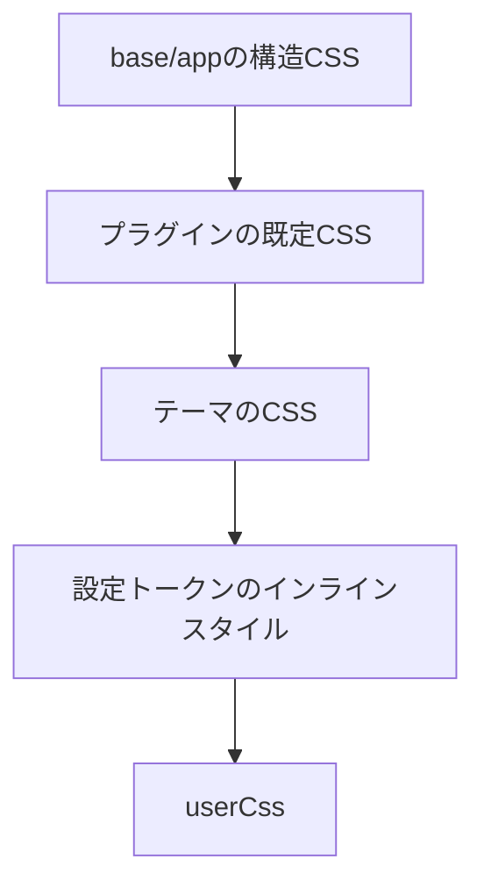

# CSSの取り決め（CSS Contract）

コンポーネントが依存してよい、安定したCSSのフックとカスケードの順序です。テーマは文書化されたフック（`rb-*`と`rr-*`）を公開するため、コンポーネントは特定のテーマを前提にせずにスタイルを当てられます。

## 安定したフック
クラス名の名前空間は2つあります。
- `rb-*` — フレームワークが提供する構造のフックとセマンティックデザイントークン（`.rb-theme-root`、`.rb-site`、`.rb-article`、`.rb-article-body`など）
- `rr-<feature>` — プラグインが描画する最も外側の要素に付くルートフック（`.rr-search`、`.rr-callout`など）

## カスケード順
読み込み順は、テーマのCSSがプラグインの既定スタイルに勝ち、`userCss`が最後の上書きになることを保証します。

フレームワークの構造CSS → base/appの構造CSS → プラグインの既定CSS → テーマのCSS → 設定のトークンによるインラインスタイル → userCss

## カスケード順の検証
保証されるカスケード順は、フレームワークの構造CSS → base/appの構造CSS → プラグインの既定CSS → テーマのCSS → 設定のトークンによるインラインスタイル → userCssです。この順序は`@riebeckite/honox`が強制し、レイヤーごとに別々のスタイルシートを生成して、ヘッダーのコメントでカスケード上の位置を示します。`userCss`は最後の上書きで、サイト固有の小さな調整に適しています。

## テーマCSSの書き方
テーマは安定したフックと、文書化された子孫要素にだけスタイルを当ててください。新しい`rb-*`/`rr-*`のクラス名を考案しないでください。対象にするのは`.rb-site`、`.rb-article`、`.rb-article-layout`、`.rb-article-header`、`.rb-article-body`、`.rb-article-content`、`.rb-article-meta`、`.rb-article-footer`、`.rb-sidebar`、および各プラグインが文書化した`rr-*`のルートフックだけです。BEMの要素（`__…`）と修飾子（`--…`）は内部実装の詳細です。

## 関連用語
- [[glossary/theme|Theme]]
- [[design-token|Design Token]]
- [[glossary/typography|Typography]]
- [[glossary/color-mode|Color Mode]]

## さらに詳しく
- [CSS](../framework/theme-system/css.ja.md)
