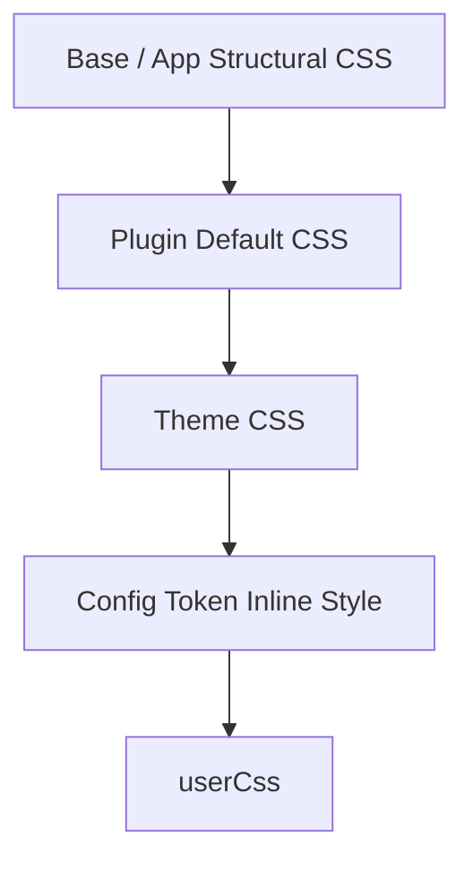

# CSS Contract

The stable CSS hooks and cascade order that components may rely on. Themes expose documented hooks (rb-* and rr-*) so components can style without hardcoding a specific theme.

## Stable hooks

Two class namepaces are provided:
- `rb-*` — structural hooks and semantic design tokens provided by the framework ('.rb-theme-root', '.rb-site', '.rb-article', '.rb-article-body', etc.)
- `rr-<feature>` — root hooks on the outermost element rendered by a plugin ('.rr-search', '.rr-callout', etc.)

## Cascade order

Load order guarantees theme CSS wins over plugins and `userCss` is the final override:

framework structural CSS → base/app structural CSS → Plugin default CSS → Theme CSS → config token inline style → userCss

A theme should style only stable hooks and documented descendant elements. Do not invent new rb-* / rr-* class names.

## Related terms

- [[glossary/theme|Theme]]
- [[design-token|Design Token]]
- [[glossary/typography|Typography]]
- [[glossary/color-mode|Color Mode]]

## Learn more

- [CSS](../framework/theme-system/css.md)
