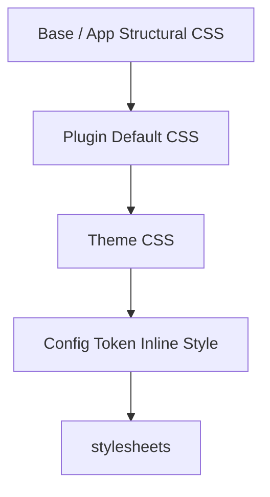

# CSS Contract

The stable CSS hooks and cascade order that components may rely on. Themes expose documented hooks (rb-* and rr-*) so components can style without hardcoding a specific theme.

## Stable hooks
Two class namepaces are provided:
- `rb-*` — structural hooks and semantic design tokens provided by the framework ('.rb-theme-root', '.rb-site', '.rb-article', '.rb-article-body', etc.)
- `rr-<feature>` — root hooks on the outermost element rendered by a plugin ('.rr-search', '.rr-callout', etc.)

## Cascade order

The recommended cascade order is: framework structural CSS → base/app structural CSS → Plugin default CSS → Theme CSS → config token inline style → stylesheets. This is the typical order used by `@riebeckite/honox`, but is not an absolute guarantee — the actual import order in the application determines the effective cascade. `stylesheets` is the final override — ideal for small site-specific tweaks.

## Cascade Order Verification

The typical cascade order is: framework structural CSS → base/app structural CSS → Plugin default CSS → Theme CSS → config token inline style → stylesheets. This order is the default used by `@riebeckite/honox` which generates separate stylesheets for each layer with header comments noting their cascade position. `stylesheets` is the final override — ideal for small site-specific tweaks.

## Theme CSS Writing Guidelines

A theme should style only stable hooks and documented descendant elements. Do not invent new `rb-*` / `rr-*` class names. Target only `.rb-site`, `.rb-article`, `.rb-article-layout`, `.rb-article-header`, `.rb-article-body`, `.rb-article-content`, `.rb-article-meta`, `.rb-sidebar`, and the `rr-*` plugin roots documented by each plugin. BEM elements (`__…`) and modifiers (`--…`) are internal implementation details.

## Related terms
- [[glossary/theme|Theme]]
- [[design-token|Design Token]]
- [[glossary/typography|Typography]]
- [[glossary/color-mode|Color Mode]]

## Learn more
- [CSS](../framework/theme-system/css.md)