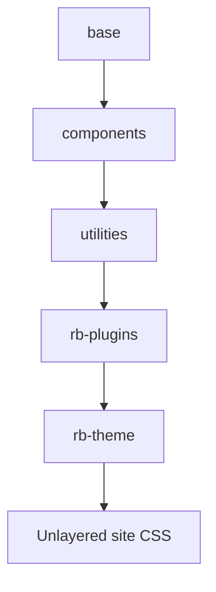

# CSS Contract

The stable CSS hooks and cascade order that components may rely on. Themes expose documented hooks (rb-* and rr-*) so components can style without hardcoding a specific theme.

## Stable hooks
Two class namepaces are provided:
- `rb-*` — structural hooks and semantic design tokens provided by the framework ('.rb-theme-root', '.rb-site', '.rb-article', '.rb-article-body', etc.)
- `rr-<feature>` — root hooks on the outermost element rendered by a new plugin ('.rr-search', '.rr-callout', etc.); some built-in plugins document `rb-*` roots instead.

## Cascade order

For same-origin normal declarations, the contract is: `base` → `components` → `utilities` → `rb-plugins` → `rb-theme` → unlayered site CSS. Framework CSS supplies the first layers, generated plugin and theme entries use `rb-plugins` and `rb-theme`, and ordinary site CSS is unlayered. Consequently, unlayered site rules override theme rules regardless of specificity.

## Cascade Order Verification

The framework stylesheet fixes the layer order. A plugin's internal layers nest under `rb-plugins`; a theme's internal layers nest under `rb-theme`. `!important`, inline styles, animations, transitions, and other cascade origins are outside this normal-declaration contract. Custom properties use the same cascade and inherit.

## Theme CSS Writing Guidelines

A theme should style only stable hooks and documented descendant elements. Do not invent new `rb-*` / `rr-*` class names. Target only `.rb-site`, `.rb-article`, `.rb-article-layout`, `.rb-article-header`, `.rb-article-body`, `.rb-article-content`, `.rb-article-meta`, `.rb-sidebar`, and the `rr-*` or `rb-*` plugin roots documented by each plugin. BEM elements (`__…`) and modifiers (`--…`) are internal implementation details.

## Related terms
- [[glossary/theme|Theme]]
- [[design-token|Design Token]]
- [[glossary/typography|Typography]]
- [[glossary/color-mode|Color Mode]]

## Learn more
- [CSS](../framework/theme-system/css.md)
