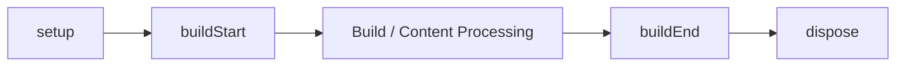

# Lifecycle hook

プラグインのライフサイクルフックは ContentManager 一回あたり、この順序で実行されます: `setup`, `buildStart`, コンテンツ処理、`buildEnd`, そして reverse resolved order の `dispose`。名前付きコンテンツフックは resolved plugin order で参加します。

## ビルドライフサイクル

フレームワークのライフサイクルは `setup`, `buildStart`, `onConfigResolved`, コンテンツ処理、そして `buildEnd` を ContentManager 一回あたり実行します。`buildEnd` は診断収集後に完成した manifest を受け取り、terminal hook です。

## 名前付きコンテンツフック

コンテンツフック (`onConfigResolved`, `onContentLoaded`, `onPostParsed`, `onPostProcessed`, `onManifestCreated`) は resolved plugin order で実行されます。フックの失敗は `PluginHookError` でプラグイン、フック名、原因を特定して報告されます。

## 関連用語

- [[plugin|Plugin]]
- [[plugin-cache|Plugin cache]]
- [[content-hook|Content hook]]
- [[glossary/diagnostics|Diagnostics]]

## さらに詳しく

- [Plugin Lifecycle](../framework/plugin-system/lifecycle.ja.md)
- [Plugin API](../reference/plugin-api.ja.md)
