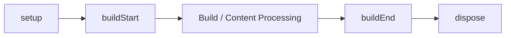

# Lifecycle hook

Pluginのlifecycle hookは、Content Managerが1回動く間に`setup`、`buildStart`、コンテンツ処理、`buildEnd`、そして逆順の`dispose`の順で実行されます。名前付きのcontent hookは、依存関係を解決したPluginの順序で加わります。

## ビルドライフサイクル

フレームワークは1回のContent Managerにつき`setup`、`buildStart`、`onConfigResolved`、コンテンツ処理、`buildEnd`を実行します。`buildEnd`はdiagnosticを集めた後の完成したmanifestを受け取る最後のhookです。

## 名前付きコンテンツフック

content hook（`onConfigResolved`、`onContentLoaded`、`onPostParsed`、`onPostProcessed`、`onManifestCreated`）は、依存関係を解決したPluginの順序で実行されます。hookが失敗すると、`PluginHookError`がPlugin、hook名、原因を示して報告します。

## フックの一覧と目的
- `onConfigResolved`：configが解決された後に呼ばれる；最終的な解決済みオプションを読むのに適しています。
- `onContentLoaded`：コンテンツがソースから読み込まれた後に呼ばれる；ここではmanifestレベルの情報を再構築しないでください。
- `onPostParsed`：Markdown/HTMLがパースされた後に呼ばれる；パースされたコンテンツの変換に適しています。
- `onPostProcessed`：コンテンツパイプラインの最後に呼ばれる；content graphの前に生成されたHTMLを修正する最後の機会です。
- `onManifestCreated`：manifestが作成された後に呼ばれる；フルなmanifestにアクセスでき、manifestを調整したり生成データを追加したりできます。

## hook失敗
hookが失敗すると、`PluginHookError`（`@riebeckite/core`からインポート）がスローされ、`message`でPluginとhook名が特定され、`cause`に原エラーが保持されます。content hookの場合、`path`で故障したファイル（例：`note.md`）が特定されます。

## 関連用語

- [[plugin|Plugin]]
- [[plugin-cache|Plugin cache]]
- [[content-hook|Content hook]]
- [[glossary/diagnostics|Diagnostics]]

## さらに詳しく

- [Plugin Lifecycle](../framework/plugin-system/lifecycle.ja.md)
- [Plugin API](../reference/plugin-api.ja.md)
