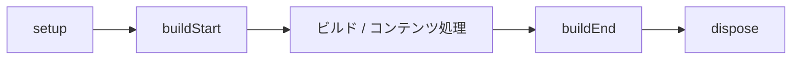

# ライフサイクルフック（Lifecycle hook）

プラグインのライフサイクルフックは、`ContentManager` ごとに1回、`setup`、`buildStart`、コンテンツ処理、`buildEnd`、`dispose`（解決済み順序の逆順）の順で実行されます。名前付きコンテンツフックは、解決済みのプラグイン順に参加します。

## ビルドライフサイクル

フレームワークのライフサイクルは、`ContentManager` ごとに `setup`、`buildStart`、`onConfigResolved`、コンテンツ処理、`buildEnd` を1回実行します。`buildEnd` は、診断の収集後に完成したマニフェストを受け取る唯一の終端フックです。

## 名前付きコンテンツフック

コンテンツフック（`onConfigResolved`、`onContentLoaded`、`onPostParsed`、`onPostProcessed`、`onManifestCreated`）は、解決済みのプラグイン順に実行されます。フックが失敗すると `PluginHookError` がスローされ、プラグイン、フック名、原因が示されます。

## フックの一覧と目的
- `onConfigResolved`：設定の解決後に呼ばれます。最終的に解決されたオプションを読むのに適しています。
- `onContentLoaded`：コンテンツをソースから読み込んだ後に呼ばれます。ここでマニフェストレベルの情報を作り直すのは避けてください。
- `onPostParsed`：Markdown/HTMLのパース後に呼ばれます。パース済みコンテンツの変換に向いています。
- `onPostProcessed`：コンテンツパイプラインの完了後に呼ばれます。コンテンツグラフへ渡す前に生成HTMLを変更できる最後の機会です。
- `onManifestCreated`：マニフェストの作成後に呼ばれます。マニフェスト全体にアクセスでき、調整や生成データの追加ができます。

## フックの失敗
フックが失敗すると `PluginHookError`（`@riebeckite/core` からインポート可能）がスローされます。`message` にはプラグイン名とフック名、`cause` には元のエラーが入り、コンテンツフックの場合は `path` に問題のあるファイル（例：`note.md`）が示されます。

## 関連用語

- [[plugin|Plugin]]
- [[plugin-cache|Plugin cache]]
- [[content-hook|Content hook]]
- [[glossary/diagnostics|Diagnostics]]

## さらに詳しく

- [Plugin Lifecycle](../framework/plugin-system/lifecycle.ja.md)
- [Plugin API](../reference/plugin-api.ja.md)
