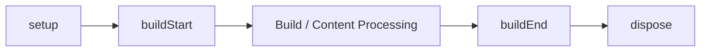

# Lifecycle hook

Plugin lifecycle hooks run once per ContentManager in order: `setup`, `buildStart`, content processing, `buildEnd`, and `dispose` (reverse resolved order). Named content hooks participate in resolved plugin order.

## Build lifecycle

The framework lifecycle runs `setup`, `buildStart`, `onConfigResolved`, content processing, and `buildEnd` once per ContentManager. `buildEnd` receives the completed manifest after diagnostics are collected and is the only terminal hook.

## Named content hooks

Content hooks (`onConfigResolved`, `onContentLoaded`, `onPostParsed`, `onPostProcessed`, `onManifestCreated`) run in resolved plugin order. A hook failure is reported as `PluginHookError` identifying the plugin, hook name, and cause.

## Hook list and purposes
- `onConfigResolved` — called after config is resolved; useful for reading final resolved options.
- `onContentLoaded` — called after content is loaded from the source; avoid rebuilding manifest-level information here.
- `onPostParsed` — called after Markdown/HTML parsing; good for transforming parsed content.
- `onPostProcessed` — called after the full content pipeline; the last chance to modify generated HTML before the content graph.
- `onManifestCreated` — called after the manifest is created; has access to the full manifest and can adjust it or add generated data.

## Hook failure
A hook failure throws `PluginHookError` (importable from `@riebeckite/core`) with `message` naming the plugin and hook, `cause` holding the original error, and for content hooks `path` identifying the offending file (e.g., `note.md`).

## Related terms

- [[plugin|Plugin]]
- [[plugin-cache|Plugin cache]]
- [[content-hook|Content hook]]
- [[glossary/diagnostics|Diagnostics]]

## Learn more

- [Plugin Lifecycle](../framework/plugin-system/lifecycle.md)
- [Plugin API](../reference/plugin-api.md)
