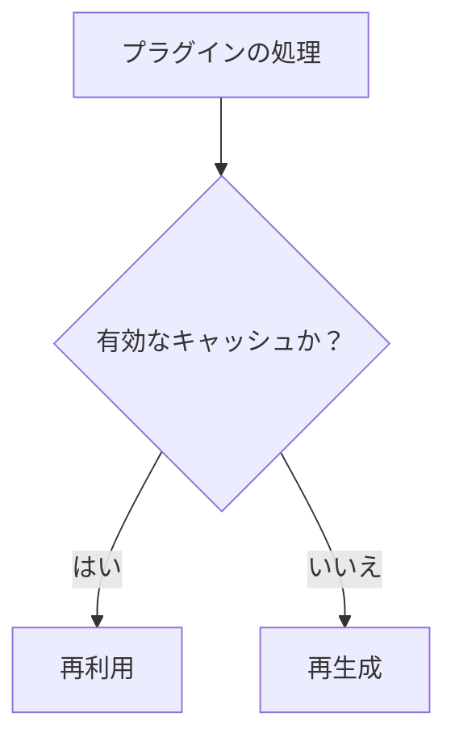

# プラグインキャッシュ（Plugin Cache）

各プラグインは `context.cache` を通じて、プラグインごとに再生成可能なビルド時キャッシュを持ちます。保存できるのは、プラグインの名前空間に限定されたJSONシリアライズ可能な値だけです。

## 目的とスコープ

プラグインキャッシュはプラグインごとに分離され、ビルド中だけ存在します。永続データベースでもCloudflare Workersのストレージでもありません。

```ts
context.cache.set("key", value)
const value = await context.cache.get("key")
```

## キャッシュの無効化

壊れたキャッシュは安全なミスとして扱ってください。書き込みはアトミックです。契約が変わったら `cacheVersion` で互換性を切り替えます。



## 設定

キャッシュの動作は、プラグイン定義の `cacheVersion` で制御します。処理済みコンテンツの永続キャッシュは `processedContentCache` と、依存モード `none`/`tracked`/`global`/`unsafe` で制御します。

## processedContentCacheのモード

プラグイン定義の `processedContentCache` 契約（`plugin.processedContentCache`）には `dependencyMode` があり、永続コンテンツキャッシュが依存関係をどう追跡するかを決めます。モードは4つです。

| モード | 説明 |
| --- | --- |
| `none` | 処理済みHTMLが現在のコンテンツソース、frontmatter、プラグインオプションだけに依存する。依存関係のフィンガープリントは記録されず、ビルドのたびにコンテンツが変更された可能性があるものとして扱われる。 |
| `tracked` | 外部のコンテンツとファイル入力は、依存関係のフィンガープリントを記録するフレームワーク所有のAPI（`CachedContentDependency` 経由）だけを通じて読む。キャッシュは出力に影響した入力を証明でき、正確な無効化が可能になる。 |
| `global` | 処理済みHTMLが解決済みのコンテンツ位置の集合（すべてのエントリのpermalinkと言語）に依存する。依存関係のフィンガープリントはエントリ単位ではなく、コンテンツ集合全体に対して記録される。 |
| `unsafe` | プラグインが何に影響するか証明できない。永続コンテンツキャッシュはこのプラグインを完全にバイパスする必要がある。`appliesToContent` を持たない `dependencyMode: "unsafe"` のプラグインがあると、`requiresFullContentRegeneration` は `true` を返す。 |

`tracked` モードのプラグイン定義の例：

```ts
export default definePlugin({
  name: "my-plugin",
  cacheVersion: "1",
  processedContentCache: {
    version: "1",
    dependencyMode: "tracked",
    appliesToContent: (context) =>
      context.slug.startsWith("blog/") ? "applies" : "does-not-apply",
    contentDependencyFingerprint: (context) => {
      // Return a hash of the content inputs this plugin depends on.
      return computeMyFingerprint(context.slug);
    },
    environmentFingerprint: () => {
      // Hash of the runtime environment (e.g. node version, OS).
      return `env:${process.version}`;
    },
  },
});
```

---

## trackedモードでの依存関係の記録

`tracked` モードでは、プラグインがコンテンツを処理するときにフレームワークのAPIを呼び、依存関係を記録できます。パイプライン（`content_dependency_tracker.ts`）は `CachedContentDependency` エントリを、`kind`（`"content"` または `"file"`）と入力から計算した `fingerprint` 付きで記録します。これらの依存関係は永続コンテンツキャッシュのエントリに保存されます（`content_persistent_cache.ts` の `PersistentContentCacheEntry` を参照）。後続のビルドで依存関係のフィンガープリントが1つでも変わっていれば、キャッシュエントリは無効化され、コンテンツが再処理されます。

追跡はパイプラインの依存関係トラッカーによって徹底されます。トラッカーには、Markdownリンクの正規化とコンテンツソースの読み取り時に `recordLinkResolution` コールバックが渡されます。`remarkPlugins`、`rehypePlugins`、`onContentLoaded`、`onPostParsed`、`onPostProcessed` を使うプラグインは、trackedモードでは依存関係の追跡対象になります。

---

## `cacheVersion` と `processedContentCache.version` の違い

2つのバージョンフィールドを区別することが重要です。

- **`cacheVersion`**（プラグイン定義のフィールド、型 `string`）：プラグインごとの一時的な実行時キャッシュのバージョンです。`packages/core/src/pipeline.ts` の `createPluginCache` / `createUnavailablePluginCache` が管理します。このバージョンを変えると、プラグインのローカルキャッシュが無効化されます。
- **`processedContentCache.version`**（契約のフィールド、型 `string`）：永続的な処理済みコンテンツキャッシュ契約のバージョンです。この値を変えると、この契約を使うプラグインが影響するすべてのコンテンツキャッシュエントリが無効化されます。

`createPluginCache` と `createUnavailablePluginCache` のどちらを使うか（`packages/core/src/pipeline.ts` の `options.isBuildTime`、`cacheFor` メソッド、533〜543行で決まる）によって、プラグインごとのキャッシュをそもそも使えるかが決まります。

## 関連用語

- [[plugin|Plugin]]
- [[plugin-dependency|Plugin dependency]]
- [[lifecycle-hook|Lifecycle hook]]
- [[glossary/diagnostics|Diagnostics]]
- [[cache-invalidation|Cache Invalidation]]
- [[cache-version|Cache Version]]

## さらに詳しく

- [Build System](../framework/build-system.ja.md)
- [Build Dependency の取り決め](../framework/build-dependency.ja.md)
