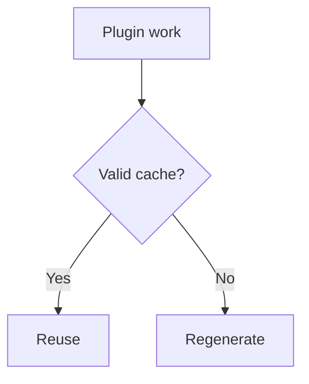

# Plugin cache

Each plugin gets a per-plugin, regenerable build-time cache via `context.cache`; store only JSON-serializable values scoped to the plugin namespace.

## Purpose and scope

The plugin cache is isolated per plugin and exists only for the duration of a build. It is not a persistent database or Cloudflare Workers storage.

```ts
context.cache.set("key", value)
const value = await context.cache.get("key")
```

## Cache invalidation

Treat a corrupt cache as a safe miss; writes are atomic. Switch compatibility with `cacheVersion` when the contract changes.



## Configuration

Cache behavior is controlled by `cacheVersion` on the plugin definition. Persistent processed-content cache uses `processedContentCache` with dependency modes `none`/`tracked`/`global`/`unsafe`.

## processedContentCache Modes

The `processedContentCache` contract on a plugin definition (`plugin.processedContentCache`) has a `dependencyMode` that determines how the persistent content cache tracks dependencies. There are four modes:

| Mode | Description |
| --- | --- |
| `none` | Processed HTML depends only on the current content source, frontmatter, and plugin options. No dependency fingerprints are recorded; every build treats the content as potentially changed. |
| `tracked` | External content and file inputs are read **only** through framework-owned APIs that record dependency fingerprints (via `CachedContentDependency`). The cache can prove what inputs affected the output, enabling precise invalidation. |
| `global` | Processed HTML depends on the resolved content-location set (all entries' permalinks and languages). Dependency fingerprints are recorded for the entire content set, not per-entry. |
| `unsafe` | The plugin cannot prove what it affects; the persistent content cache must bypass this plugin entirely. `requiresFullContentRegeneration` will return `true` if any plugin has `dependencyMode: "unsafe"` without `appliesToContent`. |

Example plugin definition with `tracked` mode:

```ts
export default definePlugin({
  name: "my-plugin",
  cacheVersion: "1",
  processedContentCache: {
    version: "1",
    dependencyMode: "tracked",
    appliesToContent: (context) =>
      context.slug.startsWith("blog/") ? "applies" : "does-not-apply",
    contentDependencyFingerprint: (context) => {
      // Return a hash of the content inputs this plugin depends on.
      return computeMyFingerprint(context.slug);
    },
    environmentFingerprint: () => {
      // Hash of the runtime environment (e.g. node version, OS).
      return `env:${process.version}`;
    },
  },
});
```

---

## How Tracked Mode Records Dependencies

In `tracked` mode, when a plugin processes content, it may call framework APIs to record dependencies. The pipeline (via `content_dependency_tracker.ts`) records `CachedContentDependency` entries with `kind` (`"content"` or `"file"`) and a `fingerprint` computed from the input. These dependencies are stored in the persistent content cache entry (see `PersistentContentCacheEntry` in `content_persistent_cache.ts`). On subsequent builds, if any dependency's fingerprint has changed, the cache entry is invalidated and the content is reprocessed.

The tracking is enforced through the pipeline's dependency tracker, which is passed `recordLinkResolution` callbacks during markdown link normalization and content source reading. Plugins that use `remarkPlugins`, `rehypePlugins`, `onContentLoaded`, `onPostParsed`, or `onPostProcessed` are subject to dependency tracking in tracked mode.

---

## `cacheVersion` vs `processedContentCache.version`

It is important to distinguish two version fields:

- **`cacheVersion`** (plugin definition field, type `string`): Versions the per-plugin, ephemeral runtime cache. Managed by `createPluginCache` / `createUnavailablePluginCache` in `packages/core/src/pipeline.ts`. Changes to this version invalidate the plugin's local cache.
- **`processedContentCache.version`** (contract field, type `string`): Versions the persistent processed-content cache contract. Changes invalidate all content cache entries affected by plugins that use this contract.

The choice between `createPluginCache` and `createUnavailablePluginCache` (determined by `options.isBuildTime` in `packages/core/src/pipeline.ts`, `cacheFor` method, line 533–543) controls whether a per-plugin cache is available at all.

## Related terms

- [[plugin|Plugin]]
- [[plugin-dependency|Plugin dependency]]
- [[lifecycle-hook|Lifecycle hook]]
- [[glossary/diagnostics|Diagnostics]]
- [[cache-invalidation|Cache Invalidation]]
- [[cache-version|Cache Version]]

## Learn more

- [Build System](../framework/build-system.md)
- [Build Dependency Contract](../framework/build-dependency.md)