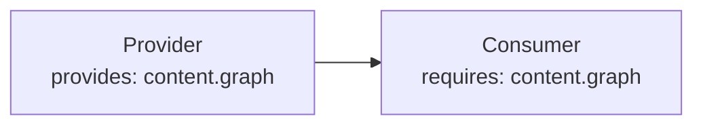

# Plugin dependency

プラグインは `requires` でキャビリティの要求を宣言します; resolver は provider を consumer より前に配置し、欠落時は `PluginDependencyError` でエラー報告します ( `kind` と `pluginName` で特定)。

## キャビリティ fields

`provides`: このプラグインが他に提供するキャビリティ。
`requires`: 必須のキャビリティ (このプラグイン実行前に解決されなければなりません)。
`optional`: 存在時に使用されるが必須ではないキャビリティ。

## 解決順

resolver はまず `order` で並べ替え、次にキャビリティ依存関係を強制します。必須キャビリティが欠落すると `PluginDependencyError` がthrow されます。duplicate provider や cycle は設定エラーです。

## 例

```ts
definePlugin({
  name: "consumer",
  requires: ["content.graph"],
});
```



## 関連用語

- [[plugin|Plugin]]
- [[capability|Capability]]
- [[lifecycle-hook|Lifecycle hook]]
- [[content-hook|Content hook]]
- [[endpoint|Endpoint]]

## さらに詳しく

- [Plugin API](../reference/plugin-api.ja.md)
- [Plugin System](../framework/plugin-system.ja.md)
