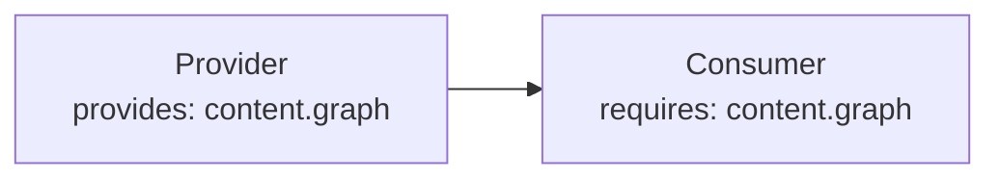

# Plugin dependency

Pluginは`requires`でCapabilityの要求を宣言します。依存解決は、Capabilityを提供するPluginを、それを利用するPluginより前に並べます。要求を満たせない場合は`PluginDependencyError`を報告し、`kind`と`pluginName`で原因を特定できます。

## Capabilityのfield

`provides`: このPluginが他へ提供するCapability。
`requires`: 必須のCapability。このPluginを実行する前に解決されている必要があります。
`optional`: 存在すれば使いますが、必須ではないCapability。

## 解決の順序

依存解決はまず`order`で並べ替え、次にCapabilityの依存関係を満たします。必須のCapabilityが欠けていると`PluginDependencyError`になります。提供側の重複や依存の循環は設定エラーです。

## 例

```ts
definePlugin({
  name: "consumer",
  requires: ["content.graph"],
});
```



## 関連用語

- [[plugin|Plugin]]
- [[capability|Capability]]
- [[lifecycle-hook|Lifecycle hook]]
- [[content-hook|Content hook]]
- [[endpoint|Endpoint]]

## さらに詳しく

- [Plugin API](../reference/plugin-api.ja.md)
- [Plugin System](../framework/plugin-system.ja.md)
