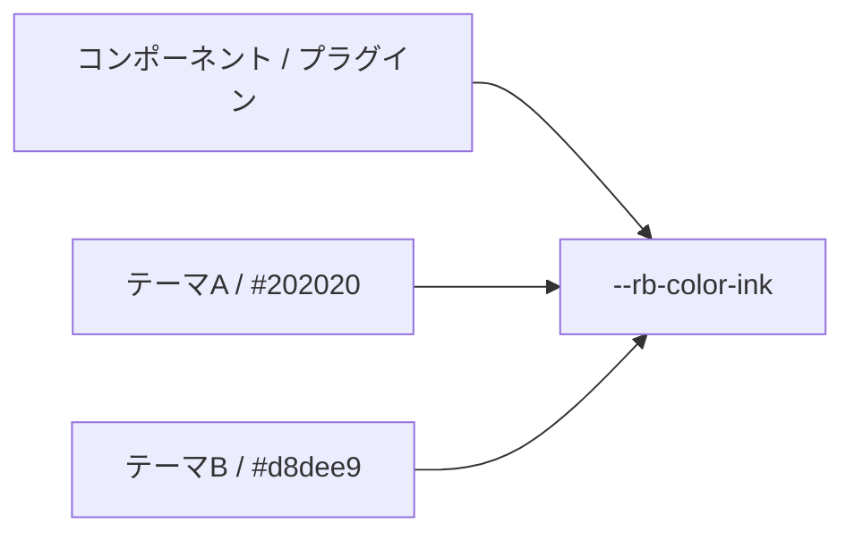

# セマンティックトークン（Semantic Token）

テーマ固有の値ではなく、意味（本文色、アクセント、境界など）で参照するデザイントークンです。コンポーネントを変えずにテーマを入れ替えられます。

## トークンの分類
セマンティックトークンは、色、タイポグラフィ、レイアウトのグループに分かれます。各グループには意味に基づく名前があり、CSSカスタムプロパティに対応します。
色グループ：paper、ink、muted、accent、border、borderStrong、surface、surfaceHover、overlay、danger、success、codeBackground。
タイポグラフィグループ：bodyFont、headingFont、monoFont。
レイアウトグループ：pageMaxWidth、articleMaxWidth、sidebarWidth、contentGap。



## テーマからの独立
コンポーネントがテーマ固有の色名を直接参照すると、テーマを入れ替えられなくなります。セマンティックトークンは、1つのトークン（例：`--rb-color-ink`）がどのテーマのinkの値にも解決できるようにして、この問題を解きます。

## プラグイン固有の意味トークン（`--rr-`）
プラグイン固有の意味トークンは `--rr-` 接頭辞を使い、利用可能なら `--rb-` にフォールバックします。これにより、プラグインはテーマからの独立性を保ちながら、独自のトークン名前空間を持てます。
```css
--rr-example-background: var(--rb-color-surface);
```

## トークンのCSS変数名
トークン名はkebab-caseのCSS変数に変換されます。`borderStrong` は `--rb-color-border-strong`、`bodyFont` は `--rb-font-body` のようになります。CSSカスタムプロパティ名は `--rb-<group>-<token>` の形で、groupは `color`、`typography`、`layout` のいずれかです。

## 関連用語
- [[design-token|Design Token]]
- [[glossary/color-mode|Color Mode]]
- [[glossary/typography|Typography]]
- [[glossary/theme|Theme]]

## さらに詳しく
- [Design Tokens](../framework/theme-system/tokens.ja.md)
