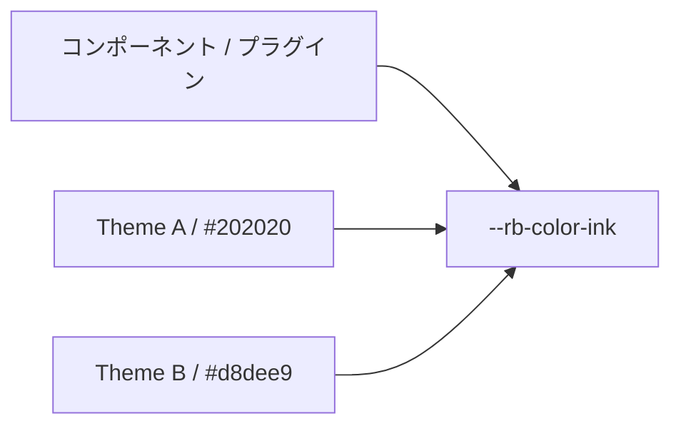

# Semantic Token

Semantic Tokenは、本文の色、アクセント、境界といった意味で参照するDesign Tokenです。コンポーネントを変えずにThemeを入れ替えられます。

## Tokenの分類

Semantic Tokenは色、タイポグラフィ、レイアウトのグループに分かれます。各グループには意味に基づく名前があり、CSSカスタムプロパティに対応します。
色グループ: paper, ink, muted, accent, border, borderStrong, surface, surfaceHover, overlay, danger, success, codeBackground。
タイポグラフィグループ: bodyFont, headingFont, monoFont。
レイアウトグループ: pageMaxWidth, articleMaxWidth, sidebarWidth, contentGap。

## Themeからの独立

コンポーネントがTheme固有の色名を参照すると、Themeを入れ替えられなくなります。
Semantic Tokenは、`--rb-color-ink`のようなTokenがあらゆるThemeのinkの値へ解決されるようにして、この問題を解決します。
Plugin固有の意味のTokenは`--rr-`プレフィックスを使い、`--rb-`が使える場合はフォールバックします。

## 関連用語

- [[design-token|Design Token]]
- [[glossary/color-mode|Color Mode]]
- [[glossary/typography|Typography]]
- [[glossary/theme|Theme]]

## さらに詳しく

- [Design Tokens](../framework/theme-system/tokens.ja.md)
