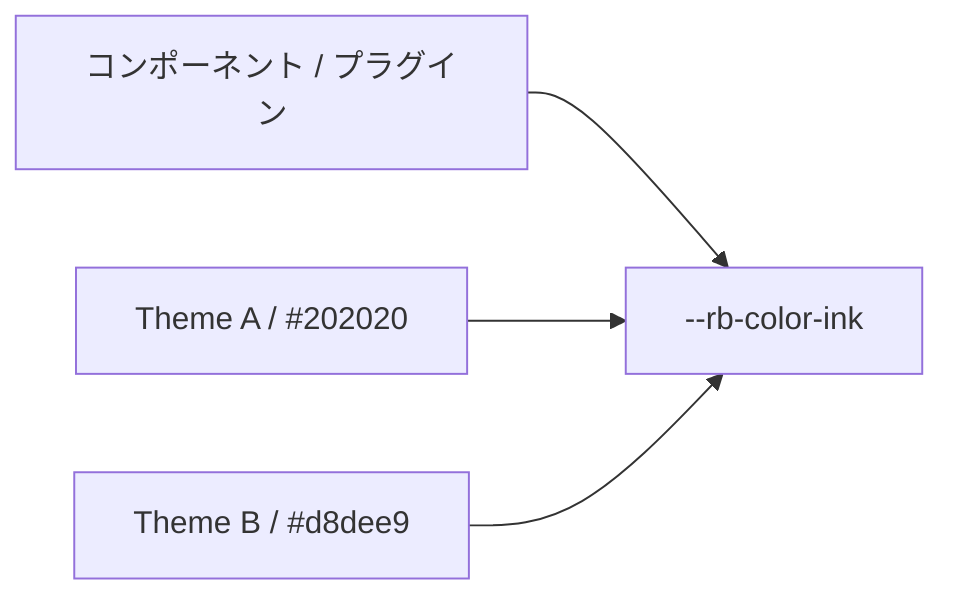

# セマンティック トークン

セマンティック トークンは、body color、accent、border などの意味で参照されるデザイン トークンで、コンポーネントの変更なしにテーマの入れ替えを可能にします。

## トークン分類

セマンティック トークンは色、タイポグラフィ、レイアウトのグループに整理されています。各グループには意味に基づく名前が含まれ、CSS カスタムプロパティにマップされます。
色グループ: paper, ink, muted, accent, border, borderStrong, surface, surfaceHover, overlay, danger, success, codeBackground。
タイポグラフィグループ: bodyFont, headingFont, monoFont。
レイアウトグループ: pageMaxWidth, articleMaxWidth, sidebarWidth, contentGap。

## テーマ独立性

コンポーネントがテーマ特有の色名を参照すると、テーマの入れ替えができなくなります。
セマンティック トークンは、--rb-color-ink などのトークンがあらゆるテーマの ink 値に解決されるようにすることでこの問題を解決します。
プラグイン固有の意味トークンは --rr- プレフィックスを使用し、--rb- が利用可能な場合はフォールバックします。

## 関連用語

- [[design-token|Design Token]]
- [[glossary/color-mode|色調モード]]
- [[glossary/typography|タイポグラフィ]]
- [[glossary/theme|Theme]]

## さらに詳しく

- [Design Tokens](../framework/theme-system/tokens.ja.md)
