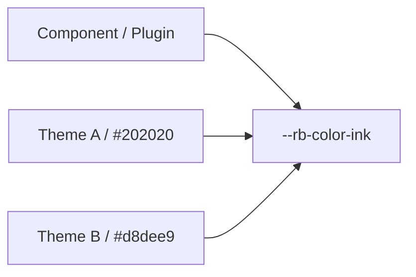

# Semantic Token

A design token referenced by meaning (e.g. body color, accent, border) rather than a theme-specific value, enabling theme swapping without component changes.

## Token taxonomy
Semantic tokens are organized into groups: color, typography, and layout. Each group contains meaning-based names that map to CSS custom properties.
Color group: paper, ink, muted, accent, border, borderStrong, surface, surfaceHover, overlay, danger, success, codeBackground.
Typography group: bodyFont, headingFont, monoFont.
Layout group: pageMaxWidth, articleMaxWidth, sidebarWidth, contentGap.



## Theme independence
If components reference theme-specific color names directly, the theme can no longer be swapped. Semantic tokens solve this by letting a single token (e.g. --rb-color-ink) resolve to any theme's ink value.

## Plugin-Specific Meaning Tokens (--rr-)
Plugin-specific meaning tokens use the `--rr-` prefix and fall back to `--rb-` when available. This allows plugins to own their token namespace while maintaining theme independence:
```css
--rr-example-background: var(--rb-color-surface);
```

## Token CSS Variable Naming
Token names are converted to kebab-case CSS variables: `borderStrong` becomes `--rb-color-border-strong`, `bodyFont` becomes `--rb-font-body`, and so on. The CSS custom property name follows the pattern `--rb-<group>-<token>` where group is one of `color`, `typography`, or `layout`.

## Related terms
- [[design-token|Design Token]]
- [[glossary/color-mode|Color Mode]]
- [[glossary/typography|Typography]]
- [[glossary/theme|Theme]]

## Learn more
- [Design Tokens](../framework/theme-system/tokens.md)