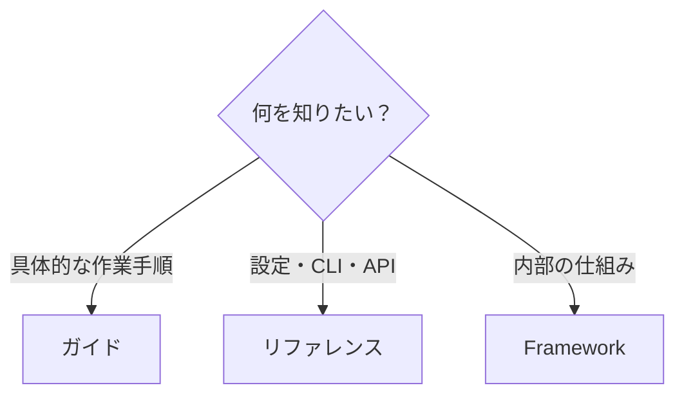
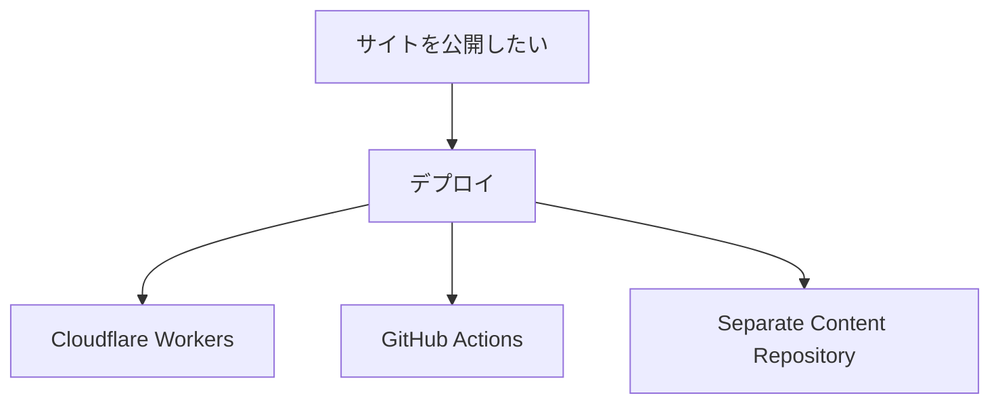

# ガイド

ガイドは、**「Riebeckite で何をしたいか」から手順を探すための章**です。

設定値や API の正確な仕様を確認したい場合は [リファレンス](../reference/README.ja.md)、Riebeckite の内部構造を理解したい場合は [Framework](../framework/README.ja.md) を参照してください。



初めて Riebeckite を使う場合は、ガイドより先に [はじめに](../getting-started/README.ja.md) から始めるのがおすすめです。

## コンテンツを作る

### 記事を書いて整理する

[記事の書き方ガイド](./writing-content.ja.md)

Markdown と frontmatter を中心に、Riebeckite で記事を書くための基本を説明します。

### Obsidian Vault を公開する

[Obsidian のノートをサイトにする](./obsidian.ja.md)

既存の Obsidian Vault を Riebeckite のコンテンツとして使う方法を説明します。

## サイトを構成する

### コンテンツとサイトを分ける

[コンテンツとサイトを分ける](./content-repositories.ja.md)

サイトのアプリケーションと Markdown のコンテンツを、別のリポジトリで管理する構成を説明します。

### 多言語サイトを作る

[多言語サイト](./localization.ja.md)

複数言語のコンテンツ、URL、言語の切り替えを扱う方法を説明します。

### Analytics を導入する

[アクセス解析](./analytics.ja.md)

Riebeckite のサイトに Analytics を導入する方法を説明します。

### SPA ナビゲーションを有効にする

[SPA ナビゲーション](./spa-navigation.ja.md)

ヘッダーやフッターを残したままページの内容だけを切り替える方法、対象になるリンク、ページを描画する側の要件を説明します。

### ローカルプラグインを開発する

[ローカルプラグインの開発](./local-plugin-development.ja.md)

ローカルのプラグインを、実際の HonoX/Vite 開発サーバーで確認する方法を説明します。

### アイコンやロゴを差し替える

[サイトのアイコンとロゴ](./branding.ja.md)

サイト固有の favicon、ヘッダーのロゴ、リンクプレビュー画像を差し替える方法を説明します。

### サイトの UI をカスタマイズする

[サイトのカスタマイズ](./customizing-your-site.ja.md)

通常の HonoX アプリケーションとして、`app/` のルート、コンポーネント、island、CSS を編集する方法を説明します。

## デプロイする

デプロイは、自動化を挟むと選択肢が増えるため、独立したセクションにしています。デプロイ方法を選ぶ場合は、まず [デプロイガイド](./deployment/README.ja.md) を参照してください。



### Cloudflare Workers に公開する

[Cloudflare Workers へのデプロイ](./deployment/cloudflare-workers.ja.md)

Riebeckite のサイトを Cloudflare Workers へデプロイする方法を説明します。

### GitHub Actions で自動デプロイする

[GitHub Actions](./deployment/github-actions.ja.md)

GitHub Actions を使ってビルドとデプロイを自動化する方法を説明します。

### コンテンツとサイトを分けた構成を自動デプロイする

[コンテンツとサイトを分ける（詳細版）](./deployment/separate-content-repository.ja.md)

コンテンツとサイトが別リポジトリにある場合の自動デプロイ構成を説明します。

## Riebeckite を更新する

[Riebeckite をアップグレードする](./upgrading.ja.md)

Riebeckite のパッケージを新しいバージョンへ更新する手順と、変更点の確認方法を説明します。

## 目的から探す

| やりたいこと | ページ |
| --- | --- |
| Markdown で記事を書く | [記事の書き方ガイド](./writing-content.ja.md) |
| Obsidian Vault を公開する | [Obsidian のノートをサイトにする](./obsidian.ja.md) |
| コンテンツとサイトを別リポジトリにする | [コンテンツとサイトを分ける](./content-repositories.ja.md) |
| 多言語サイトにする | [多言語サイト](./localization.ja.md) |
| Analytics を導入する | [アクセス解析](./analytics.ja.md) |
| サイトのアイコンやロゴを差し替える | [サイトのアイコンとロゴ](./branding.ja.md) |
| サイトの UI をカスタマイズする | [サイトのカスタマイズ](./customizing-your-site.ja.md) |
| ホームページと発見導線を作る | [発見導線のレシピ](./discovery-recipes.ja.md) |
| デプロイ方法を選ぶ | [デプロイガイド](./deployment/README.ja.md) |
| Cloudflare Workers に公開する | [Cloudflare Workers へのデプロイ](./deployment/cloudflare-workers.ja.md) |
| GitHub Actions で自動デプロイする | [GitHub Actions](./deployment/github-actions.ja.md) |
| コンテンツとサイトを分けた構成を自動デプロイする | [コンテンツとサイトを分ける（詳細版）](./deployment/separate-content-repository.ja.md) |
| Riebeckite をアップグレードする | [Riebeckite をアップグレードする](./upgrading.ja.md) |

## 次に参照する章

- **正確な**設定フィールド、CLI コマンド、API の取り決めは [リファレンス](../reference/README.ja.md) にあります。
- コンテンツ、プラグイン、テーマの仕組みは [Framework](../framework/README.ja.md) で説明しています。

## ガイドと他の章の違い

ドキュメントの役割は次のように分かれています。

```text id="3m60t7"
初めてサイトを作る
  → はじめに

やりたい作業の手順を知る
  → ガイド

プラグインを探す
  → プラグイン

テーマを探す
  → テーマ

設定・CLI・APIを調べる
  → リファレンス

内部構造を理解する
  → Framework
```

ガイドでは、内部実装を詳しく説明するよりも、**目的を達成するために何をすればよいか**を中心に説明します。
