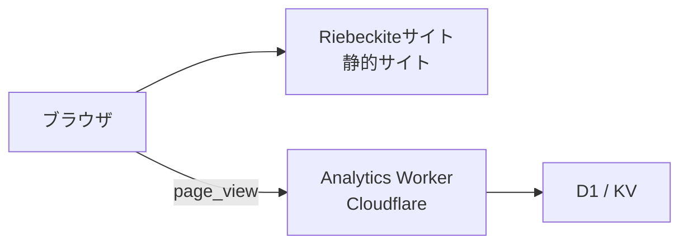
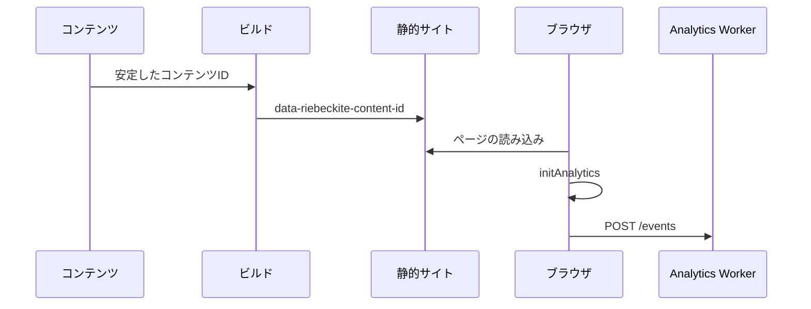
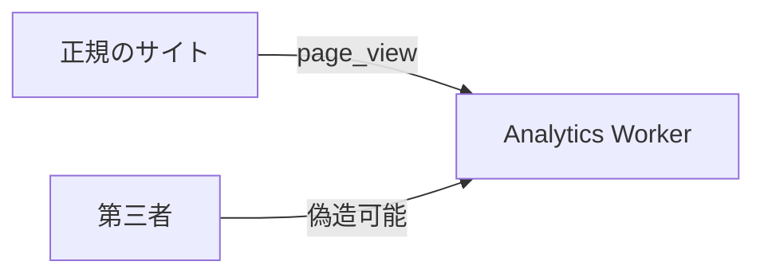
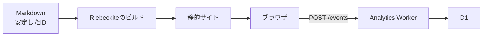
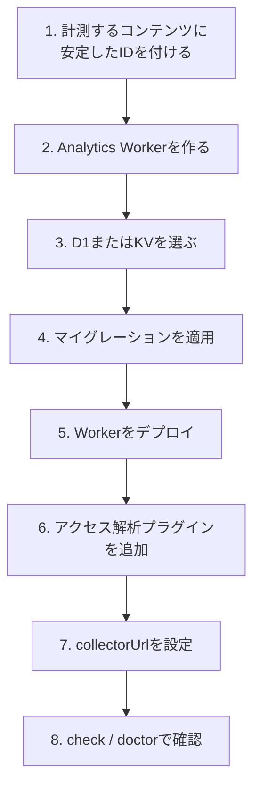

---
date: 2026-10-08
title: アクセス解析
---
# アクセス解析

Riebeckiteでは、記事ごとのページビューを収集できます。アクセス解析は、サイト側で計測する仕組みと、Cloudflare上でデータを受け取って保存する仕組みに分かれています。

| パッケージ | 役割 |
| --- | --- |
| `@riebeckite/plugin-analytics` | サイト側でページビューを送信する |
| `@riebeckite/analytics-cloudflare` | イベントを受け取り、Cloudflare上で保存・集計する |



**Riebeckiteのサイト自体は、これまでどおり静的サイトのまま**です。Analytics Workerはサイトとは別にデプロイします。サイトの`wrangler.jsonc`や`main`を、Analytics Worker用に置き換える必要はありません。

## 2つのパッケージの役割

### `@riebeckite/plugin-analytics`

Riebeckiteのサイト側で動くプラグインです。主に次の機能を提供します。

- 計測対象のコンテンツを識別する
- ブラウザから`page_view`を送信する
- `AnalyticsProvider`の取り決めを定める
- アクセス解析のクエリの取り決めを定める

Cloudflare、D1、KV、特定のデータベースには依存しません。

### `@riebeckite/analytics-cloudflare`

Cloudflare上でアクセス解析のイベントを受け取る、独立したWorkerパッケージです。主に次の機能を提供します。

- イベントの受信
- リクエストの検証
- CORS
- レート制限
- D1 / KVへの保存
- ページビューを読み取るAPI

```text id="w6zh3x"
Riebeckiteサイト
  → @riebeckite/plugin-analytics

Analytics Worker
  → @riebeckite/analytics-cloudflare
```

## 計測の仕組み

ページビューは、コンテンツに付けた**安定したコンテンツID**を基準に記録します。URLは変更されることがありますが、同じ記事を同じコンテンツとして扱いたいためです。



計測は大きく3つの段階に分かれます。

### 1. コンテンツIDを付ける

計測対象の記事には、Frontmatterで安定した`id`を指定します。

```yaml id="5rmptb"
---
id: guide-1
---
```

このIDは記事を識別するための値です。URLを変更しても同じコンテンツとして扱いたい場合があるため、`/old-guide`と`/new-guide`のようなURLをアクセス解析の識別子には使いません。詳しくは[コンテンツシステム](../framework/content-system.ja.md#安定したコンテンツid)を参照してください。

### 2. ビルド時に目印を埋め込む

ビルド時に、安定したコンテンツIDを持つ公開エントリへ隠し要素が追加されます。

```html id="ly98ut"
<span
  hidden
  data-riebeckite-content-id="guide-1"
></span>
```

ブラウザ側のアクセス解析は、この目印からコンテンツIDを取得します。

### 3. ブラウザからイベントを送る

`initAnalytics`は文書ごとに一度だけ実行されます。コンテンツIDを取得すると、設定された`collectorUrl`へ`page_view`イベントをJSONで送信します。

```json id="31i7h9"
{
  "type": "page_view",
  "contentId": "guide-1",
  "occurredAt": "2026-01-01T00:00:00.000Z",
  "path": "/guide",
  "lang": "en"
}
```

識別子として使われるのは`contentId`だけです。`path`と`lang`は補助情報です。安定したコンテンツIDを持たないコンテンツは計測されません。

## ページビューの数え方

初回のページ表示では、`initAnalytics`が実行され、`page_view`を1件送ります。

```text id="bs64om"
ページの読み込み
   ↓
initAnalytics
   ↓
page_view × 1
```

その後は、初回のページ読み込みごと、および成功したSPAのページ移動ごとに1件の`page_view`を送ります。

## サイト側の設定

サイトでは`@riebeckite/plugin-analytics`を設定します。

```ts id="74prf7"
import {
  analytics,
  MemoryAnalyticsProvider,
} from "@riebeckite/plugin-analytics";

export default defineConfig({
  // ...

  plugins: [
    analytics({
      provider:
        new MemoryAnalyticsProvider(),

      publicConfig: {
        collectorUrl:
          "https://analytics.example.com/events",
      },
    }),
  ],
});
```

主な設定は`provider`と`publicConfig.collectorUrl`の2つです。

### `provider`

`provider`は、`AnalyticsProvider`の取り決めを実装した実行環境です。プロバイダーは`capabilities`、`capture`、`query`を提供します。

認証情報やストレージのバインディングのような非公開情報は、プロバイダーの内部に保持してください。ブラウザへ渡してはいけません。

### `publicConfig.collectorUrl`

`collectorUrl`は、ブラウザがイベントを送信するURLです。

```ts id="3xqf6f"
publicConfig: {
  collectorUrl:
    "https://analytics.example.com/events",
}
```

指定できるのは、サイトからの相対パスか、JSONの`POST`を受け付けるHTTP(S) URLです。

`publicConfig`は名前のとおりブラウザへ公開されます。秘密情報を含めないでください。

### `MemoryAnalyticsProvider`

`MemoryAnalyticsProvider`は、テストとローカルでの試用向けです。本番環境でデータを永続的に保存する用途には使わないでください。本番では、Cloudflare Workerなどの実際の収集先を使用します。

## 設定の検証

アクセス解析プラグインのオプションも、通常のプラグイン設定の検証対象です。不正な`provider`や`collectorUrl`は、次のコマンドで確認できます。

```sh id="h5myi0"
pnpm exec riebeckite check
```

```sh id="kkok81"
pnpm exec riebeckite doctor
```

## AnalyticsProviderの役割

`AnalyticsProvider`は、プロバイダーがどのアクセス解析機能に対応しているかを`capabilities`で宣言します。主な対応機能は`capture`、`content_page_views`、`popular_content`です。

### イベントの保存

```ts id="6ey01d"
await provider.capture(event);
```

`capture`はページビューのイベントを保存します。

### コンテンツのページビュー取得

```ts id="4gohio"
await provider.query({
  type: "content_page_views",
  contentId: "guide-1",

  timeRange: {
    from:
      "2026-01-01T00:00:00.000Z",
  },
});
```

特定のコンテンツの合計ページビューを取得します。期間は任意です。

### 人気コンテンツの取得

```ts id="3n12mu"
await provider.query({
  type: "popular_content",
  limit: 10,
});
```

ページビューをもとにしたランキングを取得します。`limit`と期間は任意です。

### 未対応のクエリ

プロバイダーが対応していないクエリには、`UnsupportedAnalyticsQueryError`を投げます。独自のプロバイダーを実装する場合は、`assertAnalyticsQuerySupported(provider, query)`を利用してください。

```ts id="grm9c0"
assertAnalyticsQuerySupported(
  provider,
  query,
);
```

対応機能とクエリのヘルパーは、パッケージのルートからエクスポートされています。

## Cloudflare Workerで収集する

Cloudflareでイベントを収集する場合は、`@riebeckite/analytics-cloudflare`を使用します。このパッケージは`createWorker(options)`とストレージアダプターを提供します。

ストレージの既定値はありません。**D1かKVのどちらか一方を明示的に選択します**。

## D1とKVの違い

| ストレージ | イベントの保存 | 合計ページビュー | 人気ランキング | 期間指定 |
| --- | --- | --- | --- | --- |
| D1 | ○ | ○ | ○ | ○ |
| KV | ○ | × | × | × |

### D1

D1では`D1AnalyticsStorage`と`d1Storage(db)`を使用します。D1はUTCの日単位で集計します。SQLiteのアトミックなupsertを利用し、**生のページビューイベントは保存しません**。

そのため、`capture`、`content_page_views`、`popular_content`、日単位の期間クエリを利用できます。本格的にアクセス解析の集計結果を利用する場合はD1を選んでください。

### KV

KVでは`KvAnalyticsStorage`と`kvStorage(namespace)`を使用します。

KVが対応するのは`capture`だけです。集計はベストエフォートであり、同時書き込みによって件数が欠落する可能性があります。そのため`content_page_views`と`popular_content`には対応しません。これらのAPIを利用すると、HTTP `501`を返します。

## D1 Workerの実装例

```ts id="ak02xw"
import {
  createWorker,
  d1Storage,
} from "@riebeckite/analytics-cloudflare";

export interface Env {
  ANALYTICS_DB: D1Database;
}

export default {
  fetch(
    request: Request,
    env: Env,
  ) {
    return createWorker({
      storage:
        d1Storage(env.ANALYTICS_DB),

      cors: {
        allowedOrigins: [
          "https://www.example.com",
        ],
      },
    }).fetch(request);
  },
};
```

Cloudflareの`env`は`fetch`の実行時に渡されます。そのため、ストレージのバインディングもリクエストごとに構築します。

```text id="6fak1j"
リクエスト
   ↓
fetch(request, env)
   ↓
d1Storage(env.ANALYTICS_DB)
   ↓
createWorker(...)
```

モジュールのトップレベルで`env`を取得しようとしないでください。

## Workerのエンドポイント

Analytics Workerは次のエンドポイントを提供します。

| エンドポイント | 内容 |
| --- | --- |
| `POST /events` | `page_view`を受信する |
| `GET /content/:contentId/page-views` | コンテンツの合計ページビュー |
| `GET /popular` | 人気コンテンツ |

### `POST /events`

JSONの`page_view`ペイロードを受け付けます。本文の最大サイズは8 KiBです。成功すると`204 No Content`を返します。

不正なリクエストは拒否されます。

| 状態 | レスポンス |
| --- | --- |
| 不正なJSON | `400` |
| 未知または不正なフィールド | `400` |
| JSON以外のContent-Type | `415` |
| 8 KiBを超える本文 | `413` |
| レート制限の超過 | `429` |

### ページビュー取得API

```text id="lv9m44"
GET /content/:contentId/page-views?from=&to=
```

特定のコンテンツの合計ページビューを取得します。

### 人気コンテンツAPI

```text id="ckwlsu"
GET /popular?limit=&from=&to=
```

人気コンテンツを取得します。読み取りAPIは、ストレージアダプターが対応する機能を宣言している場合だけ利用できます。

## CORS

Originは既定で拒否されます。そのため、通常はサイトのOriginを明示します。

```ts id="esgw6e"
cors: {
  allowedOrigins: [
    "https://www.example.com",
  ],
}
```

すべてのOriginから利用できるようにする場合は、`"any"`を指定できます。これは、意図的に公開の収集先として運用する場合だけ使用してください。

## CORSは認証ではない

`allowedOrigins`を設定しても、届いたイベントが信頼できるようになるわけではありません。`Origin`は認証ではないため、第三者が許可されたOriginを装って`POST /events`を直接送信できます。



そのため、収集したページビューは**信頼できない計測データ**として扱ってください。

## レート制限

濫用を減らすため、任意で`rateLimit`を設定できます。レート制限は、接続元IPごとに固定の時間枠でリクエスト数を制限します。上限を超えると`429 Too Many Requests`を返します。

### D1レートリミッター

本番環境では`D1AnalyticsRateLimiter`と`d1RateLimiter(...)`を利用できます。

```ts id="24eqz6"
d1RateLimiter(
  db,
  {
    maxRequests: 100,
    windowMs: 60_000,
  },
);
```

D1上でアトミックなカウンターを管理するため、複数のWorker Isolate間でも共有できます。利用する場合は、デプロイ前に`migrations/0002_analytics_rate_limits.sql`を適用してください。

### メモリ上のレートリミッター

`MemoryAnalyticsRateLimiter`は、テストとローカル開発向けです。プロセス内のカウンターしか持たないため、短命なWorker Isolate間では共有されません。本番環境で分散したリクエストを制限する用途には適していません。

## レート制限でできないこと

レート制限は認証機能ではありません。できるのは、主に単一のクライアントから送られる大量のリクエストを一定量まで抑えることです。

複数の接続元から分散してイベントを送信したり、正規のページビューを偽造したりすることを完全には防げません。そのため、**CORSとレート制限を設定しても、アクセス解析のデータ自体を信頼済みとして扱わない**ことが重要です。

## プライバシー

Analytics Workerは、Cookie、User-Agent、フィンガープリントを読み取ったり保存したりしません。

イベントに含まれる`path`と`lang`も補助情報であり、D1には保存されません。

レート制限を有効にした場合だけ、`CF-Connecting-IP`をレート制限のキーとして読み取ります。D1レートリミッターでは、そのキーを有効なレート制限の時間枠の間だけ保存します。

## D1の準備

D1のスキーマはリクエスト中に自動生成しません。必ずデプロイ前にマイグレーションを適用します。

```sh id="ez80bk"
pnpm exec wrangler d1 execute ANALYTICS_DB \
  --file node_modules/@riebeckite/analytics-cloudflare/migrations/0001_analytics_page_views.sql

pnpm exec wrangler d1 execute ANALYTICS_DB \
  --file node_modules/@riebeckite/analytics-cloudflare/migrations/0002_analytics_rate_limits.sql
```

1つ目はアクセス解析の集計用スキーマです。2つ目はD1のレート制限を利用する場合に必要です。

## Workerのデプロイ

RiebeckiteにはAnalytics Worker用のテンプレートがあります。

```text id="2ynl7a"
templates/analytics-cloudflare/d1
templates/analytics-cloudflare/kv
```

利用するストレージに合わせて、テンプレートを**独立したWorkerのディレクトリまたはリポジトリ**へコピーします。

```text id="e2ag5w"
my-site/
  └─ 静的なRiebeckiteサイト

my-analytics/
  └─ Analytics Worker
```

Analytics Workerは専用の`main`を持ちます。静的Riebeckiteサイトの`wrangler.jsonc`と`main`を置き換えないでください。

マイグレーションを適用したら、Workerをデプロイします。

```sh id="n1m9do"
pnpm exec wrangler deploy
```

デプロイ後、サイトの`collectorUrl`にWorkerの`/events`を設定します。

```ts id="y8ehx2"
analytics({
  // ...

  publicConfig: {
    collectorUrl:
      "https://analytics.example.com/events",
  },
});
```

最終的な構成は次のようになります。



## 診断

`@riebeckite/plugin-diagnostics`を利用している場合、アクセス解析プラグインが有効なのに、安定したコンテンツIDを持たない公開ノートを検出できます。この場合は`analytics-untracked`という`info`の診断が報告されます。

```text id="j6n2dx"
公開記事
   ↓
安定したコンテンツIDがない
   ↓
analytics-untracked
```

計測漏れは、次のような診断コマンドやビルドで確認できます。

```sh id="vl1o09"
pnpm exec riebeckite check
pnpm exec riebeckite doctor
pnpm exec riebeckite build
```

診断はコンテンツを自動変更しません。詳しくは[診断](../framework/diagnostics.ja.md)を参照してください。

## 導入の流れ

初めてアクセス解析を導入する場合は、次の順番で進めると分かりやすくなります。



本番環境でページビューの集計やランキングを利用する場合はD1が必要です。KVは`capture`だけを必要とする用途に限定してください。

## まとめ

Riebeckiteのアクセス解析は、静的サイトと解析用のバックエンドを分離しています。

```text id="rnbq84"
静的なRiebeckiteサイト
  ↓
@riebeckite/plugin-analytics
  ↓
page_view
  ↓
独立したAnalytics Worker
  ↓
D1 / KV
```

サイトは静的なまま維持され、アクセス解析のストレージやCloudflare固有の処理は、サイトやCoreへ入りません。役割は次のように分かれています。

```text id="d4ph7x"
コンテンツの識別
  → 安定したコンテンツID

公開メタデータ
  → path / lang

ストレージ
  → D1 / KV

濫用の抑制
  → CORS / レート制限
```

特に、CORSとレート制限はイベントの正当性を保証する認証機能ではありません。収集したページビューは、信頼できない計測データとして扱ってください。

### 関連資料

- [コンテンツシステム](../framework/content-system.ja.md#安定したコンテンツid)：安定したコンテンツID
- [診断](../framework/diagnostics.ja.md)：構造化された指摘と`check` / `doctor`
- [リファレンス](../reference/README.ja.md)：公開パッケージとAPI
- [HonoXとの統合](../framework/honox-integration.ja.md)：静的サイトのビルド
- [デプロイ](./deployment/README.ja.md)：サイトのデプロイ
