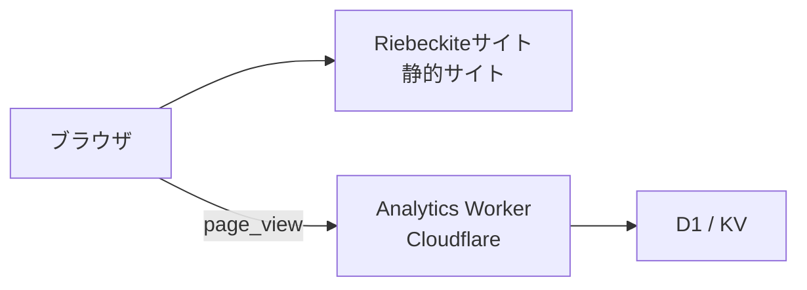
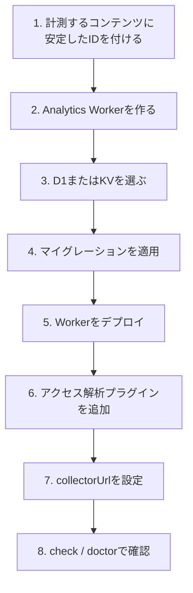

# アクセス解析

Riebeckiteでは、記事ごとのページビューを収集できます。アクセス解析は、サイト側で計測する仕組みと、Cloudflare上でデータを受け取って保存する仕組みに分かれています。

| パッケージ | 役割 |
| --- | --- |
| `@riebeckite/plugin-analytics` | サイト側でページビューを送信する |
| `@riebeckite/analytics-cloudflare` | イベントを受け取り、Cloudflare上で保存・集計する |



**Riebeckiteのサイト自体は、これまでどおり静的サイトのまま**です。Analytics Workerはサイトとは別にデプロイします。サイトの`wrangler.jsonc`や`main`を、Analytics Worker用に置き換える必要はありません。

## このページの構成

- [セットアップ](./analytics/setup.ja.md)
- [Cloudflare Worker](./analytics/worker.ja.md)

## 診断

`@riebeckite/plugin-diagnostics`を利用している場合、アクセス解析プラグインが有効な状態で、安定したコンテンツIDを持たない公開ノートを検出できます。この場合は`analytics-untracked`という`info`の診断が報告されます。

```text id="j6n2dx"
公開記事
   ↓
安定したコンテンツIDがない
   ↓
analytics-untracked
```

計測漏れは、次のような診断コマンドやビルドで確認できます。

```sh id="vl1o09"
pnpm exec riebeckite check
pnpm exec riebeckite doctor
pnpm exec riebeckite build
```

診断はコンテンツを自動変更しません。詳しくは[診断](../framework/diagnostics.ja.md)を参照してください。

## 導入の流れ

初めてアクセス解析を導入する場合は、次の順番で進めると分かりやすくなります。



本番環境でページビューの集計やランキングを利用する場合はD1が必要です。KVの利用は、`capture`だけを必要とする用途に限定してください。

## まとめ

Riebeckiteのアクセス解析は、静的サイトと解析用のバックエンドを分離しています。

```text id="rnbq84"
静的なRiebeckiteサイト
  ↓
@riebeckite/plugin-analytics
  ↓
page_view
  ↓
独立したAnalytics Worker
  ↓
D1 / KV
```

サイトは静的なまま維持され、アクセス解析のストレージやCloudflare固有の処理は、サイトやCoreへ入りません。役割は次のように分かれています。

```text id="d4ph7x"
コンテンツの識別
  → 安定したコンテンツID

公開メタデータ
  → path / lang

ストレージ
  → D1 / KV

濫用の抑制
  → CORS / レート制限
```

特に、CORSとレート制限はイベントの正当性を保証する認証機能ではありません。収集したページビューは、信頼できない計測データとして扱ってください。

### 関連資料

- [コンテンツシステム](../framework/content-system/identity.ja.md#安定したコンテンツid)：安定したコンテンツID
- [診断](../framework/diagnostics.ja.md)：構造化された指摘と`check` / `doctor`
- [リファレンス](../reference/README.ja.md)：公開パッケージとAPI
- [HonoXとの統合](../framework/honox-integration.ja.md)：静的サイトのビルド
- [デプロイ](./deployment/README.ja.md)：サイトのデプロイ
