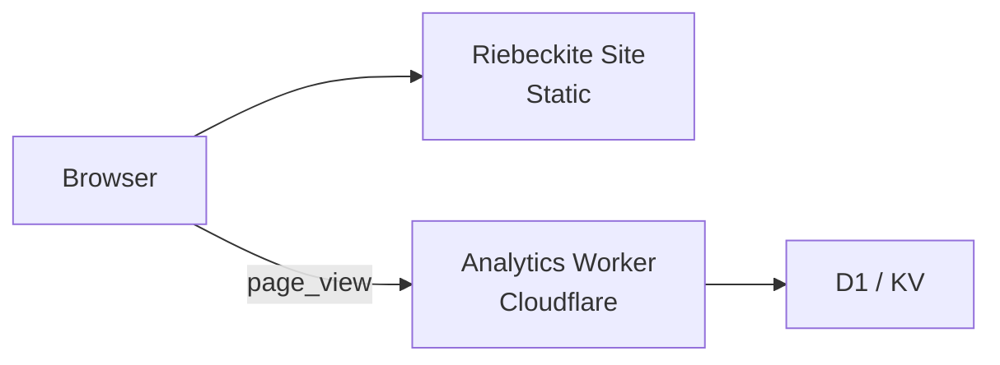
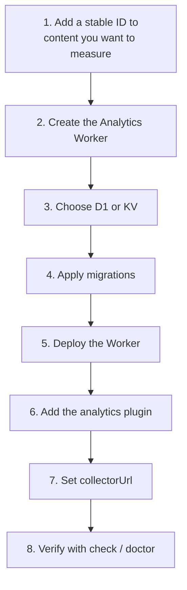

# Analytics

Riebeckite collects a page view per article. Analytics is split into two
packages with a deliberate boundary: a storage-independent plugin that registers
browser page-view tracking, and an independent Cloudflare Worker that accepts,
validates, and stores those events.

| Package | Role |
| --- | --- |
| `@riebeckite/plugin-analytics` | Sends page views from the site. |
| `@riebeckite/analytics-cloudflare` | Receives events and stores/aggregates them on Cloudflare. |



The site itself stays a normal static build. The analytics Worker is a separate
deployment that never replaces the static site's `wrangler.jsonc` or main entry.

## In this section

- [Setup](./analytics/setup.md)
- [Cloudflare Worker](./analytics/worker.md)

## Diagnostics

`@riebeckite/plugin-diagnostics` reports an `analytics-untracked` finding (info
severity) for each published note without a stable content ID when the config
enables the analytics plugin.

```text
Published note
   ↓
No stable content ID
   ↓
analytics-untracked
```

This makes tracking gaps visible directly in

```sh
pnpm exec riebeckite check
pnpm exec riebeckite doctor
pnpm exec riebeckite build
```

It never modifies content. See
[Diagnostics](../framework/diagnostics.md) for the check/doctor/inspect contract.

## Introduction flow

If you are adopting analytics for the first time, this order is the easiest to
follow.



D1 is required to use page-view aggregation and rankings in production. Limit KV
to uses that need only `capture`.

## Summary

Riebeckite analytics separates the static site from the analytics backend.

```text
Static Riebeckite Site
  ↓
@riebeckite/plugin-analytics
  ↓
page_view
  ↓
Standalone Analytics Worker
  ↓
D1 / KV
```

The site stays static, and analytics storage or Cloudflare-specific processing
never enters the site or the core.

It also separates the following roles:

```text
Content identity
  → stable content ID

Public metadata
  → path / lang

Storage
  → D1 / KV

Abuse mitigation
  → CORS / rate limit
```

In particular, CORS and rate limiting are not authentication that guarantees the
validity of analytics events. Treat collected page views as untrusted
measurement data.

## Reading list

- [Content System](../framework/content-system/identity.md#stable-content-ids) — stable content IDs
- [Diagnostics](../framework/diagnostics.md) — structured findings, `check`, and `doctor`
- [Framework Reference](../reference/README.md) — public package surface
- [HonoX Integration](../framework/honox-integration.md) — the static site build this
  Worker runs beside
- [Usage Guide](./README.md) — deployment of the static site
