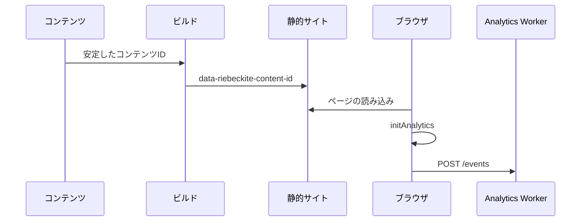

# セットアップ

## 2つのパッケージの役割

### `@riebeckite/plugin-analytics`

Riebeckite のサイト側で動く[[glossary/plugin|プラグイン]]です。主に次の機能を提供します。

- 計測対象のコンテンツを識別する
- ブラウザから `page_view` を送信する
- `AnalyticsProvider` の取り決めを定める
- アクセス解析のクエリの取り決めを定める

Cloudflare、D1、KV、特定のデータベースには依存しません。

### `@riebeckite/analytics-cloudflare`

Cloudflare 上でアクセス解析のイベントを受け取る、独立した Worker パッケージです。主に次の機能を提供します。

- イベントの受信
- リクエストの検証
- CORS
- レート制限
- D1 / KV への保存
- ページビューを読み取る API

```text id="w6zh3x"
Riebeckiteサイト
  → @riebeckite/plugin-analytics

Analytics Worker
  → @riebeckite/analytics-cloudflare
```

## 計測の仕組み

ページビューは、コンテンツに付けた**安定した[[glossary/content-id|コンテンツ ID]]**を基準に記録します。URL が変わっても、同じ記事を同じコンテンツとして扱いたいためです。



計測は大きく3つの段階に分かれます。

### 1. コンテンツIDを付ける

計測対象の記事には、Frontmatter で安定した `id` を指定します。

```yaml id="5rmptb"
---
id: guide-1
---
```

この ID は記事を識別するための値です。URL を変更しても同じコンテンツとして扱いたい場合があるため、`/old-guide` と `/new-guide` のような URL をアクセス解析の識別子には使いません。詳しくは[コンテンツシステム](../../framework/content-system/identity.ja.md#安定したコンテンツ id)を参照してください。

### 2. ビルド時に目印を埋め込む

ビルド時に、安定したコンテンツ ID を持つ公開エントリには隠し要素が追加されます。

```html id="ly98ut"
<span
  hidden
  data-riebeckite-content-id="guide-1"
></span>
```

ブラウザ側のアクセス解析は、この目印からコンテンツ ID を取得します。

### 3. ブラウザからイベントを送る

`initAnalytics` は文書ごとに一度だけ実行されます。コンテンツ ID を取得すると、設定された `collectorUrl` へ `page_view` イベントを JSON で送信します。

```json id="31i7h9"
{
  "type": "page_view",
  "contentId": "guide-1",
  "occurredAt": "2026-01-01T00:00:00.000Z",
  "path": "/guide",
  "lang": "en"
}
```

識別子として使われるのは `contentId` だけです。`path` と `lang` は補助情報です。安定したコンテンツ ID を持たないコンテンツは計測されません。

## ページビューの数え方

初回のページ表示では、`initAnalytics` が実行され、`page_view` を1件送ります。

```text id="bs64om"
ページの読み込み
   ↓
initAnalytics
   ↓
page_view × 1
```

その後は、初回のページ読み込みごと、および成功した SPA のページ移動ごとに1件の `page_view` を送ります。

## サイト側の設定

サイトでは `@riebeckite/plugin-analytics` を設定します。

```ts id="74prf7"
import {
  analytics,
  MemoryAnalyticsProvider,
} from "@riebeckite/plugin-analytics";

export default defineConfig({
  // ...

  plugins: [
    analytics({
      provider:
        new MemoryAnalyticsProvider(),

      publicConfig: {
        collectorUrl:
          "https://analytics.example.com/events",
      },
    }),
  ],
});
```

主な設定は `provider` と `publicConfig.collectorUrl` の2つです。

### `provider`

`provider` は、`AnalyticsProvider` の取り決めを実装した実行環境です。プロバイダーは `capabilities`、`capture`、`query` を提供します。

認証情報やストレージのバインディングのような非公開情報は、プロバイダーの内部に保持してください。ブラウザへ渡してはいけません。

### `publicConfig.collectorUrl`

`collectorUrl` は、ブラウザがイベントを送信する URL です。

```ts id="3xqf6f"
publicConfig: {
  collectorUrl:
    "https://analytics.example.com/events",
}
```

指定できるのは、サイトからの相対パスか、JSON の `POST` を受け付ける HTTPS URL です。平文 HTTP は localhost だけで許可されます。

`publicConfig` は名前のとおりブラウザへ公開されます。秘密情報を含めないでください。

### `MemoryAnalyticsProvider`

`MemoryAnalyticsProvider` は、テストとローカルでの試用向けです。本番環境でデータを永続的に保存する用途には使わないでください。本番では、Cloudflare Worker などの実際の収集先を使用します。

## 設定の検証

アクセス解析プラグインのオプションも、通常のプラグイン設定の検証対象です。`provider` や `collectorUrl` が不正でないかは、次のコマンドで確認できます。

```sh id="h5myi0"
pnpm exec riebeckite check
```

```sh id="kkok81"
pnpm exec riebeckite doctor
```

## AnalyticsProviderの役割

`AnalyticsProvider` は、プロバイダーがどのアクセス解析機能に対応しているかを `capabilities` で宣言します。主な対応機能は `capture`、`content_page_views`、`popular_content` です。

### イベントの保存

```ts id="6ey01d"
await provider.capture(event);
```

`capture` はページビューのイベントを保存します。

### コンテンツのページビュー取得

```ts id="4gohio"
await provider.query({
  type: "content_page_views",
  contentId: "guide-1",

  timeRange: {
    from:
      "2026-01-01T00:00:00.000Z",
  },
});
```

特定のコンテンツの合計ページビューを取得します。期間は任意です。

### 人気コンテンツの取得

```ts id="3n12mu"
await provider.query({
  type: "popular_content",
  limit: 10,
});
```

ページビューをもとにしたランキングを取得します。`limit` と期間は任意です。

### 未対応のクエリ

プロバイダーが対応していないクエリには、`UnsupportedAnalyticsQueryError` を投げます。独自のプロバイダーを実装する場合は、`assertAnalyticsQuerySupported(provider, query)` を利用してください。

```ts id="grm9c0"
assertAnalyticsQuerySupported(
  provider,
  query,
);
```

対応機能とクエリのヘルパーは、パッケージのルートからエクスポートされています。
