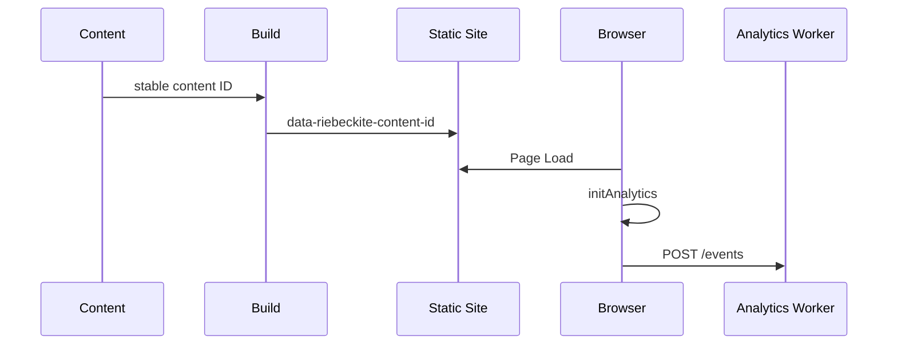

# Setup

## Which package does what?

### `@riebeckite/plugin-analytics`

The plugin on the Riebeckite site side. It provides, mainly:

- identification of the content to measure
- sending `page_view` from the browser
- the `AnalyticsProvider` contract
- the analytics query contract

It does not depend on Cloudflare, D1, KV, or any particular database.

### `@riebeckite/analytics-cloudflare`

A standalone Worker package for receiving analytics events on Cloudflare. It
provides, mainly:

- receiving events
- request validation
- CORS
- rate limiting
- storing to D1 / KV
- read APIs for page views

```text
Riebeckite Site
  → @riebeckite/plugin-analytics

Analytics Worker
  → @riebeckite/analytics-cloudflare
```

## How tracking works

Page views are recorded against a content entry's **stable content ID**.



There are three broad stages.

### 1. Content ID

Content you want to measure gets a stable `id` in its frontmatter.

```yaml
---
id: guide-1
---
```

This ID identifies the article. A URL can change while you still want the same
content to be treated as one entry, so URLs like

```text
/old-guide
/new-guide
```

are not used as the analytics identity. See
[Content System](../../framework/content-system/identity.md#stable-content-ids) for details.

### 2. A marker is added at build time

During the build, a hidden element is added to every published entry that has a
stable content ID.

```html
<span
  hidden
  data-riebeckite-content-id="guide-1"
></span>
```

The browser-side analytics reads the content ID from this marker.

### 3. The browser sends the event

`initAnalytics` runs once per document. It reads the content ID and sends a
`page_view` event as JSON to the configured `collectorUrl`.

```json
{
  "type": "page_view",
  "contentId": "guide-1",
  "occurredAt": "2026-01-01T00:00:00.000Z",
  "path": "/guide",
  "lang": "en"
}
```

The identity used is

```text
contentId
```

`path` and `lang` are contextual metadata. Content without a stable ID is not
measured.

## Page view unit

For a static navigation or an initial page load, the basic model is

```text
Page Load
   ↓
initAnalytics
   ↓
page_view × 1
```

One `page_view` is sent per initial page load and per successful SPA route
transition.

## Configuring the site

```ts
import { analytics, MemoryAnalyticsProvider } from "@riebeckite/plugin-analytics";

export default defineConfig({
  // ...
  plugins: [
    analytics({
      provider: new MemoryAnalyticsProvider(),
      publicConfig: { collectorUrl: "https://analytics.example.com/events" },
    }),
  ],
});
```

There are two main settings:

```text
provider
publicConfig.collectorUrl
```

### `provider`

`provider` is the private runtime implementation of the `AnalyticsProvider`
contract. A provider offers

```text
capabilities
capture
query
```

Private information such as credentials and storage bindings stays inside the
provider. It must never be passed to the browser.

### `publicConfig.collectorUrl`

`collectorUrl` is the URL the browser sends events to.

```ts
publicConfig: {
  collectorUrl: "https://analytics.example.com/events",
}
```

It can be either a site-relative path or an HTTP(S) URL that accepts a JSON
`POST` body. `publicConfig` is, as the name says, exposed to the browser — never
put secrets in it.

### `MemoryAnalyticsProvider`

`MemoryAnalyticsProvider` is for tests and local experiments. It is not a
persistent analytics store for production. Use a real collector such as the
Cloudflare Worker in production.

## Checking the configuration

The analytics plugin's options go through the normal plugin validation. For
example, a malformed `provider` or `collectorUrl` can be checked with

```sh
pnpm exec riebeckite check
```

or

```sh
pnpm exec riebeckite doctor
```

## AnalyticsProvider

`AnalyticsProvider` declares which analytics features it supports through
`capabilities`. The main capabilities are

```text
capture
content_page_views
popular_content
```

### Storing events

```ts
await provider.capture(event);
```

`capture` stores a page view event.

### Reading content page views

```ts
await provider.query({
  type: "content_page_views",
  contentId: "guide-1",
  timeRange: { from: "2026-01-01T00:00:00.000Z" },
});
```

Returns the total page views for one content entry. The time range is optional.

### Reading popular content

```ts
await provider.query({ type: "popular_content", limit: 10 });
```

Returns a ranking based on page views. `limit` and the time range are optional.

### Unsupported queries

A provider that cannot satisfy a query throws

```text
UnsupportedAnalyticsQueryError
```

When implementing your own provider, use

```ts
assertAnalyticsQuerySupported(provider, query);
```

[[glossary/capability|Capability]] and query helpers are exported from the package root.
