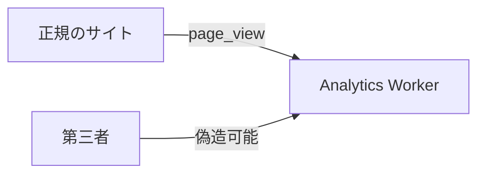
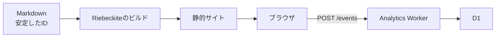

# Cloudflare Worker

## Cloudflare Workerで収集する

Cloudflareでイベントを収集する場合は、`@riebeckite/analytics-cloudflare`を使用します。このパッケージは`createWorker(options)`とストレージアダプターを提供します。

ストレージの既定値はありません。**D1かKVのどちらか一方を明示的に選択します**。

## D1とKVの違い

| ストレージ | イベントの保存 | 合計ページビュー | 人気ランキング | 期間指定 |
| --- | --- | --- | --- | --- |
| D1 | ○ | ○ | ○ | ○ |
| KV | ○ | × | × | × |

### D1

D1では`D1AnalyticsStorage`と`d1Storage(db)`を使用します。D1はUTCの日単位で集計します。SQLiteのアトミックなupsertを利用し、**生のページビューイベントは保存しません**。

そのため、`capture`、`content_page_views`、`popular_content`、日単位の期間クエリを利用できます。本格的にアクセス解析の集計結果を利用する場合はD1を選んでください。

### KV

KVでは`KvAnalyticsStorage`と`kvStorage(namespace)`を使用します。

KVが対応するのは`capture`だけです。集計はベストエフォートであり、同時書き込みによって件数が欠落する可能性があります。そのため`content_page_views`と`popular_content`には対応しません。これらのAPIを利用すると、HTTP `501`を返します。

## D1 Workerの実装例

```ts id="ak02xw"
import {
  createWorker,
  d1Storage,
} from "@riebeckite/analytics-cloudflare";

export interface Env {
  ANALYTICS_DB: D1Database;
}

export default {
  fetch(
    request: Request,
    env: Env,
  ) {
    return createWorker({
      storage:
        d1Storage(env.ANALYTICS_DB),

      cors: {
        allowedOrigins: [
          "https://www.example.com",
        ],
      },
    }).fetch(request);
  },
};
```

Cloudflareの`env`は`fetch`の実行時に渡されます。そのため、ストレージのバインディングもリクエストごとに構築します。

```text id="6fak1j"
リクエスト
   ↓
fetch(request, env)
   ↓
d1Storage(env.ANALYTICS_DB)
   ↓
createWorker(...)
```

モジュールのトップレベルで`env`を取得しようとしないでください。

## Workerのエンドポイント

Analytics Workerは次のエンドポイントを提供します。

| エンドポイント | 内容 |
| --- | --- |
| `POST /events` | `page_view`を受信する |
| `GET /content/:contentId/page-views` | コンテンツの合計ページビュー |
| `GET /popular` | 人気コンテンツ |

### `POST /events`

JSONの`page_view`ペイロードを受け付けます。本文の最大サイズは8 KiBです。成功すると`204 No Content`を返します。

不正なリクエストは拒否されます。

| 状態 | レスポンス |
| --- | --- |
| 不正なJSON | `400` |
| 未知または不正なフィールド | `400` |
| JSON以外のContent-Type | `415` |
| 8 KiBを超える本文 | `413` |
| レート制限の超過 | `429` |

### ページビュー取得API

```text id="lv9m44"
GET /content/:contentId/page-views?from=&to=
```

特定のコンテンツの合計ページビューを取得します。

### 人気コンテンツAPI

```text id="ckwlsu"
GET /popular?limit=&from=&to=
```

人気コンテンツを取得します。読み取りAPIは、ストレージアダプターが対応する機能を宣言している場合だけ利用できます。

## CORS

Originは既定で拒否されます。そのため、通常はサイトのOriginを明示します。

```ts id="esgw6e"
cors: {
  allowedOrigins: [
    "https://www.example.com",
  ],
}
```

すべてのOriginから利用できるようにする場合は、`"any"`を指定できます。この指定は、意図的に公開の収集先として運用する場合だけ使用してください。

## CORSは認証ではない

`allowedOrigins`を設定しても、届いたイベントが信頼できるようになるわけではありません。`Origin`は認証ではないため、第三者が許可されたOriginを装って`POST /events`を直接送信できます。



そのため、収集したページビューは**信頼できない計測データ**として扱ってください。

## レート制限

濫用を減らすため、任意で`rateLimit`を設定できます。レート制限は、接続元IPごとに固定の時間枠でリクエスト数を制限します。上限を超えると`429 Too Many Requests`を返します。

### D1レートリミッター

本番環境では`D1AnalyticsRateLimiter`と`d1RateLimiter(...)`を利用できます。

```ts id="24eqz6"
d1RateLimiter(
  db,
  {
    maxRequests: 100,
    windowMs: 60_000,
  },
);
```

D1上でアトミックなカウンターを管理するため、複数のWorker Isolate間でも共有できます。利用する場合は、デプロイ前に`migrations/0002_analytics_rate_limits.sql`を適用してください。

### メモリ上のレートリミッター

`MemoryAnalyticsRateLimiter`は、テストとローカル開発向けです。プロセス内のカウンターしか持たないため、短命なWorker Isolate間では共有されません。本番環境で分散したリクエストを制限する用途には適していません。

## レート制限でできないこと

レート制限は認証機能ではありません。できるのは、主に単一のクライアントから送られる大量のリクエストを一定量まで抑えることです。

複数の接続元から分散してイベントを送信したり、正規のページビューを偽造したりすることを完全には防げません。そのため、**CORSとレート制限を設定しても、アクセス解析のデータ自体を信頼済みとして扱わない**ことが重要です。

## プライバシー

Analytics Workerは、Cookie、User-Agent、[[glossary/fingerprint|フィンガープリント]]を読み取ったり保存したりしません。

イベントに含まれる`path`と`lang`も補助情報であり、D1には保存されません。

レート制限を有効にした場合だけ、`CF-Connecting-IP`をレート制限のキーとして読み取ります。D1レートリミッターでは、そのキーを有効なレート制限の時間枠の間だけ保存します。

## D1の準備

D1のスキーマはリクエスト中に自動生成しません。必ずデプロイ前にマイグレーションを適用します。

```sh id="ez80bk"
pnpm exec wrangler d1 execute ANALYTICS_DB \
  --file node_modules/@riebeckite/analytics-cloudflare/migrations/0001_analytics_page_views.sql

pnpm exec wrangler d1 execute ANALYTICS_DB \
  --file node_modules/@riebeckite/analytics-cloudflare/migrations/0002_analytics_rate_limits.sql
```

1つ目はアクセス解析の集計用スキーマです。2つ目はD1のレート制限を利用する場合に必要です。

## Workerのデプロイ

RiebeckiteにはAnalytics Worker用のテンプレートがあります。

```text id="2ynl7a"
templates/analytics-cloudflare/d1
templates/analytics-cloudflare/kv
```

利用するストレージに合わせて、テンプレートを**独立したWorkerのディレクトリまたはリポジトリ**へコピーします。

```text id="e2ag5w"
my-site/
  └─ 静的なRiebeckiteサイト

my-analytics/
  └─ Analytics Worker
```

Analytics Workerは専用の`main`を持ちます。静的Riebeckiteサイトの`wrangler.jsonc`と`main`を置き換えないでください。

マイグレーションを適用したら、Workerをデプロイします。

```sh id="n1m9do"
pnpm exec wrangler deploy
```

デプロイ後、サイトの`collectorUrl`にWorkerの`/events`を設定します。

```ts id="y8ehx2"
analytics({
  // ...

  publicConfig: {
    collectorUrl:
      "https://analytics.example.com/events",
  },
});
```

最終的な構成は次のようになります。


