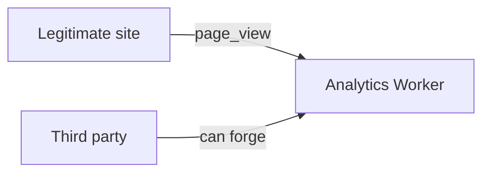
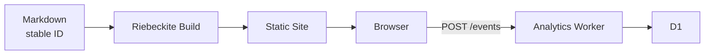

# Cloudflare Worker

## Collecting events

To collect events on Cloudflare, use `@riebeckite/analytics-cloudflare`. The
package exposes

```text
createWorker(options)
```

and storage adapters. There is no default storage: **choose exactly one of D1 or
KV explicitly.**

## D1 and KV

| Storage | Event capture | Total page views | Popular ranking | Time range |
| --- | --- | --- | --- | --- |
| D1 | Yes | Yes | Yes | Yes |
| KV | Yes | No | No | No |

### D1

For D1, use

```text
D1AnalyticsStorage
d1Storage(db)
```

D1 aggregates per UTC day. It uses atomic SQLite upserts and **does not store raw
page view events**. This makes the following available:

- `capture`
- `content_page_views`
- `popular_content`
- day-based time-range queries

Use this if you want to make real use of aggregated analytics.

### KV

For KV, use

```text
KvAnalyticsStorage
kvStorage(namespace)
```

KV supports `capture` only. Totals are best-effort, and concurrent writes can
lose counts. It therefore does not support

```text
content_page_views
popular_content
```

Using those APIs returns HTTP `501`.

## D1 Worker example

```ts
import { createWorker, d1Storage } from "@riebeckite/analytics-cloudflare";

export interface Env { ANALYTICS_DB: D1Database; }

export default {
  fetch(request: Request, env: Env) {
    return createWorker({
      storage: d1Storage(env.ANALYTICS_DB),
      cors: { allowedOrigins: ["https://www.example.com"] },
    }).fetch(request);
  },
};
```

Cloudflare passes `env` at `fetch` execution time, so the storage binding is also
constructed per request.

```text
Request
   ↓
fetch(request, env)
   ↓
d1Storage(env.ANALYTICS_DB)
   ↓
createWorker(...)
```

Do not try to read `env` at module top level.

## Worker endpoints

The analytics Worker provides the following endpoints.

| Endpoint | Description |
| --- | --- |
| `POST /events` | Receives a `page_view`. |
| `GET /content/:contentId/page-views` | Total page views for a content entry. |
| `GET /popular` | Popular content. |

### `POST /events`

Accepts a JSON `page_view` payload. The maximum body size is 8 KiB. On success it
returns

```text
204 No Content
```

Invalid requests are rejected.

| Condition | Response |
| --- | --- |
| Invalid JSON | `400` |
| Unknown or invalid field | `400` |
| Non-JSON `Content-Type` | `415` |
| Body larger than 8 KiB | `413` |
| Rate limit exceeded | `429` |

### Page view API

```text
GET /content/:contentId/page-views?from=&to=
```

Returns the total page views for one content entry.

### Popular API

```text
GET /popular?limit=&from=&to=
```

Returns popular content.

Read APIs are available only when the storage adapter advertises the
corresponding capability.

## CORS

Origins are denied by default, so you normally name the site's origin explicitly.

```ts
cors: {
  allowedOrigins: ["https://www.example.com"],
}
```

To allow every origin, specify

```text
"any"
```

Use that only when you deliberately expose a public collector.

## CORS is not authentication

Setting `allowedOrigins` does not make analytics events trustworthy. `Origin` is
not authentication, so a third party can impersonate an allowed origin and send

```text
POST /events
```

directly.



Treat collected page views as **untrusted measurement data**.

## Rate limiting

To reduce abuse, you can optionally set `rateLimit`. It limits the number of
requests per connecting IP in a fixed window. When the limit is exceeded it
returns

```text
429 Too Many Requests
```

### D1 rate limiter

For production, use

```text
D1AnalyticsRateLimiter
d1RateLimiter(...)
```

```ts
d1RateLimiter(db, { maxRequests: 100, windowMs: 60_000 });
```

Because it keeps an atomic counter on D1, it is shared across Worker isolates.
If you use it, apply

```text
migrations/0002_analytics_rate_limits.sql
```

before deploying.

### Memory rate limiter

`MemoryAnalyticsRateLimiter` is for tests and local development. It only holds
process-local counters, so it is not shared across short-lived Worker isolates
and is not suitable for limiting distributed production traffic.

## Limits of rate limiting

Rate limiting is not authentication. It can mainly

```text
A large number of requests from a single client
        ↓
Throttle down to a certain amount
```

It cannot fully prevent events sent from many distributed clients, nor forged
legitimate-looking page views. That is why it matters to
**treat analytics data itself as untrusted even when CORS and rate limiting are
configured.**

## Privacy

The analytics Worker does not read or store

```text
Cookie
User-Agent
Fingerprint
```

The `path` and `lang` in an event are also contextual metadata and are not stored
in D1. Only when rate limiting is enabled does it read

```text
CF-Connecting-IP
```

as the rate-limit key. The D1 rate limiter stores that key only for the active
rate-limit window.

## Deploying

The D1 schema is never created automatically during a request. Always apply the
migrations before deploying:

```sh
pnpm exec wrangler d1 execute ANALYTICS_DB --file node_modules/@riebeckite/analytics-cloudflare/migrations/0001_analytics_page_views.sql
pnpm exec wrangler d1 execute ANALYTICS_DB --file node_modules/@riebeckite/analytics-cloudflare/migrations/0002_analytics_rate_limits.sql
```

The first is the schema for analytics aggregation. The second is required if you
use the D1 rate limiter.

Riebeckite ships analytics Worker templates:

```text
templates/analytics-cloudflare/d1
templates/analytics-cloudflare/kv
```

Copy the template matching your storage into a **separate Worker directory or
repository**.

```text
my-site/
  └─ Static Riebeckite Site

my-analytics/
  └─ Analytics Worker
```

The analytics Worker has its own `main`. Do not replace the static Riebeckite
site's

```text
wrangler.jsonc
main
```

After applying the migrations, deploy the Worker:

```sh
pnpm exec wrangler deploy
```

Then point the site's `collectorUrl` at the Worker's `/events`:

```ts
analytics({
  // ...
  publicConfig: {
    collectorUrl: "https://analytics.example.com/events",
  },
});
```

The final arrangement looks like this:


