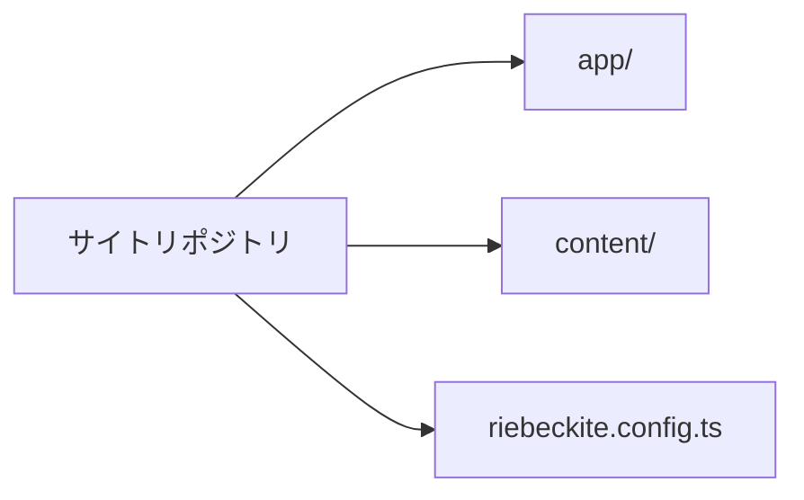
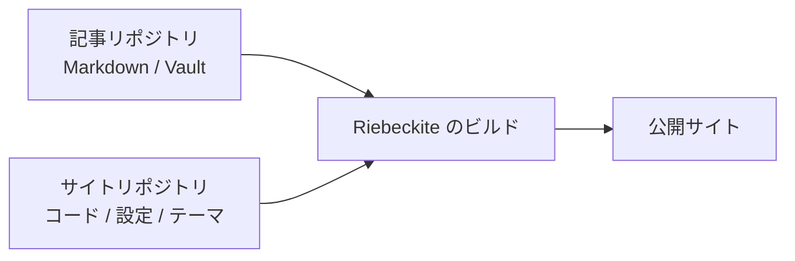
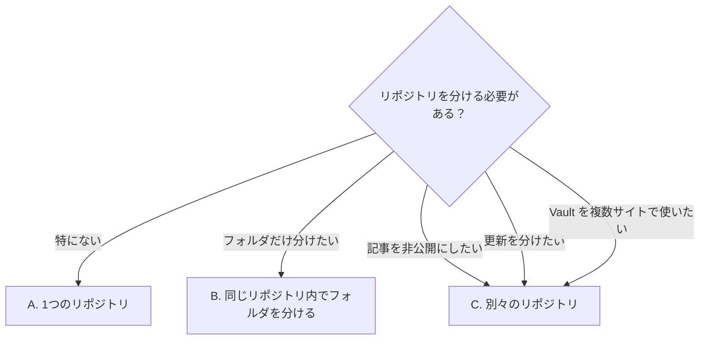
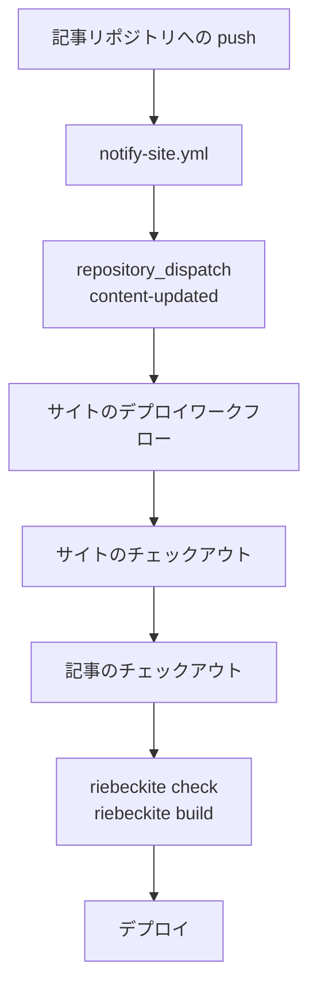
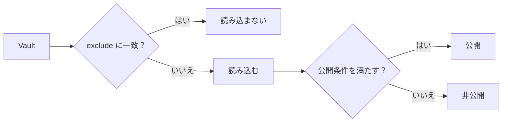
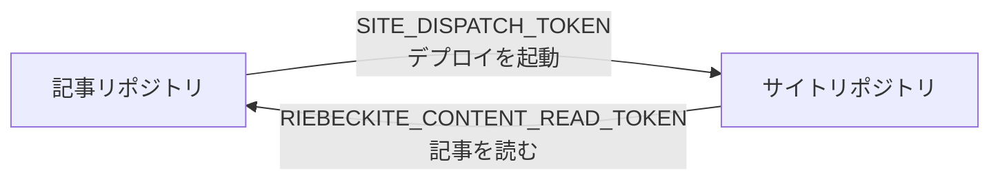
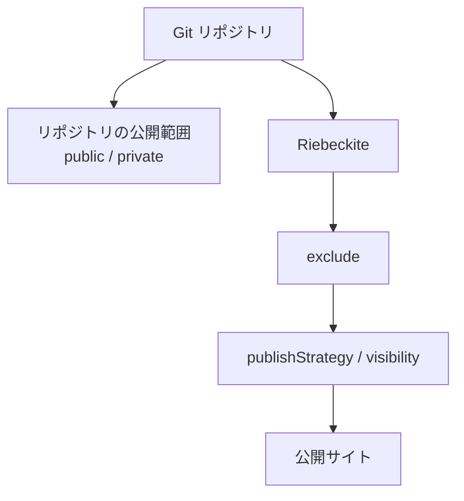
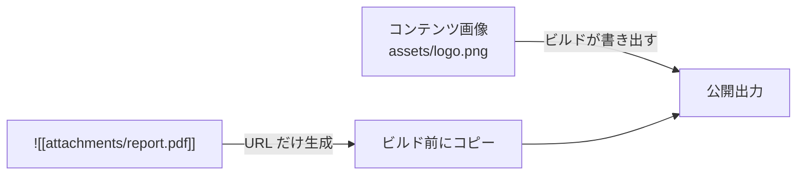
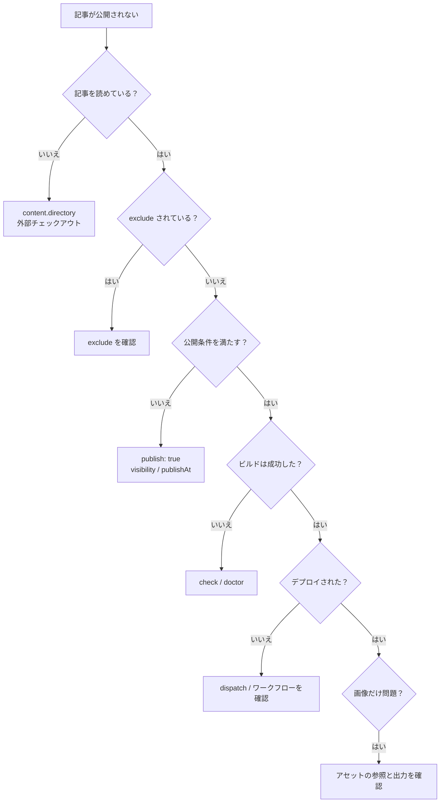
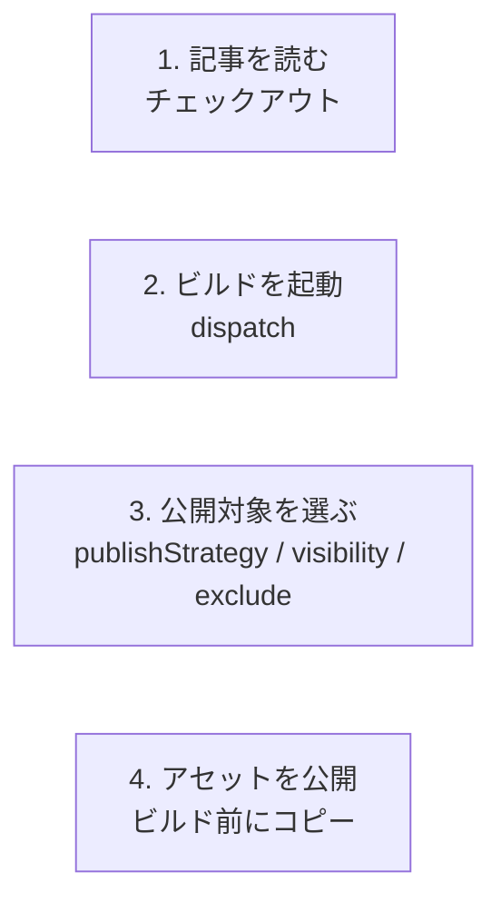

# コンテンツとサイトを分ける

記事（Markdown / Obsidian Vault）とサイト（コード、設定、テーマ）を別の場所やリポジトリに置く方法を説明します。分けるべきかどうかの判断、構成の選び方、外部 Vault の読み込み、別リポジトリからの公開までを順に扱います。

GitHub Actions の具体的な構成、ルート解決、認証、アセットの詳細は [リポジトリ分離の詳細編](./deployment/separate-content-repository.ja.md) を参照してください。

## このガイドが向いている人

- Obsidian Vault とサイトのコードを別々に管理したい
- 記事は非公開のまま、サイトだけを公開したい
- 1つの Vault を複数のサイトで使いたい
- 記事の更新とサイトの更新を分けたい

小さな個人サイトを1つのリポジトリで管理するだけなら、分ける必要はありません。

## まずは1つのリポジトリで始める

`npx create-riebeckite my-site` で作ったサイトは、最初から次の構成です。

```text
site/
├─ content/
├─ app/
├─ riebeckite.config.ts
└─ package.json
```



別の Vault を使いたいなど、分ける理由が明確になるまでは、この構成で十分です。

分けた場合は、役割は次のようになります。

```text
site repository          content repository
├─ app/                  ├─ article-a.md
├─ riebeckite.config.ts  ├─ article-b.md
├─ package.json          ├─ attachments/
└─ ...                   └─ ...
```

| リポジトリ | 主な内容 |
| --- | --- |
| サイト | アプリケーション、設定、テーマ、プラグイン、デプロイ |
| 記事 | Markdown、Obsidian Vault、添付ファイル |



Riebeckite のビルドが両方を組み合わせ、最終的なサイトを生成します。

## 記事はサイトの外に置ける

`content.directory` はサイトのルート（`appRoot`）からの相対パスで、外部のディレクトリも指定できます。

```text
workspace/
├─ vault/
│  ├─ article-a.md
│  └─ article-b.md
│
└─ site/
   ├─ app/
   ├─ riebeckite.config.ts
   └─ package.json
```

この場合、`site/riebeckite.config.ts` は次のように書けます。

```ts
export default defineConfig({
  content: {
    directory: "../vault",
  },
  // ...
});
```

記事をサイトのディレクトリへコピーする必要はありません。相対パスの基準は常にサイトのルートなので、CLI をサイト内の `app/` から実行しても、CI の作業ディレクトリから実行しても同じ Vault を読み込みます。

`content.source` で独自の読み込み元を指定した場合は、標準のファイルシステム読み込みが置き換わるため、`content.directory` は使いません。

何をどこに置くかの例を示します。

| 内容 | 置き場所 |
| --- | --- |
| 記事本文（`.md`） | Vault 内の任意のディレクトリ |
| 画像・添付ファイル | Vault の `attachments/` など |
| Obsidian の設定 | Vault の `.obsidian/` |
| サイトのコードと設定 | サイトリポジトリ |
| テーマ・プラグインの設定 | サイトリポジトリ |
| デプロイの設定 | サイトリポジトリ |
| 公開しないノート | Vault の `private/` など（`exclude` で除外） |

## 記事とサイトの分け方を選ぶ

記事とサイトをどの単位で分けるかを先に決めます。

| パターン | 構成 | 記事の公開範囲 | 向いているケース |
| --- | --- | --- | --- |
| A. 1つのリポジトリ | サイトと記事を同じリポジトリに置く（`content/`） | リポジトリと同じ | 個人ブログを1つのリポジトリで管理したい |
| B. 同じリポジトリ内でフォルダを分ける | `site/` と `vault/` を並べる | リポジトリと同じ | 履歴は共有しつつ、場所と設定を分けたい |
| C. 別々のリポジトリ | 記事を別リポジトリに置く | 記事とサイトで別々に設定できる | 記事を非公開にしたい、更新を分けたい |

選ぶときの目安は次のとおりです。

- 記事を公開したくない → C。リポジトリを非公開にしたまま、サイトだけを公開できます。ただし `publish: true` を付けた記事は公開サイトに載るため、公開判定は別に確認してください。
- 記事もサイトも公開してよい → A または B。管理するリポジトリは1つで済みます。
- 記事を更新したらサイトもデプロイしたい → C。記事の push でデプロイを起動するには、外部チェックアウトに加えて repository dispatch が必要です。
- 1つの Vault を複数のサイトで使いたい → C、または Vault を独立した場所に置き、各サイトから参照します。



以下は C の手順です。A と B では設定方法はほぼ同じで、外部リポジトリのチェックアウトと repository dispatch が不要になります。

## 別々のリポジトリで運用する手順

### デプロイが起動するまでの流れ

別々のリポジトリでは、CI が記事を読めることと、記事の更新でデプロイが起動することは別です。`--github-actions --content-repository <owner/repo> --site-repository <owner/repo>` で生成される構成は、次の順番でつながります。

1. 記事リポジトリの `main` に push する
2. 記事リポジトリの `notify-site.yml` が、サイトリポジトリへ `content-updated` を送る（`SITE_DISPATCH_TOKEN`）
3. サイトリポジトリのデプロイワークフローが `repository_dispatch` で起動する
4. サイトをチェックアウトし、記事リポジトリを `content/` へチェックアウトする（プライベートの場合は `RIEBECKITE_CONTENT_READ_TOKEN`）
5. `riebeckite check` → `riebeckite build` → Cloudflare Workers へデプロイ



外部チェックアウトは、サイトの CI が記事を読めるようにするだけです。GitHub Actions はワークフローがあるリポジトリのイベントしか拾わないため、別リポジトリの push だけではサイトのワークフローは起動しません。その橋渡しをするのが `notify-site.yml` です。

### 0. 用語を確認する

- Vault: 記事（`.md`）と添付ファイルを置くディレクトリ。Obsidian が開く単位です。
- `publish: true`: ノートを公開する印です。既定の `explicit` では、この印があるノートだけがサイトに出ます。
- `exclude`: サイトに読み込ませないパターンです。記事リポジトリにあっても、ビルドから外せます。

### 1. 記事リポジトリ（Vault）を作る

任意の場所にディレクトリを作り、Git リポジトリとして初期化します。Obsidian を使う場合は、このディレクトリを Vault として開きます。

```sh
mkdir notes
cd notes
git init
```

最初のノートを作ります。公開しないノートには `publish: true` を付けません。

```md
---
title: はじめまして
publish: true
---

最初のノートです。
```

OS の一時ファイルや Obsidian のワークスペースの状態を Git で管理したくない場合は、`.gitignore` に追加します。`.obsidian/` 自体をコミットしても構いません。サイト側で読み込み対象から外せます。

```gitignore
.DS_Store
Thumbs.db
.obsidian/workspace.json
.obsidian/workspace-mobile.json
```

GitHub にプライベートリポジトリを作り、push します。記事は非公開のままです。

```sh
git add .
git commit -m "最初のノート"
# GitHub で Private リポジトリを作成したあと
git remote add origin git@github.com:<you>/notes.git
git push -u origin main
```

### 2. サイトを生成する

GitHub Actions のデプロイ設定込みでサイトを生成します。プリセットを変えてもこの構成は同じで、変わるのはスターターサイトだけです。

```sh
npx create-riebeckite my-site --github-actions \
  --content-repository <you>/notes \
  --site-repository <you>/my-site
cd my-site
npm install
```

対話式の CLI では、コンテンツの置き場所に `Separate GitHub repository` を選び、Content repository と Site repository を入力します。

生成されるデプロイワークフローは、記事リポジトリをサイトの `content/` へチェックアウトします。`--content-repository` を指定した場合は、`content-updated` の dispatch を受け取る設定と `github/notify-site.yml` も生成されます。既定の `starter` で問題ありませんが、`--preset` でスターターを変更できます。

サイト側の `content/` にスターターのファイルが残っている場合があります。これはローカル確認用のサンプルとして扱い、日常の記事は記事リポジトリで編集してください。

ローカルでは、次のように隣接するディレクトリへ置くと扱いやすくなります。

```text
workspace/
├─ notes/     ← 手順1で作った Vault
└─ my-site/   ← 手順2で作ったサイト
```

ただし CI は、サイトのチェックアウト内にある `content/` へ記事リポジトリをチェックアウトします。生成された設定は CI に合わせて `content.directory: "content"` なので、ローカルでも `my-site/content` に Vault を配置すれば同じ設定のまま確認できます。

`content.directory` を `../notes` に変える場合は、CI のチェックアウト先も同じ相対位置になるようワークフローを調整してください。設定だけを変えると、ローカルでは読めても CI では Vault が見つからなくなります。

### 3. `content.directory` を Vault に向ける

`my-site/riebeckite.config.ts` で、読み込むディレクトリと除外パターンを指定します。

```ts
export default defineConfig({
  // ...
  content: {
    directory: "content",
    exclude: [".obsidian/**", "Templates/**", "private/**"],
  },
  // ...
});
```

- `directory: "content"` は、デプロイワークフローが記事をチェックアウトする場所に合わせています。
- `exclude` には、公開しないもの、コンテンツとして読み込ませたくないものを指定します。Obsidian の設定（`.obsidian/**`）、テンプレート（`Templates/**`）、非公開ノートのディレクトリ（`private/**`）が典型です。

`exclude` は読み込み自体を止め、`publish: true` などの公開条件は読み込んだノートの扱いを決めます。両方を組み合わせると、公開の境界を二重に設定できます。



### 4. 読み込みを確認する

表示を確認する前に、CLI で読み込み状態を確認します。

```sh
npm exec riebeckite check
npm exec riebeckite doctor
npm exec riebeckite inspect config
npm exec -- riebeckite inspect content --list
```

- `check` は設定とプラグインの契約を検証します。
- `doctor` は設定、プラグイン、コンテンツ、ビルド状態、環境を診断します。`--github` を付けると GitHub 関連の設定も確認します。
- `inspect config` は解決済みの設定を表示します。コンテンツの `Source`、`Directory`、`Exclude`、`Publishing` を確認でき、`Directory` には絶対パスが出ます。意図した Vault を指しているか確認してください。
- `inspect content --list` は読み込んだノートを `PATH`、`ID`、`ID SOURCE`、`PERMALINK` の列で一覧表示します。`exclude` に一致したファイルは `EXCLUDED PATH` と `PATTERN` の表に出ます。

`inspect content` だけを実行すると、コンテンツソースの種類、読み込み件数、除外件数、拡張子ごとの件数が分かります。

記事が見つからない場合は、相対パスの `directory` を確認してください。読み込まれているのに表示されない場合は、`publish: true`、`visibility`、`publishAt` を確認します。

### 5. チェックアウト・起動条件・シークレットを設定する

生成されたデプロイワークフローは、サイトの push、手動実行（`workflow_dispatch`）、`content-updated` の repository dispatch で起動します。記事リポジトリのチェックアウトはワークフローに含まれていますが、別リポジトリの push を監視しているわけではありません。

生成された `github/notify-site.yml` を、記事リポジトリの `.github/workflows/notify-site.yml` へコピーします。記事リポジトリの `main` に push すると、サイトリポジトリへ `content-updated` を送ります。

```yaml
repository_dispatch:
  types: [content-updated]
```

`SITE_DISPATCH_TOKEN` は記事リポジトリにだけ登録します。サイトリポジトリだけに権限を絞った Fine-grained PAT なら **Contents: read and write**、Classic PAT なら `repo` スコープ、GitHub App のインストールトークンなら **Contents: write** が必要です。

プライベートまたは内部の記事リポジトリを使う場合は、サイトリポジトリに `RIEBECKITE_CONTENT_READ_TOKEN` を登録します。Fine-grained PAT なら記事リポジトリだけに絞って **Contents: read** を付与します。公開の記事リポジトリなら、このシークレットは不要です。サイトリポジトリの `GITHUB_TOKEN` では、別のプライベート / 内部リポジトリを読めません。

デプロイ先の Cloudflare Workers 用に、サイトリポジトリへ `CLOUDFLARE_API_TOKEN` と `CLOUDFLARE_ACCOUNT_ID` も登録します。

チェックアウトではコミットを固定しないため、dispatch のたびに記事リポジトリの既定ブランチの最新コミットを読みます。

デプロイの起動方法はほかにもあります。

| 方法 | 記事の push でデプロイされるか | 設定 |
| --- | --- | --- |
| 同じリポジトリ | される | `content/` を使い、サイトの `push` で起動する |
| 別リポジトリ + dispatch | される | 外部チェックアウトと、上記の通知ワークフローを設定する |
| 別リポジトリ + schedule | 遅れて反映 | サイトのワークフローに `schedule` を追加する。dispatch 用トークンは不要 |
| 手動実行 | されない | Actions 画面から `workflow_dispatch` を実行する |
| Git サブモジュール | されない | サイト側のサブモジュール参照を更新して push する |

### 2つのトークンは役割が逆

名前は似ていますが、使う向きが逆です。

| シークレット | 置く場所 | 目的 |
| --- | --- | --- |
| `SITE_DISPATCH_TOKEN` | 記事リポジトリ | サイトのワークフローを起動する |
| `RIEBECKITE_CONTENT_READ_TOKEN` | サイトリポジトリ | プライベートの記事をチェックアウトする |



### サブモジュールで記事リポジトリを参照する

記事リポジトリをサブモジュールにすることもできます。

```sh
git submodule add git@github.com:<you>/notes.git content
```

`content` は記事リポジトリを指すリンクになります。CI で取得するには、ワークフローの `actions/checkout@v4` に `submodules: recursive` を追加します。

記事を更新しただけでは、サイト側のサブモジュール参照は変わりません。サイト側でも参照を更新してコミットし、push する必要があります。

```sh
cd my-site
cd content && git pull && cd ..
git add content
git commit -m "記事を更新"
git push
```

記事の push だけで自動デプロイしたい場合は、repository dispatch の方が向いています。

### 6. 日々の運用

設定が済んだら、記事は通常どおり編集して push します。

```sh
cd notes
# Obsidian などで編集
git add .
git commit -m "記事を追加"
git push
```

記事リポジトリのワークフローがサイトのワークフローを dispatch し、サイトは最新の記事をチェックアウトして再ビルドし、デプロイします。dispatch 用のシークレットがなければ、値を表示せずに失敗します。トークンの権限不足、記事の取得失敗、ビルドの失敗、Cloudflare へのデプロイ失敗は、それぞれのステップで失敗します。

サイト側の変更はサイトリポジトリで行います。

ローカルで確認するときは、サイトのディレクトリでコマンドを実行します。

```sh
cd my-site
npm run dev      # ローカルプレビュー
npm run check    # 設定の検証
npm run doctor   # 読み込みの問題を診断
```

## 公開の境界を決める

記事とサイトを分けたら、何を公開し、何を公開しないかを明確にします。

### 公開はどう決まるか

`content.filters.publishStrategy` は、frontmatter で公開状態を指定していないノートの扱いを決めます。既定は `explicit` です。

| 戦略 | 公開される条件 | 向いている用途 |
| --- | --- | --- |
| `explicit`（既定・推奨） | `publish: true` があるノートだけ | 公開する記事を明示的に選ぶ |
| `selective` | `private: true` も `draft: true` もないノート | ほぼすべて公開し、例外だけ隠す |

frontmatter の `visibility` と `publishAt` は、`publishStrategy` より優先されます。

| frontmatter | 結果 |
| --- | --- |
| `visibility: public` | URL で表示でき、一覧や検索にも出る |
| `visibility: unlisted` | URL を直接開けば表示できるが、一覧や検索には出ない |
| `visibility: draft` | URL を直接開いても表示されず、一覧や検索にも出ない |
| `publishAt: 2026-01-01T00:00:00.000Z` | ビルド時刻がその日時より前なら非公開、それ以降のビルドで公開される |
| `visibility` / `publishAt` なし | `publishStrategy` に従う |

`visibility` や `publishAt` が不正な場合、推測せずにビルドを失敗させます。`publishAt` はビルド時刻だけで判定するため、Riebeckite が実行時にタイマーを起動することはありません。公開時刻を過ぎても記事が出ない場合は、次のビルドかデプロイを実行してください。

非公開の Vault で `explicit` を使うのが最も安全です。公開し忘れることはあっても、意図しないノートが公開される可能性は低くなります。

リポジトリの公開範囲と、Riebeckite の公開判定は別です。



### 公開時に守るルール

- 非公開のノートに `publish: true` や `visibility: public` を付けない。非公開用のディレクトリは `content.exclude` で丸ごと除外する。
- `.obsidian/` を `exclude` に入れ、Obsidian の設定やワークスペースの状態をサイトに混ぜない。
- `Templates/**` などのテンプレート用ディレクトリを除外し、テンプレートが記事として公開されないようにする。
- `publishStrategy`、`visibility`、`publishAt` のどれで公開を決めているかを把握する。
- アセットは種類ごとに公開方法が違うことを意識する。

### アセットは種類ごとに公開方法が違う

Vault 内のアセットは3種類に分かれ、公開を担当する場所も異なります。

| 種類 | 対象 | 公開 URL | 公開する場所 |
| --- | --- | --- | --- |
| コンテンツ画像 | Vault 内の画像（png、jpg、svg など） | `/<Vault からの相対 logical path>` | Riebeckite のビルド |
| 添付ファイル / メディア | Markdown でも画像でもないファイル | `/assets/attachments/<Vault からの相対 logical path>` | サイト側の `prebuild` |
| 静的アセット | サイト自身が管理するファイル | `/` 配下 | Vite の `public/` |

コンテンツ画像は、公開ページから参照されているものだけがビルドの出力に含まれます。`public/` へ手動でコピーする必要はありません。

添付ファイルやメディアは URL が生成されるだけで、実ファイルは自動ではコピーされません。

```md
![[attachments/report.pdf]]
```

この参照が URL に変換されても、`report.pdf` が公開出力になければブラウザでは `404` になります。



公開する添付ファイルやメディアだけを `public/assets/attachments/` へコピーする `prebuild` 処理を、サイト側に用意してください。Vault 全体を `public/` へコピーすると、非公開記事や未参照のファイルまで公開される可能性があります。

参照実装は Riebeckite リポジトリの `apps/web/scripts/build_images.ts` にあります。アセットの種類と公開方法の詳細は [Attachment・Media と公開](../reference/configuration/assets.ja.md) を参照してください。

## よくある質問

### サイト内の `content/` のまま、一部だけ非公開にできる？

できます。`content.directory` を既定の `content` のままにして、非公開ノートから `publish: true` を外し、必要に応じてディレクトリを `exclude` へ追加します。リポジトリを分けるのは Vault を物理的に別の場所へ置くための方法で、公開の制御は `publishStrategy`、`visibility`、`exclude` の役割です。

### Vault を移動したら記事が表示されなくなった

`content.directory` は相対パスなので、Vault を動かすとサイトルートからの距離が変わります。`inspect config` で解決済みの `Directory` を確認し、`../` の数を直してください。絶対パスも使えますが、開発端末と CI でずれやすいため、通常は相対パスが扱いやすくなります。

### 記事は表示されるのにアセットだけ `404` になる

まずアセットの種類を確認します。画像が `404` なら、公開ページから実際に参照されているかを見てください。コンテンツ画像は、公開ページからの参照があるものだけがビルドの出力に含まれます。

添付ファイルやメディアが `404` なら、`prebuild` のコピー処理を確認します。ビルドより前に実行され、`public/assets/attachments/` へコピーしている必要があります。

### CI でだけ Vault が見つからない

CI には、追加のチェックアウトかサブモジュール を設定しない限り Vault がありません。手順5の設定を確認し、相対パスの `directory` が CI 上の配置と一致しているかを見てください。たとえば CI で `content/` にチェックアウトするなら `directory: "content"`、`notes/` に置くなら `directory: "notes"` です。

### `publishAt` の時刻を過ぎたのに公開されない

`publishAt` はビルド時の時刻で判定します。時刻を過ぎた後にビルドとデプロイを実行してください。定期実行したい場合は、サイトのワークフローに `schedule` を追加します。

### Windows でも同じ設定を使える？

はい。`exclude` のパターンは `/` 区切りで書き、OS のパス区切りには依存しません。

## 原因を切り分ける

記事が公開されないときは、次の順番で確認すると原因を絞れます。



| 症状 | 確認すること |
| --- | --- |
| 記事が表示されない | `publish: true`、`visibility`、`publishAt`、`exclude`、`inspect content --list` |
| `Directory` が意図した Vault を指していない | `inspect config` と相対パスの `directory` |
| CI で Vault が見つからない | 追加のチェックアウトかサブモジュール |
| 記事を push してもデプロイされない | `notify-site.yml`、`SITE_DISPATCH_TOKEN`、`repository_dispatch` |
| プライベートの記事をチェックアウトできない | `RIEBECKITE_CONTENT_READ_TOKEN` |
| 画像が `404` になる | 公開ページからの参照とビルドの出力 |
| 添付ファイルやメディアが `404` になる | `prebuild` のコピー処理と `public/assets/attachments/` |
| ローカルと CI でパスが違う | CI の作業ディレクトリと、サイトルートを基準にした相対パス |
| サブモジュールの記事が更新されない | サイト側のサブモジュール参照 |
| `publishAt` を過ぎても公開されない | ビルドとデプロイの再実行、または `schedule` |

より詳しい調査方法は、[リポジトリ分離の詳細編](./deployment/separate-content-repository.ja.md) のトラブルシューティングを参照してください。

## まとめ

最初からリポジトリを分ける必要はありません。

```text
単純なサイト
  → サイトと content を1リポジトリ

既存の Vault を使う
  → 外部ディレクトリも選択肢

記事を非公開にする
  → 記事を別の Private リポジトリ

記事の push で自動 Deploy
  → repository dispatch
```

分ける場合は、次の4つを別々の責務として捉えます。



リポジトリを分けても、Riebeckite の公開判定は変わりません。リポジトリの境界、記事の読み込み、デプロイの起動、サイトへの公開は、それぞれ別の設定で決まります。

### 関連資料

- [リポジトリ分離の詳細編](./deployment/separate-content-repository.ja.md)：ルート解決、CI 認証、アセット、GitHub Actions、トラブル対応
- [Content の設定](../reference/configuration/content.ja.md)：`content.directory`、`exclude`、公開条件、`content.source`
- [Attachment・Media と公開](../reference/configuration/assets.ja.md)：3種類のアセットと公開方法
- [Configuration](../reference/configuration.ja.md)：`appRoot` / `configRoot` / `contentRoot`
- [Guides](./README.ja.md)：その他の利用ガイド
