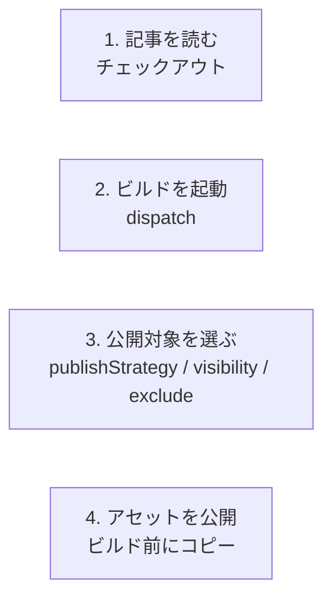

# コンテンツとサイトを分ける

記事（Markdown / [[glossary/obsidian-vault|Obsidian Vault]]）とサイト（コード、設定、[[glossary/theme|テーマ]]）を別の場所やリポジトリに置く方法を説明します。分けるべきかどうかの判断、構成の選び方、外部 Vault の読み込み、別リポジトリからの公開までを順に扱います。

GitHub Actions の具体的な構成、ルート解決、認証、アセットの詳細は [リポジトリ分離の詳細編](./deployment/separate-content-repository.ja.md) を参照してください。

## このページの構成

- [基本](./content-repositories/basics.ja.md)
- [セットアップ](./content-repositories/setup.ja.md)
- [公開とトラブルシューティング](./content-repositories/publishing.ja.md)

## まとめ

最初からリポジトリを分ける必要はありません。

```text
単純なサイト
  → サイトと content を1リポジトリ

既存の Vault を使う
  → 外部ディレクトリも選択肢

記事を非公開にする
  → 記事を別の Private リポジトリ

記事の push で自動 Deploy
  → repository dispatch
```

分ける場合は、次の4つを別々の責務として捉えます。



リポジトリを分けても、Riebeckite の公開判定は変わりません。リポジトリの境界、記事の読み込み、デプロイの起動、サイトへの公開は、それぞれ別の設定で決まります。

### 関連資料

- [リポジトリ分離の詳細編](./deployment/separate-content-repository.ja.md)：ルート解決、CI 認証、アセット、GitHub Actions、トラブル対応
- [Content の設定](../reference/configuration/content.ja.md)：`content.directory`、`exclude`、公開条件、`content.source`
- [Attachment ・ Media と公開](../reference/configuration/assets.ja.md)：3種類のアセットと公開方法
- [Configuration](../reference/configuration.ja.md)：`appRoot` / `configRoot` / `contentRoot`
- [Guides](./README.ja.md)：その他の利用ガイド
