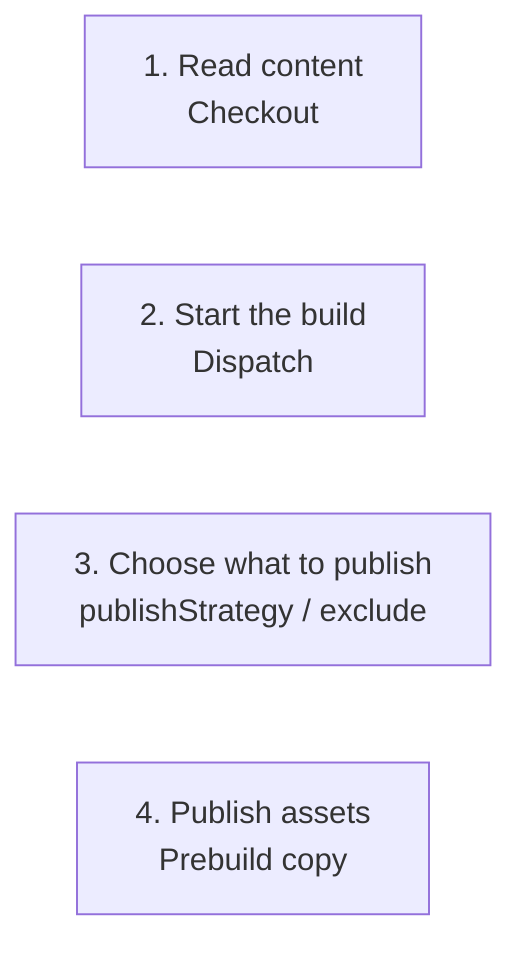

# Separating content from the site

For **keeping articles (Markdown / an Obsidian vault) separate from the site (code, configuration, themes)** — in different locations or different repositories — this guide explains why you might split them and what the resulting layout looks like. The step-by-step setup is in [Setup](./content-repositories/setup.md); the mechanics behind it (root resolution, CI auth, assets, troubleshooting) are in the [in-depth companion](./deployment/separate-content-repository.md).

## In this section

- [Basics](./content-repositories/basics.md)
- [Setup](./content-repositories/setup.md)
- [Publication and troubleshooting](./content-repositories/publishing.md)

## Which page to read

- Deciding whether and how to split → [Basics](./content-repositories/basics.md)
- Setting it up step by step → [Setup](./content-repositories/setup.md)
- Something is not publishing, or CI fails → [Publication and troubleshooting](./content-repositories/publishing.md)
- Click-by-click GitHub and Cloudflare walkthrough → [Separate Repositories Setup](../getting-started/separate-repositories-setup.md)
- The mechanics (root resolution, CI auth, assets) → [in-depth companion](./deployment/separate-content-repository.md)

## Terms

- **Content repository (vault)**: the repository or folder holding the Markdown articles and attachments.
- **Site repository**: the repository holding the Riebeckite app, configuration, theme, and deployment.

## Summary

You do not have to separate repositories from the start.

```text
simple site
  → site + content in one repository

existing vault
  → an external directory is also an option

keep articles private
  → put content in a separate private repository

auto-deploy on content push
  → repository dispatch
```

When you do split repositories, keep these four concerns apart:



Separating repositories does not itself change Riebeckite's publication decision.

**The repository boundary, reading content, starting a deploy, and publishing to the site are separate responsibilities.**

## Further reading

- [Separating content and the site (in depth)](./deployment/separate-content-repository.md) — the in-depth companion (root resolution, CI auth, assets, troubleshooting)
- [Configuration](../reference/configuration.md) — root resolution details
- [Usage Guide](./README.md) — external vault examples and assets
- Cloudflare deploy template — deployment workflow details
