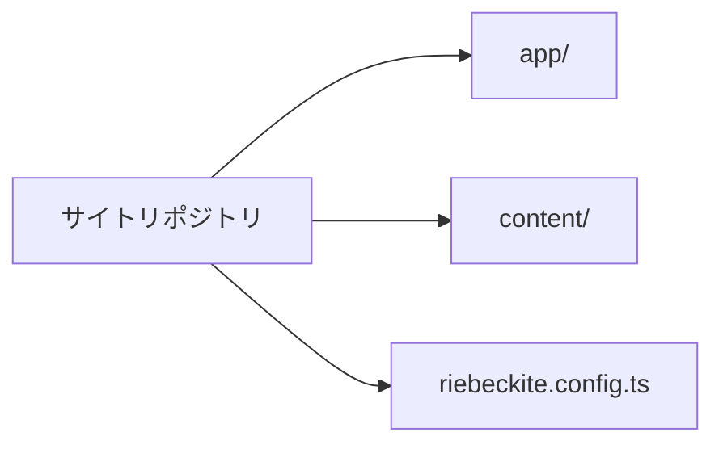
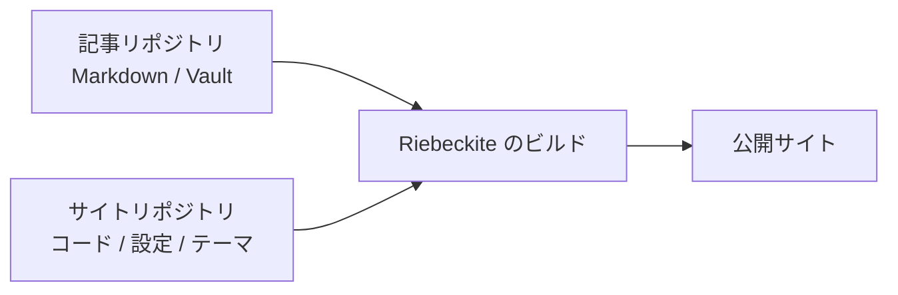
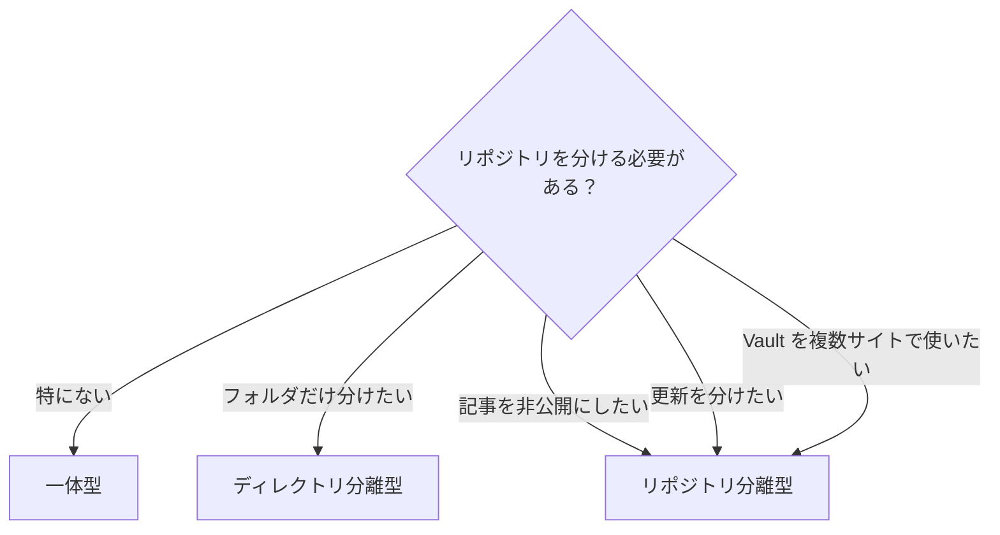

# 基本

## このガイドが向いている人

- Obsidian Vault とサイトのコードを別々に管理したい
- 記事は非公開のまま、サイトだけを公開したい
- 1つの Vault を複数のサイトで使いたい
- 記事の更新とサイトの更新を分けたい

小さな個人サイトを1つのリポジトリで管理するだけなら、分ける必要はありません。

## まずは1つのリポジトリで始める

`npx create-riebeckite my-site` で作ったサイトは、最初から次の構成です。

```text
site/
├─ content/
├─ app/
├─ riebeckite.config.ts
└─ package.json
```



別の Vault を使いたいなど、分ける理由が明確になるまでは、この構成で十分です。

分けた場合は、役割は次のようになります。

```text
site repository          content repository
├─ app/                  ├─ article-a.md
├─ riebeckite.config.ts  ├─ article-b.md
├─ package.json          ├─ attachments/
└─ ...                   └─ ...
```

| リポジトリ | 主な内容 |
| --- | --- |
| サイト | アプリケーション、設定、テーマ、[[glossary/plugin|プラグイン]]、デプロイ |
| 記事 | Markdown、Obsidian Vault、添付ファイル |



Riebeckite のビルドが両方を組み合わせ、最終的なサイトを生成します。

## 記事はサイトの外に置ける

`content.directory` はサイトのルート（`appRoot`）を基準に解決されます。`../vault` のような相対パスも、絶対パスも指定できます。相対パスのほうが他のマシンや CI でも同じように動くため、通常はおすすめです。

```text
workspace/
├─ vault/
│  ├─ article-a.md
│  └─ article-b.md
│
└─ site/
   ├─ app/
   ├─ riebeckite.config.ts
   └─ package.json
```

この場合、`site/riebeckite.config.ts` は次のように書けます。

```ts
export default defineConfig({
  content: {
    directory: "../vault",
  },
  // ...
});
```

記事をサイトのディレクトリへコピーする必要はありません。相対パスの基準は常にサイトのルートなので、CLI をサイト内の `app/` から実行しても、CI の作業ディレクトリから実行しても同じ Vault を読み込みます。

`content.source` で独自の読み込み元を指定した場合は、標準のファイルシステム読み込みが置き換わるため、`content.directory` は使いません。

何をどこに置くかの例を示します。

| 内容 | 置き場所 |
| --- | --- |
| 記事本文（`.md`） | Vault 内の任意のディレクトリ |
| 画像・添付ファイル | Vault の `attachments/` など |
| Obsidian の設定 | Vault の `.obsidian/` |
| サイトのコードと設定 | サイトリポジトリ |
| テーマ・プラグインの設定 | サイトリポジトリ |
| デプロイの設定 | サイトリポジトリ |
| 公開しないノート | Vault の `private/` など（`exclude` で除外） |

## 記事とサイトの分け方を選ぶ

記事とサイトをどの単位で分けるかを先に決めます。

| 構成 | レイアウト | 記事の[[glossary/visibility|公開範囲]] | 向いているケース |
| --- | --- | --- | --- |
| 一体型 | サイトと記事を同じリポジトリに置く（`content/`） | リポジトリと同じ | 個人ブログを1つのリポジトリで管理したい |
| ディレクトリ分離型 | `site/` と `vault/` を並べる | リポジトリと同じ | 履歴は共有しつつ、場所と設定を分けたい |
| リポジトリ分離型 | 記事とサイトを別々のリポジトリに置く | 記事とサイトで別々に設定できる | 記事を非公開にしたい、更新を分けたい |

選ぶときの目安は次のとおりです。

- 記事を公開したくない → リポジトリ分離型。リポジトリを非公開にしたまま、サイトだけを公開できます。ただし `publish: true` を付けた記事は公開サイトに載るため、公開判定は別に確認してください。
- 記事もサイトも公開してよい → 一体型またはディレクトリ分離型。管理するリポジトリは1つで済みます。
- 記事を更新したらサイトもデプロイしたい → リポジトリ分離型。記事の push でデプロイを起動するには、外部チェックアウトに加えて repository dispatch が必要です。
- 1つの Vault を複数のサイトで使いたい → リポジトリ分離型、または Vault を独立した場所に置き、各サイトから参照します。



以下はリポジトリ分離型の手順です。一体型とディレクトリ分離型では設定方法はほぼ同じで、外部リポジトリのチェックアウトと repository dispatch が不要になります。
