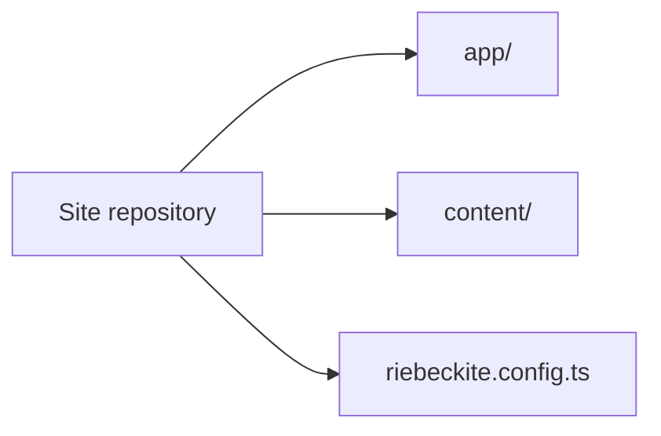
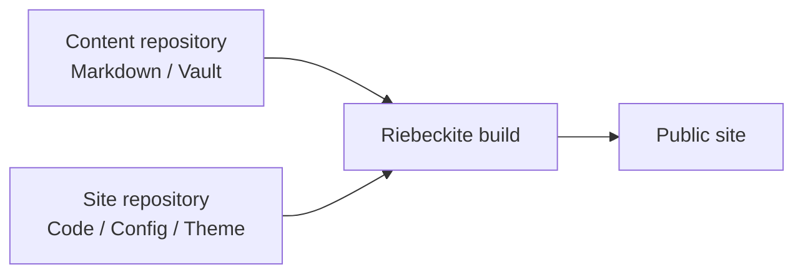
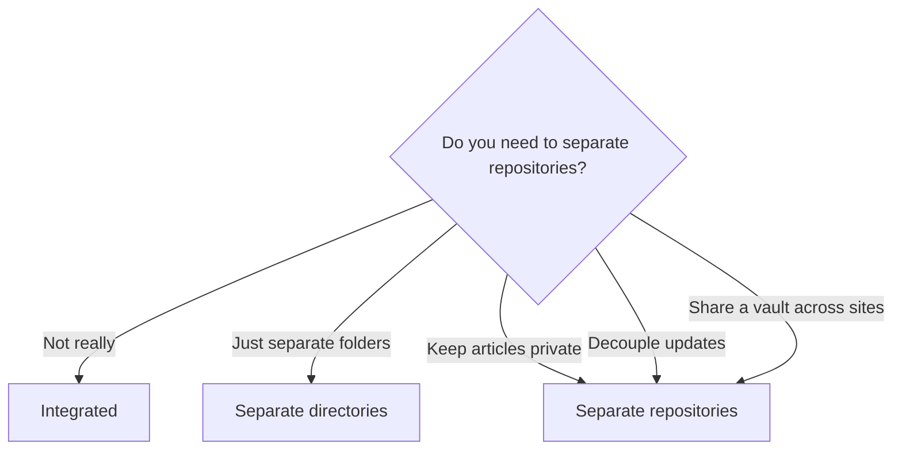

# Basics

## Who this guide is for

- You write notes in Obsidian and want them managed separately from the site code
- You want articles private and only the site public
- You want one vault shared by several sites
- You want article updates and site updates deployed independently

If all you want is a small personal blog in a single repository, there is no need to split anything. The integrated layout is enough.

## Start with one repository

The beginner setup keeps content and site code together:

```text
site repository
├─ content/
├─ app/
├─ riebeckite.config.ts
└─ package.json
```

This is what `npx create-riebeckite my-site` generates. Use it for your first site unless you already know you need a separate vault or repository.



When the split is useful, the shape becomes:

```text
site repository           content repository
├─ app/                  ├─ article-a.md
├─ riebeckite.config.ts  ├─ article-b.md
└─ ...                   └─ attachments/
```

The site repository owns the app, configuration, theme, plugins, and deployment. The content repository owns Markdown and attachments.



Riebeckite build combines both to produce the final site.

## The idea: articles can live outside the site

`content.directory` in `riebeckite.config.ts` is resolved against the site root (`appRoot`). It can be a relative path, including `../vault`, or an absolute path; relative paths are usually recommended because they behave the same on other machines and in CI. Articles do not have to live inside the site.

```ts
// site/riebeckite.config.ts
export default defineConfig({
  content: {
    directory: "../vault", // the vault folder one level above the site
  },
  // ...
});
```

The base for a relative path is always the site root. So the same vault is read whether you run the CLI from `app/` inside the site or from a CI working directory. If you replace the standard filesystem reader with a custom `content.source`, `content.directory` is not used. The precise definitions (appRoot / configRoot / contentRoot) are in [Configuration](../../reference/configuration.md), "Filesystem root and an external vault".

With this, you can split things like:

| What to separate | Where it goes (example) |
| --- | --- |
| Article bodies (`.md`) | Any folder inside the vault |
| Attachments and images | `attachments/` and similar inside the vault |
| Obsidian settings | `.obsidian/` inside the vault |
| Site code and configuration | `site/` |
| [[glossary/theme|Theme]] and plugin settings | The site repository |
| Deployment settings | The site repository |
| Notes you never publish | `private/` and similar inside the vault (excluded) |

## Choose a layout

First decide at what granularity to split articles from the site.

| Layout | Structure | Article visibility | Choose it when |
| --- | --- | --- | --- |
| Integrated | Site and articles in one Git repository (use `content/`) | Same visibility as the repository | You want a single repository for a personal blog |
| Separate directories | `site/` and `vault/` side by side in one repository | Same visibility as the repository | You share history but want locations and settings apart |
| Separate repositories | Site and articles in separate Git repositories | Independent for articles and site | You want articles private or updates decoupled |

How to decide:

- **You do not want articles public** → separate repositories. A private repository keeps the source repository private, but a note with `publish: true` is still published to the public site. Keep `publish: true` off private notes, and exclude private folders with `content.exclude`.
- **Articles and site are both fine to publish** → integrated or separate directories. One repository to manage.
- **You want article updates decoupled from the site deploy** → separate repositories. Add a repository-dispatch notification if an articles push must start a deploy; an extra checkout alone only supplies files to a deploy that already started.
- **You want one vault shared by several sites** → separate repositories, or a layout where the vault lives independently. Keep the vault in one place and have each site reference it read-only.



The steps below are for separate repositories. For the integrated and separate-directories layouts the configuration is the same; only **step 5 (fetching the articles repository in deployment) is unnecessary**.
