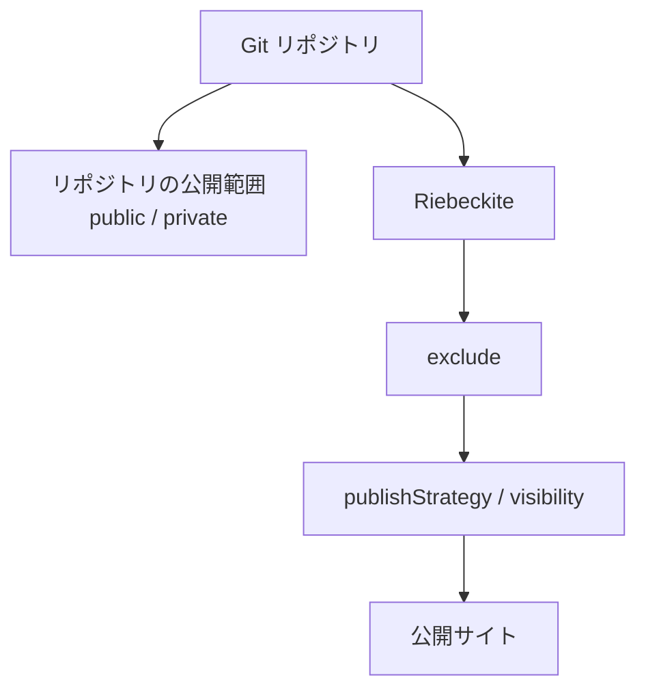
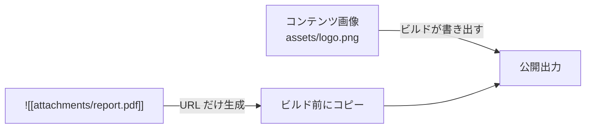
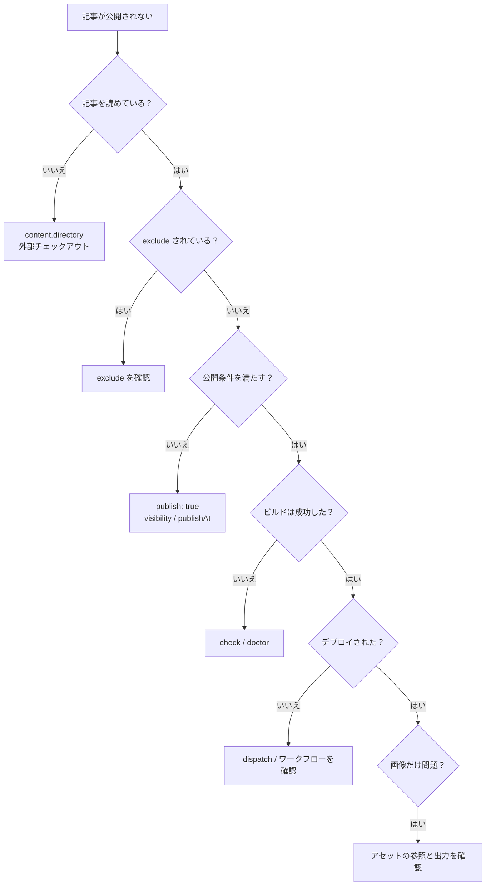

# 公開とトラブルシューティング

## 公開の境界を決める

記事とサイトを分けたら、何を公開し、何を公開しないかを明確にします。

### 公開はどう決まるか

`content.filters.publishStrategy` は、frontmatter で公開状態を指定していないノートの扱いを決めます。既定は `explicit` です。

| 戦略 | 公開される条件 | 向いている用途 |
| --- | --- | --- |
| `explicit`（既定・推奨） | `publish: true` があるノートだけ | 公開する記事を明示的に選ぶ |
| `selective` | `private: true` も `draft: true` もないノート | ほぼすべて公開し、例外だけ隠す |

frontmatter の `visibility` と `publishAt` は、`publishStrategy` より優先されます。

| frontmatter | 結果 |
| --- | --- |
| `visibility: public` | URL で表示でき、一覧や[[glossary/search|検索]]にも出る |
| `visibility: unlisted` | URL を直接開けば表示できるが、一覧や検索には出ない |
| `visibility: draft` | URL を直接開いても表示されず、一覧や検索にも出ない |
| `publishAt: 2026-01-01T00:00:00.000Z` | ビルド時刻がその日時より前なら非公開、それ以降のビルドで公開される |
| `visibility` / `publishAt` なし | `publishStrategy` に従う |

`visibility` や `publishAt` が不正な場合、推測せずにビルドを失敗させます。`publishAt` はビルド時刻だけで判定するため、Riebeckite が実行時にタイマーを起動することはありません。公開時刻を過ぎても記事が出ない場合は、次のビルドかデプロイを実行してください。

非公開の Vault で `explicit` を使うのが最も安全です。公開し忘れることはあっても、意図しないノートが公開される可能性は低くなります。

リポジトリの公開範囲と Riebeckite の公開判定は別です。



### 公開時に守るルール

- 非公開のノートに `publish: true` や `visibility: public` を付けない。非公開用のディレクトリは `content.exclude` で丸ごと除外する。
- `.obsidian/` を `exclude` に入れ、Obsidian の設定やワークスペースの状態をサイトに混ぜない。
- `Templates/**` などのテンプレート用ディレクトリを除外し、テンプレートが記事として公開されないようにする。
- `publishStrategy`、`visibility`、`publishAt` のどれで公開を決めているかを把握する。
- アセットは種類ごとに公開方法が違うことを意識する。

### アセットは種類ごとに公開方法が違う

Vault 内のアセットは3種類に分かれ、公開を担当する場所も異なります。

| 種類 | 対象 | 公開 URL | 公開する場所 |
| --- | --- | --- | --- |
| コンテンツ画像 | Vault 内の画像（png、jpg、svg など） | `/<Vault からの相対 logical path>` | Riebeckite のビルド |
| 添付ファイル / メディア | Markdown でも画像でもないファイル | `/assets/attachments/<Vault からの相対 logical path>` | サイト側の `prebuild` |
| 静的アセット | サイト自身が管理するファイル | `/` 配下 | Vite の `public/` |

コンテンツ画像は、公開ページから参照されているものだけがビルドの出力に含まれます。`public/` へ手動でコピーする必要はありません。

添付ファイルやメディアは URL が生成されるだけで、実ファイルは自動ではコピーされません。

```md
![[attachments/report.pdf]]
```

この参照が URL に変換されても、`report.pdf` が公開出力になければブラウザでは `404` になります。



公開する添付ファイルやメディアだけを `public/assets/attachments/` へコピーする `prebuild` 処理を、サイト側に用意してください。Vault 全体を `public/` へコピーすると、非公開記事や未参照のファイルまで公開される可能性があります。

参考になる実装は Riebeckite リポジトリ自身の `website/scripts/build_images.ts` にあります。生成されるサイトにはこのファイルは含まれないので、同等の `prebuild` スクリプトを自分で用意してください。アセットの種類と公開方法の詳細は [Attachment ・ Media と公開](../../reference/configuration/assets.ja.md) を参照してください。

## よくある質問

### サイト内の `content/` のまま、一部だけ非公開にできる？

できます。`content.directory` を既定の `content` のままにして、非公開ノートから `publish: true` を外し、必要に応じてディレクトリを `exclude` へ追加します。リポジトリを分けるのは Vault を物理的に別の場所へ置くための方法で、公開の制御は `publishStrategy`、`visibility`、`exclude` の役割です。

### Vault を移動したら記事が表示されなくなった

`content.directory` は相対パスなので、Vault を動かすとサイトルートからの距離が変わります。`inspect config` で解決済みの `Directory` を確認し、`../` の数を直してください。絶対パスも使えますが、開発端末と CI でずれやすいため、通常は相対パスが扱いやすくなります。

### 記事は表示されるのにアセットだけ `404` になる

まずアセットの種類を確認します。画像が `404` なら、公開ページから実際に参照されているかを見てください。コンテンツ画像は、公開ページからの参照があるものだけがビルドの出力に含まれます。

添付ファイルやメディアが `404` なら、`prebuild` のコピー処理を確認します。ビルドより前に実行され、`public/assets/attachments/` へコピーされる必要があります。

### CI でだけ Vault が見つからない

CI には、追加のチェックアウトかサブモジュールを設定しない限り Vault がありません。手順5の設定を確認し、相対パスの `directory` が CI 上の配置と一致しているかを見てください。たとえば CI で `content/` にチェックアウトするなら `directory: "content"`、`notes/` に置くなら `directory: "notes"` です。

### `publishAt` の時刻を過ぎたのに公開されない

`publishAt` はビルド時の時刻で判定します。時刻を過ぎた後にビルドとデプロイを実行してください。定期実行したい場合は、サイトのワークフローに `schedule` を追加します。

### Windows でも同じ設定を使える？

はい。`exclude` のパターンは `/` 区切りで書き、OS のパス区切りには依存しません。

## 原因を切り分ける

記事が公開されないときは、次の順番で確認すると原因を絞れます。



| 症状 | 確認すること |
| --- | --- |
| 記事が表示されない | `publish: true`、`visibility`、`publishAt`、`exclude`、`inspect content --list` |
| `Directory` が意図した Vault を指していない | `inspect config` と相対パスの `directory` |
| CI で Vault が見つからない | 追加のチェックアウトかサブモジュール |
| 記事を push してもデプロイされない | `notify-site.yml`、GitHub App の Secret（または `SITE_DISPATCH_TOKEN`）、`repository_dispatch` |
| プライベートの記事をチェックアウトできない | `RIEBECKITE_CONTENT_READ_TOKEN` |
| 画像が `404` になる | 公開ページからの参照とビルドの出力 |
| 添付ファイルやメディアが `404` になる | `prebuild` のコピー処理と `public/assets/attachments/` |
| ローカルと CI でパスが違う | CI の作業ディレクトリと、サイトルートを基準にした相対パス |
| サブモジュールの記事が更新されない | サイト側のサブモジュール参照 |
| `publishAt` を過ぎても公開されない | ビルドとデプロイの再実行、または `schedule` |

より詳しい調査方法は、[リポジトリ分離の詳細編](../deployment/separate-content-repository.ja.md) のトラブルシューティングを参照してください。
