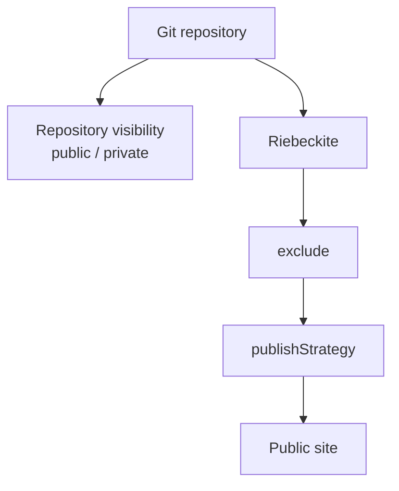
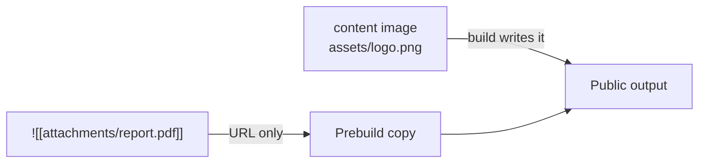
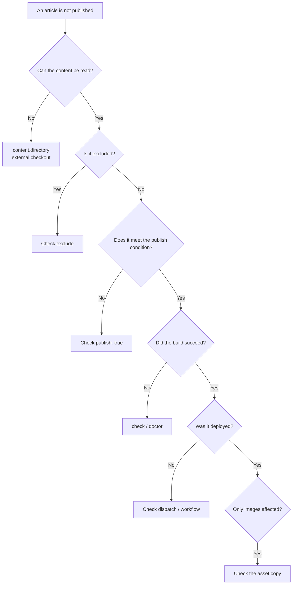

# Publication and troubleshooting

## Publication rules

When articles and the site are separate, be explicit about where the publication boundary lies.

### How publication is decided

`content.filters.publishStrategy` decides which notes are published when frontmatter does not set an explicit state. The default is `explicit`.

| Strategy | Published when | Choose it when |
| --- | --- | --- |
| `explicit` (default, recommended) | Only notes with `publish: true` | You want to opt articles in deliberately |
| `selective` | Notes without `private: true` or `draft: true` | You publish almost everything and hide only exceptions |

[[glossary/frontmatter|Frontmatter]] `visibility` and `publishAt` take precedence over the strategy.

| Frontmatter | Result |
| --- | --- |
| `visibility: public` | [[glossary/routable|Routable]] and discoverable |
| `visibility: unlisted` | Routable by direct URL, but excluded from discovery surfaces |
| `visibility: draft` | Not routable and not discoverable |
| `publishAt: 2026-01-01T00:00:00.000Z` | Hidden before the build time, public on the first build after that time |
| no `visibility` / `publishAt` | Falls back to `publishStrategy` |

Malformed `visibility` or `publishAt` values fail the build instead of being guessed. `publishAt` is evaluated against the build time only; Riebeckite does not start a runtime timer. If the time has passed and the article is still missing, run another build or deploy.

Using `explicit` with a private vault is the safest arrangement: you may forget to publish something, but you are unlikely to publish something by accident.

Repository visibility and Riebeckite's publication decision are separate concerns:



### Rules to follow

- **Never put `publish: true` or `visibility: public` on private notes**, and exclude whole private folders with `content.exclude`.
- **Put `.obsidian/` in `exclude`** so Obsidian settings and workspace state never mix into the site.
- **Exclude template folders** (`Templates/**` and the like) so note templates are not published as articles.
- **Know which asset kind you are copying.** Content images (png, jpg, svg, and similar) are published by the build as generated output, so they need no manual copy. Attachments and media (files that are neither Markdown nor images) get URLs but are not copied, so they need a prebuild step on the site side that copies only the files you publish (reference implementation: `website/scripts/build_images.ts` in the Riebeckite repository itself — a generated site does not include that file, so add an equivalent `prebuild` script that copies the attachments you publish into `public/assets/attachments/`). Static files owned by the site belong under `public/`; never copy the whole vault there. See the assets section of the [in-depth companion](../deployment/separate-content-repository.md) for how it works.

### Attachments and media

Assets inside the vault are published differently depending on their kind:

| Kind | Target | URL | Published by |
| --- | --- | --- | --- |
| Content image | Images in the vault (png, jpg, svg, and similar) | `/<logical path from the vault>` | The Riebeckite build |
| Attachment / media | Files that are neither Markdown nor images | `/assets/attachments/<logical path from the vault>` | A prebuild step on the site side |
| Static asset | Files owned by the site application | Under `/` | Vite's `public/` |

A content image reaches the build output only when a published page references it, so you never copy it into `public/` by hand. An attachment or media file, by contrast, gets a URL but no file:

```md
![[attachments/report.pdf]]
```

If `report.pdf` is not present in the public output, the browser gets a `404`.



Provide a prebuild step on the site side that copies only the attachments and media you publish.

## FAQ

**Can I keep articles in the site's `content/` and make only some notes private?**

Yes. Leave `content.directory` at the default `content`, remove `publish: true` from private notes, and add folders to `exclude` as needed. Repository separation is a way to place the vault physically elsewhere; publication control itself belongs to `publishStrategy` and `exclude`.

**Articles vanished after I moved the vault.**

`content.directory` is relative, so the distance from the site root changes when the vault moves. Check the resolved `Directory` with `inspect config` and fix the number of `../` levels. Absolute paths also work, but they drift between developer machines and CI, so relative paths are usually recommended.

**Articles render but assets 404.**

First identify the asset kind. If an image 404s, confirm a published page actually references it: content images reach the build output only through a reference from a published page. If an attachment or media file 404s, confirm the prebuild copy step runs before the build and targets `public/assets/attachments/`.

**CI alone says the vault was not found.**

CI does not have the vault unless you add the additional checkout or submodule. Check the step 5 setup and confirm the relative `directory` matches the CI layout (for example `notes`).

**Does this work the same on Windows?**

Yes. Write `exclude` patterns with `/` separators; they do not depend on the platform's path separator.

**`publishAt` has passed but the article is still missing.**

`publishAt` is evaluated at build time. Run a build and deploy after the scheduled time. To publish on a schedule without a manual run, add `schedule` to the site workflow.

## Isolating the problem

When something is not published, checking in this order narrows the cause quickly:



## Troubleshooting

| Symptom | Fix |
| --- | --- |
| Articles do not appear | Check `publish: true`, `exclude` patterns, and `inspect content --list` |
| `Directory` does not point at the intended vault | Check `inspect config` and revisit the relative `directory` |
| CI build cannot find the vault | Add the extra checkout or submodule support |
| Content push does not deploy | Check `notify-site.yml`, the GitHub App secrets (or `SITE_DISPATCH_TOKEN`), and `repository_dispatch` |
| Private content cannot be checked out | Check `RIEBECKITE_CONTENT_READ_TOKEN` |
| Images 404 after deploy | Confirm a published page references the image and that it is in the build output |
| Attachments or media 404 after deploy | Confirm the prebuild copy runs before the build and targets `public/assets/attachments/` |
| Works locally but the path differs in CI | Check the CI working directory and the base (site root). `../notes` vs `notes` is a common source of drift |
| `publishAt` has passed but the article is not published | Run another build and deploy, or add `schedule` to the site workflow |
| Submodule articles do not update | Update the `content` reference on the site side, commit, and push |

For deeper diagnosis, see the troubleshooting section of the [in-depth companion](../deployment/separate-content-repository.md).
