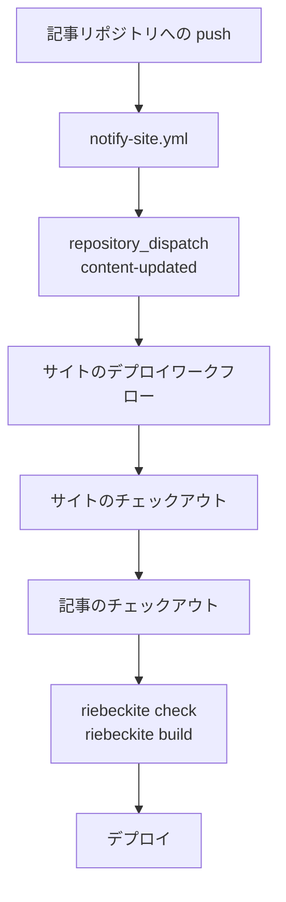
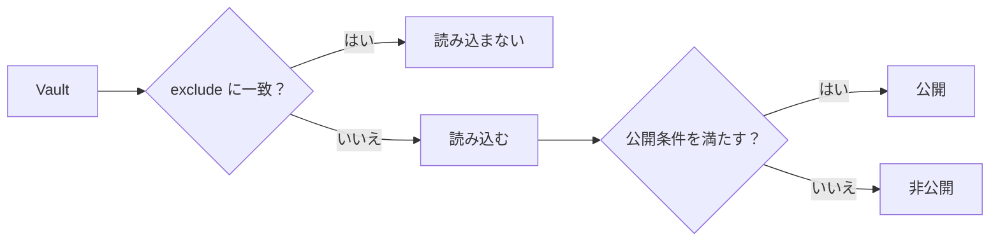
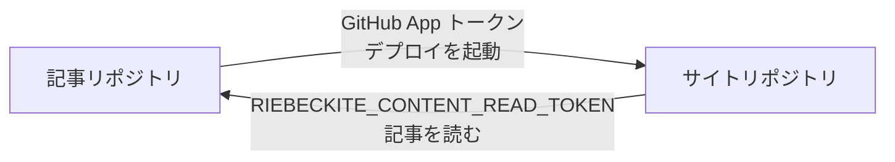

# セットアップ

## 別々のリポジトリで運用する手順

### デプロイが起動するまでの流れ

別々のリポジトリでは、CI が記事を読めることと、記事の更新でデプロイが起動することは別です。`--github-actions --content-repository <owner/repo> --site-repository <owner/repo>` で生成される構成は、次の順番でつながります。

1. 記事リポジトリの `main` に push する
2. 記事リポジトリの `notify-site.yml` が、サイトリポジトリへ `content-updated` を送る（GitHub App のトークン、または任意の `SITE_DISPATCH_TOKEN`）
3. サイトリポジトリのデプロイワークフローが `repository_dispatch` で起動する
4. サイトをチェックアウトし、記事リポジトリを `content/` へチェックアウトする（プライベートの場合は `RIEBECKITE_CONTENT_READ_TOKEN`）
5. `riebeckite check` → `riebeckite build` → Cloudflare Workers へデプロイ



外部チェックアウトは、サイトの CI が記事を読めるようにするだけです。GitHub Actions はワークフローがあるリポジトリのイベントしか拾わないため、別リポジトリの push だけではサイトのワークフローは起動しません。その橋渡しをするのが `notify-site.yml` です。

### 0. 用語を確認する

- Vault: 記事（`.md`）と添付ファイルを置くディレクトリ。Obsidian が開く単位です。
- `publish: true`: ノートを公開する印です。既定の `explicit` では、この印があるノートだけがサイトに出ます。
- `exclude`: サイトに読み込ませないパターンです。記事リポジトリにあっても、ビルドから外せます。

### 1. 記事リポジトリ（Vault）を作る

任意の場所にディレクトリを作り、Git リポジトリとして初期化します。Obsidian を使う場合は、このディレクトリを Vault として開きます。

```sh
mkdir notes
cd notes
git init
```

最初のノートを作ります。公開しないノートには `publish: true` を付けません。

```md
---
title: はじめまして
publish: true
---

最初のノートです。
```

OS の一時ファイルや Obsidian のワークスペースの状態を Git で管理したくない場合は、`.gitignore` に追加します。`.obsidian/` 自体をコミットしても構いません。サイト側で読み込み対象から外せます。

```gitignore
.DS_Store
Thumbs.db
.obsidian/workspace.json
.obsidian/workspace-mobile.json
```

GitHub にプライベートリポジトリを作り、push します。記事は非公開のままです。

```sh
git add .
git commit -m "最初のノート"
# GitHub で Private リポジトリを作成したあと
git remote add origin git@github.com:<you>/notes.git
git push -u origin main
```

### 2. サイトを生成する

GitHub Actions のデプロイ設定込みでサイトを生成します。[[glossary/preset|プリセット]]を変えてもこの構成は同じで、変わるのはスターターサイトだけです。

```sh
npx create-riebeckite my-site --github-actions \
  --content-repository <you>/notes \
  --site-repository <you>/my-site
cd my-site
npm install
```

対話式の CLI では、コンテンツの置き場所に `Separate GitHub repository` を選び、Content repository と Site repository を入力します。

生成されるデプロイワークフローは、記事リポジトリをサイトの `content/` へチェックアウトします。`--content-repository` を指定した場合は、`content-updated` の dispatch を受け取る設定と `github/notify-site.yml` も生成されます。既定の `starter` で問題ありませんが、`--preset` でスターターを変更できます。

サイト側の `content/` にスターターのファイルが残っている場合があります。これはローカル確認用のサンプルとして扱い、日常の記事は記事リポジトリで編集してください。

ローカルでは、次のように隣接するディレクトリへ置くと扱いやすくなります。

```text
workspace/
├─ notes/     ← 手順1で作った Vault
└─ my-site/   ← 手順2で作ったサイト
```

ただし CI は、サイトのチェックアウト内にある `content/` へ記事リポジトリをチェックアウトします。生成された設定は CI に合わせて `content.directory: "content"` なので、ローカルでも `my-site/content` に Vault を配置すれば同じ設定のまま確認できます。

`content.directory` を `../notes` に変える場合は、CI のチェックアウト先も同じ相対位置になるようワークフローを調整してください。設定だけを変えると、ローカルでは読めても CI では Vault が見つからなくなります。

### 3. `content.directory` を Vault に向ける

`my-site/riebeckite.config.ts` で、読み込むディレクトリと除外パターンを指定します。

```ts
export default defineConfig({
  // ...
  content: {
    directory: "content",
    exclude: [".obsidian/**", "Templates/**", "private/**"],
  },
  // ...
});
```

- `directory: "content"` は、デプロイワークフローが記事をチェックアウトする場所に合わせています。
- `exclude` には、公開しないもの、コンテンツとして読み込ませたくないものを指定します。Obsidian の設定（`.obsidian/**`）、テンプレート（`Templates/**`）、非公開ノートのディレクトリ（`private/**`）が典型です。

`exclude` は読み込み自体を止め、`publish: true` などの公開条件は読み込んだノートの扱いを決めます。両方を組み合わせると、公開の境界を二重に設定できます。



### 4. 読み込みを確認する

表示を確認する前に、CLI で読み込み状態を確認します。

```sh
npm exec riebeckite check
npm exec riebeckite doctor
npm exec riebeckite inspect config
npm exec -- riebeckite inspect content --list
```

- `check` は設定とプラグインの契約を検証します。
- `doctor` は設定、プラグイン、コンテンツ、[[glossary/build-state|ビルド状態]]、環境を診断します。
- `inspect config` は解決済みの設定を表示します。コンテンツの `Source`、`Directory`、`Exclude`、`Publishing` を確認でき、`Directory` には絶対パスが表示されます。意図した Vault を指しているか確認してください。
- `inspect content --list` は読み込んだノートを `PATH`、`ID`、`ID SOURCE`、`PERMALINK` の列で一覧表示します。`exclude` に一致したファイルは `EXCLUDED PATH` と `PATTERN` の表に出ます。

`inspect content` だけを実行すると、[[glossary/content-source|コンテンツソース]]の種類、読み込み件数、除外件数、拡張子ごとの件数が分かります。

記事が見つからない場合は、相対パスの `directory` を確認してください。読み込まれているのに表示されない場合は、`publish: true`、`visibility`、`publishAt` を確認してください。

### 5. チェックアウト・起動条件・シークレットを設定する

生成されたデプロイワークフローは、サイトの push、手動実行（`workflow_dispatch`）、`content-updated` の repository dispatch で起動します。記事リポジトリのチェックアウトはワークフローに含まれていますが、別リポジトリの push を監視しているわけではありません。

生成された `github/notify-site.yml` を、記事リポジトリの `.github/workflows/notify-site.yml` へコピーします。記事リポジトリの `main` に push すると、サイトリポジトリへ `content-updated` を送ります。

推奨は GitHub App です。自分のアカウント所有の App を作成し、Webhook を無効にし、**Contents: read and write** と **Metadata: read-only** を付与して、サイトリポジトリだけにインストールします。**記事リポジトリ**に Secret `RIEBECKITE_APP_ID` と `RIEBECKITE_APP_PRIVATE_KEY`（PEM の秘密鍵）を登録します。ワークフローは `actions/create-github-app-token` で短期のインストールトークンを発行し、`createDispatchEvent` を呼びます。長期トークンは保存しません。

GitHub App を作れない場合は、記事リポジトリに `SITE_DISPATCH_TOKEN` を設定します。サイトリポジトリだけに権限を絞った Fine-grained PAT なら **Contents: read and write**、Classic PAT なら `repo` スコープが必要です。

```yaml
repository_dispatch:
  types: [content-updated]
```

プライベートまたは内部の記事リポジトリを使う場合は、サイトリポジトリに `RIEBECKITE_CONTENT_READ_TOKEN` を登録します。Fine-grained PAT なら記事リポジトリだけに絞って **Contents: read** を付与します。公開の記事リポジトリなら、このシークレットは不要です。サイトリポジトリの `GITHUB_TOKEN` では、別のプライベート / 内部リポジトリを読めません。

デプロイ先の Cloudflare Workers 用に、サイトリポジトリへ Secret `CLOUDFLARE_API_TOKEN` と Variable `CLOUDFLARE_ACCOUNT_ID` も登録します。

チェックアウトではコミットを固定しないため、dispatch のたびに記事リポジトリの既定ブランチの最新コミットを読みます。

デプロイの起動方法はほかにもあります。

| 方法 | 記事の push でデプロイされるか | 設定 |
| --- | --- | --- |
| 同じリポジトリ | される | `content/` を使い、サイトの `push` で起動する |
| 別リポジトリ + dispatch | される | 外部チェックアウトと、上記の通知ワークフローを設定する |
| 別リポジトリ + schedule | 遅れて反映 | サイトのワークフローに `schedule` を追加する。dispatch 用トークンは不要 |
| 手動実行 | されない | Actions 画面から `workflow_dispatch` を実行する |
| Git サブモジュール | されない | サイト側のサブモジュール参照を更新して push する |

### 2つのトークンは役割が逆

名前は似ていますが、使う向きが逆です。

| シークレット / 変数 | 置く場所 | 目的 |
| --- | --- | --- |
| `RIEBECKITE_APP_ID` / `RIEBECKITE_APP_PRIVATE_KEY` | 記事リポジトリ | GitHub App の短期トークンでサイトのワークフローを起動する |
| `SITE_DISPATCH_TOKEN` | 記事リポジトリ | GitHub App を使わない場合のフォールバック |
| `RIEBECKITE_CONTENT_READ_TOKEN` | サイトリポジトリ | プライベートの記事をチェックアウトする |



### サブモジュールで記事リポジトリを参照する

記事リポジトリをサブモジュールにすることもできます。

```sh
git submodule add git@github.com:<you>/notes.git content
```

`content` は記事リポジトリを指すリンクになります。CI で取得するには、ワークフローの `actions/checkout@v4` に `submodules: recursive` を追加します。

記事を更新しただけでは、サイト側のサブモジュール参照は変わりません。サイト側でも参照を更新してコミットし、push する必要があります。

```sh
cd my-site
cd content && git pull && cd ..
git add content
git commit -m "記事を更新"
git push
```

記事の push だけで自動デプロイしたい場合は、repository dispatch の方が向いています。

### 6. 日々の運用

設定が済んだら、記事は通常どおり編集して push します。

```sh
cd notes
# Obsidian などで編集
git add .
git commit -m "記事を追加"
git push
```

記事リポジトリのワークフローがサイトのワークフローを dispatch し、サイトは最新の記事をチェックアウトして再ビルドし、デプロイします。dispatch 用のシークレットがなければ、値を表示せずに失敗します。トークンの権限不足、記事の取得失敗、ビルドの失敗、Cloudflare へのデプロイ失敗は、それぞれのステップで失敗します。

サイト側の変更はサイトリポジトリで行います。

ローカルで確認するときは、サイトのディレクトリでコマンドを実行します。

```sh
cd my-site
npm run dev      # ローカルプレビュー
npm run check    # 設定の検証
npm run doctor   # 読み込みの問題を診断
```
