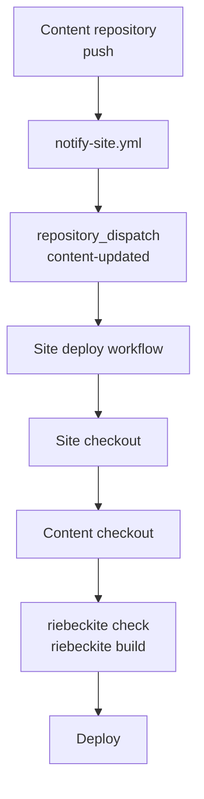
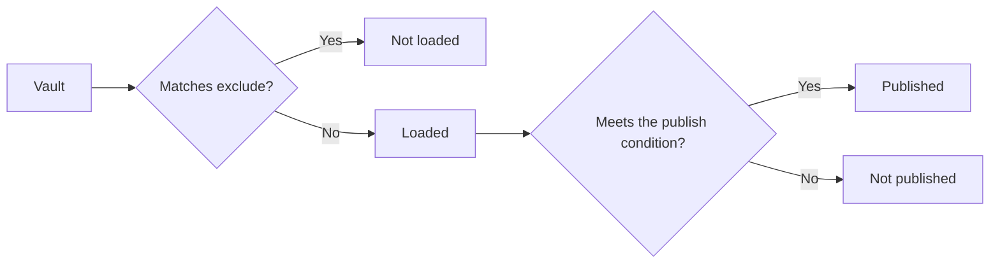
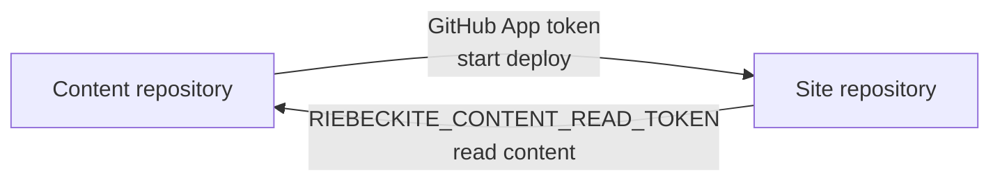

# Setup

## Steps: separate repositories (pattern C)

### How deployment is triggered (the whole flow)

With separate repositories, letting CI **read** the articles and **starting** the deployment are two different things. The setup generated by `--github-actions --content-repository <owner/repo> --site-repository <owner/repo>` connects them in this order:

1. You push to `main` in the articles repository.
2. The articles repository's `notify-site.yml` sends `content-updated` to the site repository (GitHub App token, or the optional `SITE_DISPATCH_TOKEN`).
3. The site repository's deploy workflow starts via `repository_dispatch`.
4. The workflow checks out the site, then checks out the articles repository into `content/` (with `RIEBECKITE_CONTENT_READ_TOKEN` when private).
5. `riebeckite check` → `riebeckite build` → deploy to Cloudflare Workers.



Steps 2 and 3 are the point. The extra checkout only makes the articles **readable**; it does not make the site workflow observe pushes to the articles repository. GitHub Actions only picks up events in the repository that contains the workflow, so a push to another repository is connected by this notification (repository dispatch).

### 0. Align on terms

- **Vault**: the folder holding articles (`.md`) and attachments; the unit Obsidian opens.
- **`publish: true`**: marks a note as published. Under the explicit strategy, only marked notes reach the site.
- **`exclude`**: patterns the site does not read. A file may be in the articles repository and still be kept out of the build.

### 1. Create the articles repository (the vault)

Create a folder anywhere and initialize it as a Git repository. If you use Obsidian, open this folder as a vault.

```sh
mkdir notes
cd notes
git init
```

Add a first note. Leave `publish: true` off notes you want to keep private.

```md
---
title: Hello
publish: true
---

My first note.
```

If you do not want to track OS temp files or Obsidian workspace state, add a `.gitignore`. Committing `.obsidian/` itself is fine (the site side excludes it from reading later).

```gitignore
.DS_Store
Thumbs.db
.obsidian/workspace.json
.obsidian/workspace-mobile.json
```

Push to a **private** GitHub repository and the articles stay unpublished.

```sh
git add .
git commit -m "first note"
# After creating a private repository on GitHub:
git remote add origin git@github.com:<you>/notes.git
git push -u origin main
```

### 2. Generate the site

Generate the site with the common GitHub Actions deployment assets. This works with every preset; a preset changes only the starter site. In the interactive CLI the same setup is choosing `Separate GitHub repository` and entering the content and site repository values; the GitHub Actions deployment is then configured automatically.

```sh
npx create-riebeckite my-site --github-actions \
  --content-repository <you>/notes \
  --site-repository <you>/my-site
cd my-site
npm install
```

The generated deployment checks out the vault into the site's `content/` directory. Because `--content-repository` is present, it also generates the `content-updated` dispatch receiver and `github/notify-site.yml`. `create-riebeckite` accepts `--preset` to choose a starter; the default `starter` is fine to begin with. The site repository may still contain starter files under `content/`; use them only as local examples. In day-to-day work, edit and push the content repository.

```text
workspace/
├─ notes/     ← the articles from step 1 (the vault)
└─ my-site/   ← the site from step 2
```

This side-by-side layout is useful locally, but CI checks out the content repository into `content/` inside the site checkout. The generated config uses `content.directory: "content"`, so placing the vault at `my-site/content` lets you preview with the same setting. If you change `content.directory` to `../notes`, adjust the workflow checkout path too; changing only the config makes local preview work but leaves CI unable to find the vault.

### 3. Point content.directory at the vault

In `my-site/riebeckite.config.ts`:

```ts
// my-site/riebeckite.config.ts
export default defineConfig({
  // ...
  content: {
    directory: "content",
    exclude: [".obsidian/**", "Templates/**", "private/**"],
  },
  // ...
});
```

- `directory: "content"` matches the path used by the deployment workflow.
- `exclude` holds things you never publish: Obsidian settings (`.obsidian/**`), templates (`Templates/**`), and a private-notes folder (`private/**`).

`exclude` keeps things from being loaded; `publish: true` marks things to publish. Using both gives you two layers of protection (see [Publication rules](./publishing.md#publication-rules)).



### 4. Verify loading

Before checking the rendered site, verify loading with the CLI.

```sh
npm exec riebeckite check
npm exec riebeckite doctor
npm exec riebeckite inspect config
npm exec -- riebeckite inspect content --list
```

- `check` validates the configuration and plugin contracts.
- `doctor` diagnoses configuration, plugins, content, build state, and the environment.
- `inspect config` prints the resolved content `Source`, `Directory`, `Exclude`, and `Publishing` (the resolved strategy). `Directory` is absolute; confirm it points at the intended vault.
- `inspect content --list` lists every loaded note with `PATH`, `ID`, `ID SOURCE`, and `PERMALINK`. Files matched by `exclude` appear in the `EXCLUDED PATH` / `PATTERN` table. Use it to confirm how `exclude` is taking effect and whether you are loading starter content or the real content repository.

Running `inspect content` without `--list` shows the content source type, entry count, excluded count, and per-extension counts.

A wrong path is usually the relative `directory`. If articles do not appear, check for `publish: true` (the explicit strategy), `visibility`, and `publishAt`.

### 5. Set up checkout, trigger, and secrets

The generated deploy workflow checks out the site and then the configured content repository into `content/`. It runs for a site push, manual dispatch, or `content-updated` repository dispatch. The generated notification workflow supplies the cross-repository trigger; the content checkout itself does **not** observe pushes in another repository.

Copy the generated `github/notify-site.yml` into the content repository as `.github/workflows/notify-site.yml`. Its `main` push sends `content-updated` to the site.

The preferred authentication is a GitHub App. Create an App owned by your account, disable its webhook, grant **Contents: read and write** and **Metadata: read-only**, and install it only on the site repository. In the **content repository**, add the secrets `RIEBECKITE_APP_ID` and `RIEBECKITE_APP_PRIVATE_KEY` (the PEM private key). The workflow mints a short-lived installation token with `actions/create-github-app-token` and calls `createDispatchEvent`; no long-lived token is stored.

If you cannot create a GitHub App, set `SITE_DISPATCH_TOKEN` in the content repository instead. A fine-grained PAT restricted to the site repository needs **Contents: read and write**; a classic PAT needs the `repo` scope.

For a click-by-click walkthrough, see [Separate Repositories Setup](../../getting-started/separate-repositories-setup.md).

```yaml
repository_dispatch:
  types: [content-updated]
```

For a private or internal content repository, store `RIEBECKITE_CONTENT_READ_TOKEN` in the **site** repository. Restrict its fine-grained PAT or GitHub App token to the content repository with **Contents: read**. A public content repository needs no extra checkout token. The site repository's `GITHUB_TOKEN` cannot read a different private/internal repository. The unpinned checkout intentionally reads the content default branch's newest tip for each dispatch. The site repository also needs `CLOUDFLARE_API_TOKEN` as a secret and `CLOUDFLARE_ACCOUNT_ID` as an Actions variable for the deploy step.

| Deployment choice | Article push deploys | Setup |
| --- | --- | --- |
| Same repository | Yes | Keep `content/`; site `push` starts the workflow. |
| Separate repositories + dispatch | Yes | External checkout plus the content notification workflow above. |
| Separate repositories + schedule | Delayed | Add `schedule` to the site workflow; no dispatch token. |
| Manual dispatch | No | Run `workflow_dispatch` in the Actions tab. |
| Git submodule | No | Update the site-side submodule reference and push it. |

### Do not confuse the two tokens

The two tokens have similar names but opposite roles.

| Secret | Where it lives | Purpose |
| --- | --- | --- |
| Content repository | Start the site workflow |
| `RIEBECKITE_APP_ID` / `RIEBECKITE_APP_PRIVATE_KEY` | Content repository | Start the site workflow with a short-lived GitHub App token |
| `RIEBECKITE_CONTENT_READ_TOKEN` | Site repository | Check out private content |



Keeping this relationship in mind makes CI problems easier to isolate.

**Submodule alternative**

```sh
git submodule add git@github.com:<you>/notes.git content
```

`content` becomes a link to the articles repository. Add `submodules: recursive` to `actions/checkout@v4` in the workflow so CI fetches the dependency. After updating articles, you must update the submodule reference on the site side and push (a two-step operation).

With either option, run `riebeckite build` from the site directory. That is why the workflow runs the lockfile-aware install → `npm exec riebeckite check` → `npm exec riebeckite build`.

### 6. Day-to-day operation

Once configured, you mostly just write and push.

**Updating articles (repository dispatch)**

```sh
cd notes
# edit in Obsidian
git add .
git commit -m "add an article"
git push
```

The content workflow dispatches the site workflow, which checks out the latest default-branch content, rebuilds, and deploys. A missing dispatch secret fails without printing its value; wrong token access, inaccessible content, build, and Cloudflare errors fail at their respective steps. Site-side changes live in the other repository: edit `my-site` and push as usual.

**Updating articles (submodule alternative)**

```sh
cd my-site
cd content && git pull && cd ..
git add content
git commit -m "update articles"
git push
```

**Checking locally**

```sh
cd my-site
npm run dev      # local preview
npm run check    # validate configuration
npm run doctor   # diagnose loading problems
```
