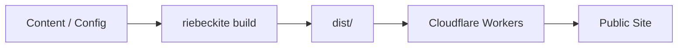
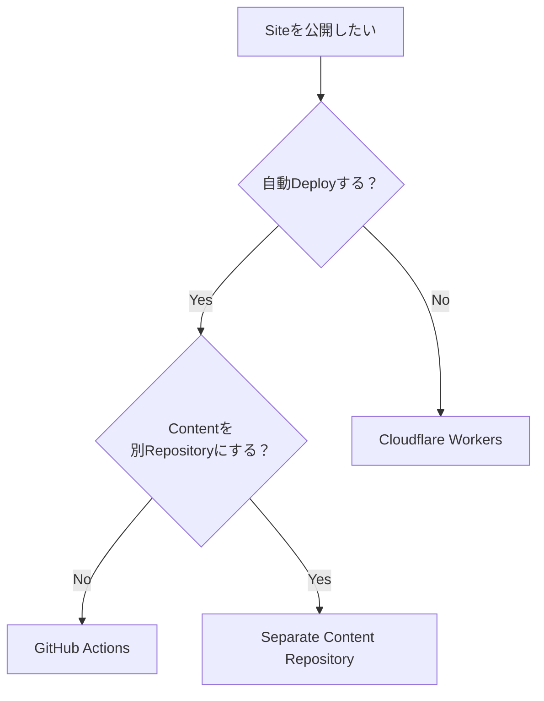

# デプロイガイド

Riebeckite で作成したサイトを Cloudflare Workers へ公開するためのガイドです。

基本的な流れは次のとおりです。



```sh
npm exec riebeckite build
```

を実行すると、公開用のサイトが `dist/` に生成されます。

通常の静的サイトでは、この `dist/` を Cloudflare Workers の Static Assets として配信します。

## どのガイドを読めばいい？

| やりたいこと | ガイド |
| --- | --- |
| 手元から Cloudflare Workers へ公開したい | [Cloudflare Workers](./cloudflare-workers.ja.md) |
| GitHub への Push から自動公開したい | [GitHub Actions](./github-actions.ja.md) |
| コンテンツとサイトを別リポジトリで運用したい | [コンテンツとサイトを分ける](./separate-content-repository.ja.md) |

初めて公開する場合は、まず [Cloudflare Workers](./cloudflare-workers.ja.md) を読むのがおすすめです。`create-riebeckite` で `Cloudflare Workers` を選ぶと Wrangler の依存と `wrangler.jsonc` が生成され、`npm exec riebeckite deploy` で手元から公開できます。`deploy` はビルドを行わないため、先に `npm exec riebeckite build` で `dist/` を作ります。すでに手元から公開しているサイトは、`npm exec riebeckite deploy setup` で GitHub Actions の継続デプロイを準備できます。



## ビルドとデプロイ

Riebeckite では、ビルドとデプロイは別の処理です。

```text
Build
  → Contentや設定から dist/ を生成する

Deploy
  → dist/ をCloudflare Workersから配信する
```

公開対象は `dist/` です。

`.riebeckite/` やプラグインのキャッシュはビルド時に利用する状態であり、公開アセットではありません。

```text
dist/
  → 公開する

.riebeckite/
Plugin Cache
  → 公開しない
```

通常の静的サイトでは Runtime の `main` も必要ありません。Riebeckite のビルド処理を Workers 上で実行するのではなく、ビルド済みの `dist/` を配信します。

## 公開前の確認

デプロイ前には、次の順で確認できます。

```sh
npm exec riebeckite check
npm exec riebeckite doctor
npm exec riebeckite build
```

`build` が成功したら、生成された `dist/` をデプロイします。

## デプロイガイド

### Cloudflare Workers

[Cloudflare Workers](./cloudflare-workers.ja.md)

`dist/` を Cloudflare Workers へ手元から公開する方法を説明します。`npm exec riebeckite deploy` がログインと `wrangler.jsonc` の生成を行います。

### GitHub Actions

[GitHub Actions](./github-actions.ja.md)

サイトリポジトリへの Push から、ビルドと Cloudflare Workers へのデプロイを自動化します。

### コンテンツとサイトを分ける

[コンテンツとサイトを分ける](./separate-content-repository.ja.md)

Obsidian Vault などのコンテンツとサイトを別リポジトリで管理する方法を説明します。

プライベートなコンテンツリポジトリの認証や、コンテンツ更新からサイトのデプロイを起動する方法もこちらで扱います。

## まとめ

Riebeckite のデプロイは、

```text
Content
  ↓
riebeckite build
  ↓
dist/
  ↓
Cloudflare Workers
```

と考えれば十分です。

- 手動で公開する → [Cloudflare Workers](./cloudflare-workers.ja.md)
- Push から自動公開する → [GitHub Actions](./github-actions.ja.md)
- コンテンツリポジトリを分ける → [コンテンツとサイトを分ける](./separate-content-repository.ja.md)
