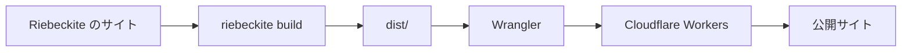

# Cloudflare Workers へのデプロイ

このガイドでは、Riebeckite で作ったサイトを **Cloudflare Workers に公開する手順**を説明します。まずは手元から直接デプロイする方法を扱います。

全体の流れは次のとおりです。



Riebeckite の通常の静的サイトでは、ビルドで生成された `dist/` を Cloudflare Workers の Static Assets として公開します。

## このページの構成

- [セットアップ](./cloudflare-workers/setup.ja.md)
- [運用](./cloudflare-workers/operations.ja.md)

## よくある問題

### `dist/` がない

先に次のコマンドを実行してください。

```sh
npm exec riebeckite build
```

Cloudflare Workers に公開する Static Assets は `dist/` に生成されます。

### サイトを更新したのに公開内容が古い

変更後に、もう一度次のコマンドを実行します。コンテンツが変わっていれば `publish run` がビルドします。計画はコンテンツ、リダイレクト、生成出力を追跡するため、設定だけの変更が検出されない場合があり、`--force` を付けるとデプロイされます。

```sh
npm exec riebeckite build
npm exec -- riebeckite publish run --execute --force
```

### 公開後の URL が正しくない

`riebeckite.config.ts` の次の設定が、実際の公開 URL と一致しているか確認します。

```ts
site: {
  baseUrl: "...",
},
```

変更した場合は、再度ビルドし、`--force` を付けてデプロイしてください。

### Riebeckite のビルドが失敗する

次のコマンドで、Riebeckite 側の設定やコンテンツを確認します。

```sh
npm exec riebeckite check
npm exec riebeckite doctor
```

### Wrangler で失敗する

Riebeckite の `build` が成功しているなら、次のコマンドで Wrangler 側の設定を確認します。

```sh
npx wrangler deploy --dry-run
```

`wrangler.jsonc` の `name` と、次の `assets` の設定も確認してください。

```jsonc
"assets": {
  "directory": "./dist"
}
```

## まとめ

Riebeckite のサイトを Cloudflare Workers へ公開する最小手順は、次のとおりです。

```sh
npm exec riebeckite build

npm exec -- riebeckite publish run --execute
```

`create-riebeckite` で `Cloudflare Workers` を選んだサイトには Wrangler が含まれているため、`npm install -D wrangler` は不要です。`Not now` で生成した既存のサイトでは、先に `npm install -D wrangler` を実行し、検出できる Wrangler 設定がないため `publish run` に `--provider cloudflare-workers` を追加してください。

最初のデプロイで公開 URL がわかったら、次の流れで設定を反映します。

```text
riebeckite.config.ts
      ↓
site.baseUrl を設定
      ↓
再ビルド
      ↓
再デプロイ
```

役割を整理すると、次のとおりです。

```text
riebeckite build
  → dist/ を作る

wrangler dev
  → Cloudflare での配信を手元で確認する

riebeckite publish run --execute
  → dist/ を Cloudflare Workers へ公開する
```

自動デプロイが必要になったら、手動デプロイの仕組みを変えるのではなく、この一連の処理を [GitHub Actions](./github-actions.ja.md) から実行する形に移行します。

## 次に読むもの

- [サイト公開までの最短ガイド](../../getting-started/deployment.ja.md)：初回公開までの最短手順
- [GitHub Actions](./github-actions.ja.md)：GitHub へのプッシュから自動デプロイする
- [コンテンツリポジトリの分離](./separate-content-repository.ja.md)：コンテンツとサイトを別リポジトリで運用する
- [使い方ガイド](../README.ja.md)
- [CLI](../../reference/cli.ja.md)：`build`、`check`、`doctor` などのコマンド
