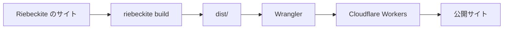
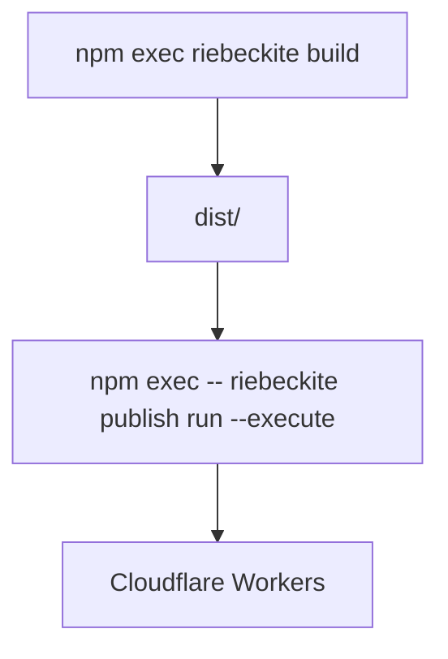
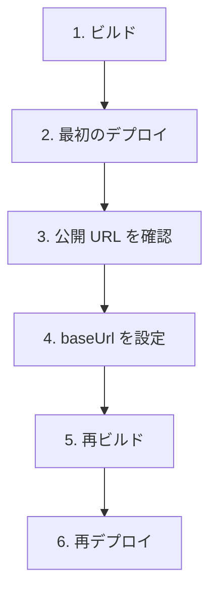
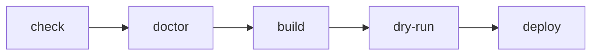
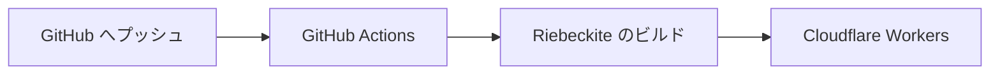
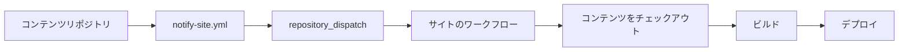

# Cloudflare Workers へのデプロイ

このガイドでは、Riebeckite で作ったサイトを **Cloudflare Workers に公開する手順**を説明します。まずは手元から直接デプロイする方法を扱います。

全体の流れは次のとおりです。



Riebeckite の通常の静的サイトでは、ビルドで生成された `dist/` を Cloudflare Workers の Static Assets として公開します。

## 前提

サイトのディレクトリで、次のコマンドが成功することを確認してください。

```sh
npm install
npm exec riebeckite build
```

ビルドに成功すると `dist/` が生成されます。

```text
my-site/
├─ app/
├─ content/
├─ dist/               ← 公開する
├─ riebeckite.config.ts
└─ package.json
```

Cloudflare Workers に公開するのは、この `dist/` の中身です。`.riebeckite/` やプラグインのキャッシュなど、ビルド時の状態は公開されません。

増分処理は、`riebeckite build` を実行するローカル環境または GitHub Actions のランナー上で行われます。Wrangler は新しく生成された `dist/` を Workers Static Assets としてアップロードするだけで、Workers 自体が増分ビルドを行うわけではありません。生成される GitHub Actions ワークフローは、このビルドのために `.riebeckite/cache` と `.riebeckite/build/content-state.json` を永続化します。`dist/` は永続化しません。

## 1. Cloudflare アカウントを作成する

まだアカウントを持っていない場合は、[Cloudflare](https://www.cloudflare.com/) で作成します。無料プランで始められます。

アカウントを作成したら、次に Cloudflare Workers へデプロイするための Wrangler を用意します。

## 2. Wrangler を用意する

`create-riebeckite` で `Cloudflare Workers` を選んだサイトには、Wrangler の依存関係と `wrangler.jsonc` がすでに含まれています。追加のインストールや設定は不要です。

`Not now` で生成したサイトや、手動で用意する場合は、サイトのディレクトリで次を実行します。

```sh
npm install -D wrangler
```

Wrangler は Cloudflare Workers の開発とデプロイに使う公式 CLI です。インストールすると `npx wrangler` で実行できます。

## 3. `wrangler.jsonc` を用意する

Cloudflare Workers に何をデプロイするかは `wrangler.jsonc` で設定します。

`--github-actions` を指定した場合や、デプロイ設定で `Cloudflare Workers` を選んだ場合は、このファイルが生成済みです。`npm exec -- riebeckite publish run --execute` も、ファイルがなければサイトのフォルダ名から自動で作成します。そのため、自分で用意するのは内容を確認・編集したいときだけです。

手動で作成する場合は、サイトのルートに `wrangler.jsonc` を置きます。サイトの構成は次のとおりです。

```text
my-site/
|- dist/
|- package.json
|- riebeckite.config.ts
`- wrangler.jsonc
```

`wrangler.jsonc` には次の内容を記述します。

```jsonc
{
  "name": "my-riebeckite-site",
  "assets": {
    "directory": "./dist"
  }
}
```

`name` は Cloudflare 上の Worker 名です。自分だけの一意な名前に変更してください。`assets.directory` は `./dist` のままにします。

この設定は、次の対応関係を表しています。

```text
Riebeckite
    ↓
dist/ を生成
    ↓
Wrangler
    ↓
dist/ を Static Assets として公開
```

## 4. Cloudflare にログインする

`riebeckite publish run --execute` は、初回の実行時にブラウザを開いて Cloudflare へのログインを求めます。事前にログインしておきたい場合や、Wrangler を直接使う場合は、次のコマンドでもログインできます。

```sh
npx wrangler login
```

ブラウザが開いたら Cloudflare にログインし、Wrangler からのアクセスを許可します。これで、手元から Cloudflare Workers へデプロイできるようになります。

## 5. サイトをデプロイする

まず Riebeckite をビルドします。

```sh
npm exec riebeckite build
```

続いてデプロイします。

```sh
npm exec -- riebeckite publish run --execute
```

`riebeckite publish run --execute` は Wrangler を呼び出して `dist/` を公開します。ログインが必要なら先にブラウザでログインし、`wrangler.jsonc` がなければ自動で作成します。`create-riebeckite` で `Cloudflare Workers` を選び、`Deploy now?` に `Yes` と答えた場合は、生成直後にこのビルドとデプロイが自動で実行されます。Wrangler を直接使うなら `npx wrangler deploy` でも同じです。



デプロイが成功すると、Wrangler が公開先の URL を表示します。たとえば、次のような URL です。

```text
https://<name>.<account>.workers.dev
```

表示された URL をブラウザで開き、サイトが表示されれば最初のデプロイは成功です。

## 6. `baseUrl` を公開 URL に合わせる

最初のデプロイでサイトの URL がわかったら、`riebeckite.config.ts` の `baseUrl` を実際の公開 URL に変更します。

```ts
export default defineConfig({
  site: {
    baseUrl: "https://my-riebeckite-site.example.workers.dev",
  },

  // ...
});
```

`baseUrl` はサイトの公開 URL を表すため、実際に公開する URL と一致させてください。これにより、サイトマップやフィードの URL も公開先と一致します。

設定を変更したら、もう一度ビルドしてデプロイします。

```sh
npm exec riebeckite build
npm exec -- riebeckite publish run --execute
```

最初の公開は、次のような流れになります。



## 7. 公開前に設定を確認する

実際にデプロイせずに、Cloudflare Workers 向けの設定を確認することもできます。

### ドライラン

```sh
npx wrangler deploy --dry-run
```

実際には公開せず、デプロイの準備内容を確認します。「まだ本番に出したくないが、Wrangler の設定に問題がないか確認したい」というときに使えます。

### `wrangler dev` で配信状態を確認する

```sh
npx wrangler dev
```

デプロイ後の Worker に近い状態を、ローカルで確認できます。

通常の記事やサイトの開発では `npm exec riebeckite dev` を使い、Cloudflare Workers での配信状態を確認したいときに `npx wrangler dev` を使う、と考えると整理しやすいです。

```text
普段の記事・サイト開発
  → riebeckite dev

Cloudflare での配信状態を確認
  → wrangler dev

実際に公開
  → riebeckite publish run --execute
```

## 8. 更新したサイトを再デプロイする

一度公開した後に記事や設定を変更した場合も、手順は同じです。

```sh
npm exec riebeckite build
npm exec -- riebeckite publish run --execute
```

```text
コンテンツを変更
     ↓
ビルド
     ↓
dist/ を更新
     ↓
デプロイ
```

`riebeckite publish run --execute` は Wrangler に `dist/` を公開させるだけで、Riebeckite のコンテンツを再ビルドしません。そのため、Riebeckite 側を変更した場合は先に次のコマンドを実行します。

```sh
npm exec riebeckite build
```

## 9. デプロイ前のチェックリスト

本番へデプロイする前に、次の順で確認できます。

```sh
npm exec riebeckite check
npm exec riebeckite doctor
npm exec riebeckite build
npm exec -- riebeckite publish validate
npm exec -- riebeckite publish run --execute
```

各コマンドの役割は次のとおりです。

| コマンド | 役割 |
| --- | --- |
| `riebeckite check` | 設定やプラグインを検証する |
| `riebeckite doctor` | サイト全体の問題を診断する |
| `riebeckite build` | `dist/` を生成する |
| `riebeckite publish validate` | デプロイ内容を確認する（内部で Wrangler を呼び出します） |
| `riebeckite publish run --execute` | Cloudflare Workers へ公開する |

問題が起きた場合は、どの段階で失敗しているかを切り分けます。



## ビルドとデプロイは別の処理

Riebeckite のビルドと Cloudflare へのデプロイは、別の処理です。

```text
Riebeckite
  → サイトを生成する

Wrangler
  → 生成されたサイトを Cloudflare へ公開する
```

つまり、`npm exec riebeckite build` が失敗する場合は Riebeckite 側を、`npm exec -- riebeckite publish run --execute` が失敗する場合は Cloudflare / Wrangler 側を確認します。この境界を意識すると、デプロイの問題を調査しやすくなります。

## GitHub Actions で自動デプロイする

毎回 `npm exec riebeckite build` と `npm exec -- riebeckite publish run --execute` を手元で実行する代わりに、GitHub Actions から自動でデプロイすることもできます。



詳しい仕組みと設定は [GitHub Actions](./github-actions.ja.md) を参照してください。

すでに手元から公開しているサイトは、サイトのディレクトリで次を実行すると継続デプロイに移行できます。

```sh
npm exec riebeckite deploy setup
```

このコマンドは `.github/workflows/publish.yml` を作成し、`CLOUDFLARE_API_TOKEN` と `CLOUDFLARE_ACCOUNT_ID` をリポジトリシークレットとして登録したうえで、プッシュを待ちます。

### サイトとコンテンツが同じリポジトリにある場合

GitHub Actions を有効にしてサイトを生成します。

```sh
npx create-riebeckite my-site --github-actions
```

これにより、Cloudflare Workers 用の `wrangler.jsonc` とデプロイワークフローが生成されます。以降は、サイトリポジトリの `main` へプッシュすると自動でビルドとデプロイが実行されます。

### コンテンツを別リポジトリに置く場合

コンテンツとサイトを別リポジトリにする場合は、次のように生成できます。

```sh
npx create-riebeckite my-site --github-actions \
  --content-repository OWNER/notes \
  --site-repository OWNER/my-site
```

この構成では、次の2つのリポジトリに分かれます。

```text
OWNER/notes
  → コンテンツリポジトリ

OWNER/my-site
  → サイトリポジトリ
```

生成される構成には、次のものが含まれます。

- コンテンツリポジトリを `content/` へチェックアウトする設定
- `content-updated` の `repository_dispatch` を受け取るサイト側ワークフロー
- コンテンツリポジトリ用の `github/notify-site.yml`

`github/notify-site.yml` は、コンテンツリポジトリの次の場所へコピーします。

```text
.github/workflows/notify-site.yml
```

### 外部コンテンツではチェックアウトと通知の両方が必要

コンテンツリポジトリを分離した場合、コンテンツを取得することと、コンテンツ更新時にサイトのワークフローを起動することは別です。



外部コンテンツリポジトリをチェックアウトする設定だけでは、コンテンツリポジトリへのプッシュをきっかけにサイトのワークフローは起動しません。

ワークフロー全体の流れは [GitHub Actions](./github-actions.ja.md) を、リポジトリを分離する場合の詳しい設定は [コンテンツリポジトリの分離](./separate-content-repository.ja.md) を参照してください。

## よくある問題

### `dist/` がない

先に次のコマンドを実行してください。

```sh
npm exec riebeckite build
```

Cloudflare Workers に公開する Static Assets は `dist/` に生成されます。

### サイトを更新したのに公開内容が古い

変更後に、もう一度次のコマンドを実行します。

```sh
npm exec riebeckite build
npm exec -- riebeckite publish run --execute
```

`riebeckite publish run --execute` は Riebeckite のビルドの代わりにはなりません。

### 公開後の URL が正しくない

`riebeckite.config.ts` の次の設定が、実際の公開 URL と一致しているか確認します。

```ts
site: {
  baseUrl: "...",
},
```

変更した場合は、再度ビルドしてデプロイしてください。

### Riebeckite のビルドが失敗する

次のコマンドで、Riebeckite 側の設定やコンテンツを確認します。

```sh
npm exec riebeckite check
npm exec riebeckite doctor
```

### Wrangler で失敗する

Riebeckite の `build` が成功しているなら、次のコマンドで Wrangler 側の設定を確認します。

```sh
npx wrangler deploy --dry-run
```

`wrangler.jsonc` の `name` と、次の `assets` の設定も確認してください。

```jsonc
"assets": {
  "directory": "./dist"
}
```

## まとめ

Riebeckite のサイトを Cloudflare Workers へ公開する最小手順は、次のとおりです。

```sh
npm exec riebeckite build

npm exec -- riebeckite publish run --execute
```

`create-riebeckite` で `Cloudflare Workers` を選んだサイトには Wrangler が含まれているため、`npm install -D wrangler` は不要です。`Not now` で生成した既存のサイトでは、先に実行してください。

最初のデプロイで公開 URL がわかったら、次の流れで設定を反映します。

```text
riebeckite.config.ts
      ↓
site.baseUrl を設定
      ↓
再ビルド
      ↓
再デプロイ
```

役割を整理すると、次のとおりです。

```text
riebeckite build
  → dist/ を作る

wrangler dev
  → Cloudflare での配信を手元で確認する

riebeckite publish run --execute
  → dist/ を Cloudflare Workers へ公開する
```

自動デプロイが必要になったら、手動デプロイの仕組みを変えるのではなく、この一連の処理を [GitHub Actions](./github-actions.ja.md) から実行する形に移行します。

## 次に読むもの

- [サイト公開までの最短ガイド](../../getting-started/deployment.ja.md)：初回公開までの最短手順
- [GitHub Actions](./github-actions.ja.md)：GitHub へのプッシュから自動デプロイする
- [コンテンツリポジトリの分離](./separate-content-repository.ja.md)：コンテンツとサイトを別リポジトリで運用する
- [使い方ガイド](../README.ja.md)
- [CLI](../../reference/cli.ja.md)：`build`、`check`、`doctor` などのコマンド
