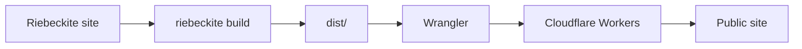

# Cloudflare Workers deployment

This guide focuses only on publishing a Riebeckite site to Cloudflare Workers.

The overall flow is:



For a normal Riebeckite static site, the `dist/` produced by the build is published as Cloudflare Workers Static Assets.

## In this section

- [Setup](./cloudflare-workers/setup.md)
- [Operations](./cloudflare-workers/operations.md)

## Common problems

### `dist/` is missing

Run `npm exec riebeckite build` first. Cloudflare Workers publishes the Static Assets generated in `dist/`.

### The published content is stale after updating the site

Run `npm exec riebeckite build` and `npm exec -- riebeckite publish run --execute` again after the change. `riebeckite publish run --execute` does not replace Riebeckite's build.

### The URL is wrong after publishing

Check that `site.baseUrl` in `riebeckite.config.ts` matches the actual published URL. If you change it, build and deploy again.

### Riebeckite's build fails

Use `npm exec riebeckite check` and `npm exec riebeckite doctor` to check the Riebeckite-side config and content.

### Wrangler fails

If Riebeckite's `build` succeeded, use `npx wrangler deploy --dry-run` to check the Wrangler-side configuration. Also check `name` and `assets.directory` in `wrangler.jsonc`.

## Summary

The minimal steps to publish a Riebeckite site to Cloudflare Workers are:

```sh
npm exec riebeckite build
npm exec -- riebeckite publish run --execute
```

A site generated with `create-riebeckite`'s `Cloudflare Workers` choice already includes Wrangler, so `npm install -D wrangler` is not needed. For an existing site generated with `Not now`, run `npm install -D wrangler` first.

After the first deployment gives you the public URL:

```text
riebeckite.config.ts
      ↓
set site.baseUrl
      ↓
rebuild
      ↓
redeploy
```

The roles are:

```text
riebeckite build
  → creates dist/

wrangler dev
  → checks Cloudflare serving locally

riebeckite publish run --execute
  → publishes dist/ to Cloudflare Workers
```

When you need automated deployment, move that sequence to run from [GitHub Actions](./github-actions.md) rather than changing the manual deploy mechanism.

## Next steps

- [Fast path to publishing a site](../../getting-started/deployment.md)
- [GitHub Actions](./github-actions.md)
- [Separate Content Repository](./separate-content-repository.md)
- [Usage Guide](../README.md)
- [CLI](../../reference/cli.md)
