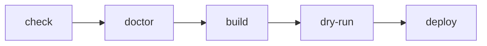
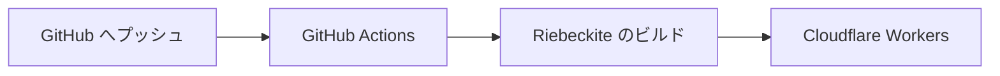
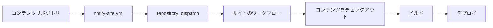

# 運用

## 更新したサイトを再デプロイする

一度公開した後に記事や設定を変更した場合も、手順は同じです。

```sh
npm exec riebeckite build
npm exec -- riebeckite publish run --execute
```

```text
コンテンツを変更
     ↓
ビルド
     ↓
dist/ を更新
     ↓
デプロイ
```

`riebeckite publish run --execute` は、計画、必要に応じたビルド、成果物検証、公開ゲート、Hosting adapter 経由のデプロイを行います。Riebeckite 側を変更した場合は、まず `npm exec riebeckite build` を実行してコンテンツが最新であることを確認してください。

```sh
npm exec riebeckite build
```

## デプロイ前のチェックリスト

本番へデプロイする前に、次の順で確認できます。

```sh
npm exec riebeckite check
npm exec riebeckite doctor
npm exec riebeckite build
npm exec -- riebeckite publish validate
npm exec -- riebeckite publish run --execute
```

各コマンドの役割は次のとおりです。

| コマンド | 役割 |
| --- | --- |
| `riebeckite check` | 設定やプラグインを検証する |
| `riebeckite doctor` | サイト全体の問題を診断する |
| `riebeckite build` | `dist/` を生成する |
| `riebeckite publish validate` | デプロイ内容を確認する |
| `riebeckite publish run --execute` | Cloudflare Workers へ公開する |

問題が起きた場合は、どの段階で失敗しているかを切り分けます。



## ビルドとデプロイは別の処理

Riebeckite のビルドと Cloudflare へのデプロイは、別の処理です。

```text
Riebeckite
  → サイトを生成する

Wrangler
  → 生成されたサイトを Cloudflare へ公開する
```

つまり、`npm exec riebeckite build` が失敗する場合は Riebeckite 側を、`npm exec -- riebeckite publish run --execute` が失敗する場合は Cloudflare / Wrangler 側を確認します。この境界を意識すると、デプロイの問題を調査しやすくなります。

## GitHub Actions で自動デプロイする

毎回 `npm exec riebeckite build` と `npm exec -- riebeckite publish run --execute` を手元で実行する代わりに、GitHub Actions から自動でデプロイすることもできます。



詳しい仕組みと設定は [GitHub Actions](../github-actions.ja.md) を参照してください。

すでに手元から公開しているサイトは、サイトのディレクトリで次を実行すると継続デプロイに移行できます。

```sh
npm exec riebeckite deploy setup
```

このコマンドは `.github/workflows/publish.yml` を作成し、`CLOUDFLARE_API_TOKEN` と `CLOUDFLARE_ACCOUNT_ID` をリポジトリシークレットとして登録したうえで、プッシュを待ちます。

### サイトとコンテンツが同じリポジトリにある場合

GitHub Actions を有効にしてサイトを生成します。

```sh
npx create-riebeckite my-site --github-actions
```

これにより、Cloudflare Workers 用の `wrangler.jsonc` とデプロイワークフローが生成されます。以降は、サイトリポジトリの `main` へプッシュすると自動でビルドとデプロイが実行されます。

### コンテンツを別リポジトリに置く場合

コンテンツとサイトを別リポジトリにする場合は、次のように生成できます。

```sh
npx create-riebeckite my-site --github-actions \
  --content-repository OWNER/notes \
  --site-repository OWNER/my-site
```

この構成では、次の2つのリポジトリに分かれます。

```text
OWNER/notes
  → コンテンツリポジトリ

OWNER/my-site
  → サイトリポジトリ
```

生成される構成には、次のものが含まれます。

- コンテンツリポジトリを `content/` へチェックアウトする設定
- `content-updated` の `repository_dispatch` を受け取るサイト側ワークフロー
- コンテンツリポジトリ用の `github/notify-site.yml`

`github/notify-site.yml` は、コンテンツリポジトリの次の場所へコピーします。

```text
.github/workflows/notify-site.yml
```

### 外部コンテンツではチェックアウトと通知の両方が必要

コンテンツリポジトリを分離した場合、コンテンツを取得することと、コンテンツ更新時にサイトのワークフローを起動することは別です。



外部コンテンツリポジトリをチェックアウトする設定だけでは、コンテンツリポジトリへのプッシュをきっかけにサイトのワークフローは起動しません。

ワークフロー全体の流れは [GitHub Actions](../github-actions.ja.md) を、リポジトリを分離する場合の詳しい設定は [コンテンツリポジトリの分離](../separate-content-repository.ja.md) を参照してください。
