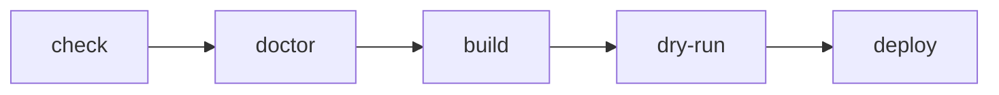
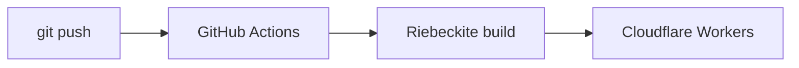
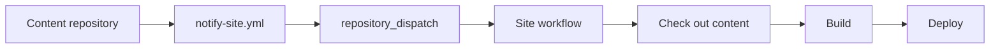

# Operations

## Redeploying an updated site

After a site is published, the steps to update articles or configuration are the same.

```sh
npm exec riebeckite build
npm exec -- riebeckite publish run --execute
```

```text
Change content
     ↓
Build
     ↓
Update dist/
     ↓
Deploy
```

`riebeckite publish run --execute` plans, builds if needed, validates the artifact, runs the publication gate, and deploys through the hosting adapter. If you changed anything on the Riebeckite side, run `npm exec riebeckite build` first to ensure content is up to date.

## Pre-deploy checklist

Before deploying to production, you can verify in this order.

```sh
npm exec riebeckite check
npm exec riebeckite doctor
npm exec riebeckite build
npm exec -- riebeckite publish validate
npm exec -- riebeckite publish run --execute
```

Each command has a role:

| Command | Role |
| --- | --- |
| `riebeckite check` | Validate config and plugins |
| `riebeckite doctor` | Diagnose site-wide problems |
| `riebeckite build` | Generate `dist/` |
| `riebeckite publish validate` | Check what will be deployed (reads plan/artifact/state) |
| `riebeckite publish run --execute` | Publish to Cloudflare Workers |

When something fails, separate which stage is failing.



## Build and deploy are separate

Riebeckite's build and Cloudflare's deploy are separate operations.

```text
Riebeckite
  → generates the site

Wrangler
  → publishes the generated site to Cloudflare
```

So if `npm exec riebeckite build` fails, look at the Riebeckite side; if `npm exec -- riebeckite publish run --execute` fails, look at the Cloudflare / Wrangler side. Separating these boundaries makes deployment problems easier to investigate.

## Automated deployment with GitHub Actions

Instead of running `npm exec -- riebeckite publish run --execute` manually, you can deploy when you push to GitHub.



If the site is already published from your machine, promote it from the site folder:

```sh
npm exec riebeckite deploy setup
```

This creates `.github/workflows/publish.yml`, stores `CLOUDFLARE_API_TOKEN` as a repository secret and `CLOUDFLARE_ACCOUNT_ID` as a repository variable, then waits for you to push.

### When the site and content are in the same repository

For a same-repository site that is not published yet, generate the workflow with:

```sh
npx create-riebeckite my-site --github-actions
```

This generates the Cloudflare Workers `wrangler.jsonc` and the deployment workflow. After that, a push to `main` in the site repository builds and deploys automatically.

### When content is in a separate repository

For a separate content repository, generate both workflow files with:

```sh
npx create-riebeckite my-site --github-actions \
  --content-repository OWNER/notes \
  --site-repository OWNER/my-site
```

This separates:

```text
OWNER/notes
  → content repository

OWNER/my-site
  → site repository
```

The generated setup checks out `OWNER/notes` into `content/`, receives `content-updated` repository dispatch events, and writes `github/notify-site.yml` for the content repository. Copy that file to `.github/workflows/notify-site.yml` in the content repository.

### External content needs both checkout and notification

When the content repository is separate, checking out the content and starting the site workflow on a content update are two different things.



An external checkout alone does not start the site workflow on a content push.

See [GitHub Actions](../github-actions.md) for the full workflow and [Separate Content Repository](../separate-content-repository.md) for the separate-repository setup.
