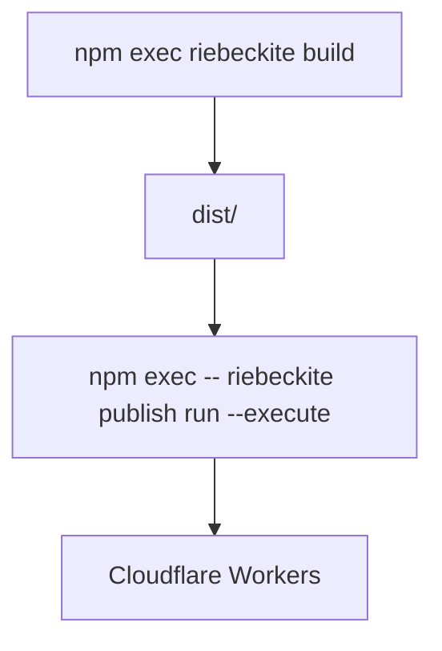
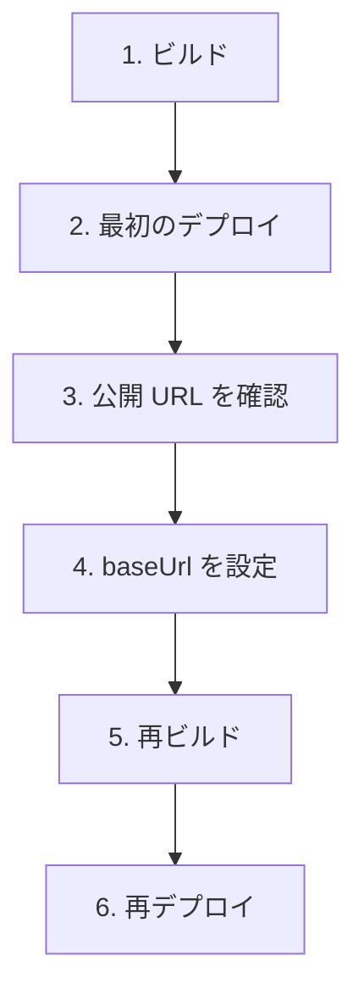

# セットアップ

## 前提

サイトのディレクトリで、次のコマンドが成功することを確認してください。

```sh
npm install
npm exec riebeckite build
```

ビルドに成功すると `dist/` が生成されます。

```text
my-site/
├─ app/
├─ content/
├─ dist/               ← 公開する
├─ riebeckite.config.ts
└─ package.json
```

Cloudflare Workers に公開するのは、この `dist/` の中身です。`.riebeckite/` や[[glossary/plugin|プラグイン]]の[[glossary/cache|キャッシュ]]など、ビルド時の状態は公開されません。

増分処理は、`riebeckite build` を実行するローカル環境または GitHub Actions のランナー上で行われます。Wrangler は新しく生成された `dist/` を Workers Static Assets としてアップロードするだけで、Workers 自体が[[glossary/incremental-build|増分ビルド]]を行うわけではありません。生成される GitHub Actions ワークフローは、このビルドのために `.riebeckite/cache` と `.riebeckite/build/content-state.json` を永続化します。`dist/` は永続化しません。

## 1. Cloudflare アカウントを作成する

まだアカウントを持っていない場合は、[Cloudflare](https://www.cloudflare.com/) で作成します。無料プランで始められます。

アカウントを作成したら、次に Cloudflare Workers へデプロイするための Wrangler を用意します。

## 2. Wrangler を用意する

`create-riebeckite` で `Cloudflare Workers` を選んだサイトには、Wrangler の依存関係と `wrangler.jsonc` がすでに含まれています。追加のインストールや設定は不要です。

`Not now` で生成したサイトや、手動で用意する場合は、サイトのディレクトリで次を実行します。

```sh
npm install -D wrangler
```

Wrangler は Cloudflare Workers の開発とデプロイに使う公式 CLI です。インストールすると `npx wrangler` で実行できます。

## 3. `wrangler.jsonc` を用意する

Cloudflare Workers に何をデプロイするかは `wrangler.jsonc` で設定します。

`--github-actions` を指定した場合や、デプロイ設定で `Cloudflare Workers` を選んだ場合は、このファイルが生成済みです。`npm exec -- riebeckite publish run --execute` も、ファイルがなければアプリのルートディレクトリ名から自動で作成します。そのため、自分で用意するのは内容を確認・編集したいときだけです。

手動で作成する場合は、サイトのルートに `wrangler.jsonc` を置きます。サイトの構成は次のとおりです。

```text
my-site/
|- dist/
|- package.json
|- riebeckite.config.ts
`- wrangler.jsonc
```

`wrangler.jsonc` には次の内容を記述します。

```jsonc
{
  "name": "my-riebeckite-site",
  "assets": {
    "directory": "./dist"
  }
}
```

`name` は Cloudflare 上の Worker 名です。自分だけの一意な名前に変更してください。`assets.directory` は `./dist` のままにします。

この設定は、次の対応関係を表しています。

```text
Riebeckite
    ↓
dist/ を生成
    ↓
Wrangler
    ↓
dist/ を Static Assets として公開
```

## 4. Cloudflare にログインする

`riebeckite publish run --execute` は、初回の実行時にブラウザを開いて Cloudflare へのログインを求めます。事前にログインしておきたい場合や、Wrangler を直接使う場合は、次のコマンドでもログインできます。

```sh
npx wrangler login
```

ブラウザが開いたら Cloudflare にログインし、Wrangler からのアクセスを許可します。これで、手元から Cloudflare Workers へデプロイできるようになります。

## 5. サイトをデプロイする

まず Riebeckite をビルドします。

```sh
npm exec riebeckite build
```

続いてデプロイします。

```sh
npm exec -- riebeckite publish run --execute
```

`riebeckite publish run --execute` は Wrangler を呼び出して `dist/` を公開します。ログインが必要なら先にブラウザでログインし、`wrangler.jsonc` がなければ自動で作成します。`create-riebeckite` で `Cloudflare Workers` を選び、`Deploy now?` に `Yes` と答えた場合は、生成直後にこのビルドとデプロイが自動で実行されます。Wrangler を直接使うなら `npx wrangler deploy` でも同じです。



デプロイが成功すると、Wrangler が[[glossary/public-location|公開先]]の URL を表示します。たとえば、次のような URL です。

```text
https://<name>.<account>.workers.dev
```

表示された URL をブラウザで開き、サイトが表示されれば最初のデプロイは成功です。

## 6. `baseUrl` を公開 URL に合わせる

最初のデプロイでサイトの URL がわかったら、`riebeckite.config.ts` の `baseUrl` を実際の公開 URL に変更します。

```ts
export default defineConfig({
  site: {
    baseUrl: "https://my-riebeckite-site.example.workers.dev",
  },

  // ...
});
```

`baseUrl` はサイトの公開 URL を表すため、実際に公開する URL と一致させてください。これにより、[[glossary/sitemap|サイトマップ]]やフィードの URL も公開先と一致します。

設定を変更したら、もう一度ビルドしてデプロイします。`baseUrl` はコンテンツの計画に含まれないため、設定だけを変えた再デプロイには `--force` が必要です。

```sh
npm exec riebeckite build
npm exec -- riebeckite publish run --execute --force
```

最初の公開は、次のような流れになります。



## 7. 公開前に設定を確認する

実際にデプロイせずに、Cloudflare Workers 向けの設定を確認することもできます。

### ドライラン

```sh
npx wrangler deploy --dry-run
```

実際には公開せず、デプロイの準備内容を確認します。「まだ本番に出したくないが、Wrangler の設定に問題がないか確認したい」というときに使えます。

### `wrangler dev` で配信状態を確認する

```sh
npx wrangler dev
```

デプロイ後の Worker に近い状態を、ローカルで確認できます。

通常の記事やサイトの開発では `npm exec riebeckite dev` を使い、Cloudflare Workers での配信状態を確認したいときに `npx wrangler dev` を使う、と考えると整理しやすいです。

```text
普段の記事・サイト開発
  → riebeckite dev

Cloudflare での配信状態を確認
  → wrangler dev

実際に公開
  → riebeckite publish run --execute
```
