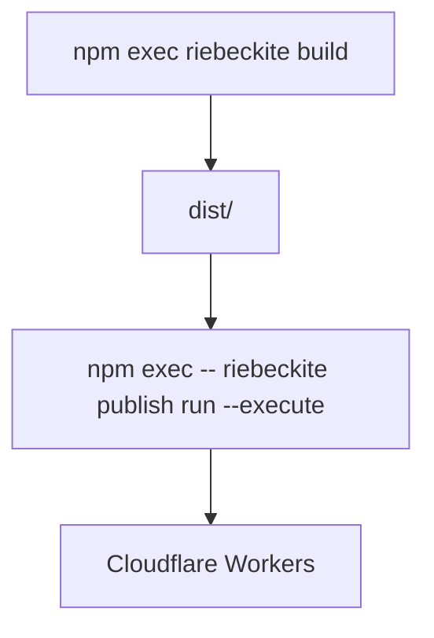
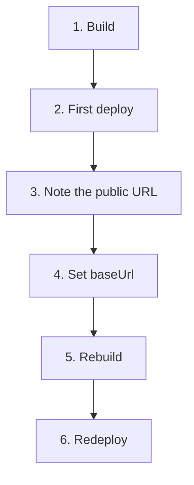

# Setup

## Prerequisites

In the site folder, make sure these commands succeed.

```sh
npm install
npm exec riebeckite build
```

A successful build creates `dist/`.

```text
my-site/
├─ app/
├─ content/
├─ dist/               ← publish this
├─ riebeckite.config.ts
└─ package.json
```

Cloudflare Workers serves the files from `dist/`. Build-time state such as `.riebeckite/` and plugin caches is not published.

Incremental processing happens during `riebeckite build` on your machine or GitHub Actions runner. Wrangler then uploads the newly generated `dist/` as Workers Static Assets; Workers do not perform incremental builds. The generated GitHub Actions workflow persists `.riebeckite/cache` and `.riebeckite/build/content-state.json` for this build step, never `dist/`.

## 1. Create a Cloudflare account

Create an account at [cloudflare.com](https://www.cloudflare.com/). The free plan is enough to get started.

## 2. Get wrangler

A site generated with `create-riebeckite`'s `Cloudflare Workers` choice already includes the Wrangler dependency and `wrangler.jsonc`, so no extra install or setup is needed.

For a site generated with `Not now`, or when preparing one manually, run this in the site folder:

```sh
npm install -D wrangler
```

wrangler is the official command-line tool for deploying to Cloudflare Workers.

## 3. Add wrangler.jsonc

`npm exec -- riebeckite publish run --execute --provider cloudflare-workers` creates `wrangler.jsonc` from the app root directory name when the file is missing and the provider is known, so this step is only needed when you want to review or customize it. To create it yourself, add a `wrangler.jsonc` in the site root:

```text
my-site/
|- dist/
|- package.json
|- riebeckite.config.ts
`- wrangler.jsonc
```

Change `name` first.

```jsonc
{
  "name": "my-riebeckite-site",
  "assets": {
    "directory": "./dist"
  }
}
```

`name` is the Worker name on Cloudflare. Choose a name that is unique to you. Keep `assets.directory` as `./dist`.

This maps to:

```text
Riebeckite
    ↓
generates dist/
    ↓
Wrangler
    ↓
publishes dist/ as Static Assets
```

## 4. Log in to Cloudflare

`riebeckite publish run --execute` opens the browser and asks you to log in on the first run. To log in ahead of time, or if you run Wrangler directly, use:

```sh
npx wrangler login
```

A browser window opens. Log in to Cloudflare and grant access.

## 5. Deploy

```sh
npm exec -- riebeckite publish run --execute
```

`riebeckite publish run --execute` calls Wrangler to publish `dist/`. It logs you in first when needed and creates `wrangler.jsonc` when it is missing, provided a provider is detected or passed with `--provider cloudflare-workers`. Choosing `Cloudflare Workers` in `create-riebeckite` and answering `Yes` to `Deploy now?` runs this build and deploy immediately after scaffolding. To run Wrangler directly instead, use `npx wrangler deploy`.



The deploy prints a URL such as `https://<name>.<account>.workers.dev`. Open it in a browser. If the site loads, deployment worked.

## 6. Match baseUrl to the deployed URL

After the first successful deploy, update `baseUrl` in `riebeckite.config.ts`.

```ts
site: {
  baseUrl: "https://my-riebeckite-site.example.workers.dev",
},
```

Then build and deploy again. Because `baseUrl` is not part of the content plan, `--force` is required for this config-only redeploy.

```sh
npm exec riebeckite build
npm exec -- riebeckite publish run --execute --force
```

This makes sitemap and feed URLs match the public site.

In other words, the first publish follows this flow:



## 7. Check before publishing

You can verify the Cloudflare Workers configuration without deploying.

### Dry run

```sh
npx wrangler deploy --dry-run
```

This checks the deployment preparation without actually publishing. Use it when you do not want to go live yet but want to confirm the Wrangler configuration.

### Wrangler dev

```sh
npx wrangler dev
```

This serves a local version close to the deployed Worker. A simple way to think about it:

```text
Day-to-day article and site development
  → riebeckite dev

Check the Cloudflare serving state
  → wrangler dev

Publish for real
  → riebeckite publish run --execute
```
