# GitHub Actions

Riebeckite と GitHub Actions を組み合わせると、**GitHub へのプッシュをきっかけに Cloudflare Workers へ自動デプロイ**できます。

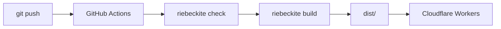

サイトとコンテンツを同じリポジトリに置く一般的な構成なら、`main` へプッシュするだけでビルドとデプロイが実行されます。

## GitHub Actions を有効にしてサイトを作る

対話形式の CLI では、セットアップの最後にデプロイ方法を尋ねられます。継続デプロイには `GitHub Actions` を選んでください。手元から最初の公開を行う場合は `Cloudflare Workers` を選びます。コマンドラインから GitHub Actions を指定する場合は次のとおりです。

```bash id="f10w6x"
npx create-riebeckite my-site --preset starter --github-actions
```

`--github-actions` を付けると、サイトに次の2つが追加されます。

```text id="hw99qe"
my-site/
├─ .github/
│  └─ workflows/
│     └─ publish.yml
│
├─ wrangler.jsonc
└─ ...
```

| ファイル | 役割 |
| --- | --- |
| `wrangler.jsonc` | Cloudflare Workers へのデプロイ設定 |
| `.github/workflows/publish.yml` | GitHub Actions のビルド／デプロイワークフロー |

通常は、生成されたワークフローを出発点として使います。

## 既存のサイトに継続デプロイを追加する

すでに Local-first で公開しているサイトなら、作り直さずに継続デプロイを追加できます。サイトのディレクトリで次を実行してください。

```sh id="d3setupj1"
npm exec riebeckite deploy setup
```

このコマンドは次の順に処理を進めます。

1. Git リポジトリと GitHub のリモートを検出する
2. GitHub CLI（`gh`）がインストール済みで、ログイン済みか確認する
3. `.github/workflows/publish.yml` がなければ、同じテンプレートから作成する。Riebeckite 以外の既存ワークフローは上書きせず、検出したことを報告して、シークレットの登録に進む前に停止する
4. Wrangler のログイン状態から Cloudflare アカウントを取得する。複数ある場合は選択する
5. `CLOUDFLARE_ACCOUNT_ID` と `CLOUDFLARE_API_TOKEN` をリポジトリシークレットとして登録する。トークンは入力内容が表示されないプロンプト、または非対話実行用の環境変数 `CLOUDFLARE_API_TOKEN` から読み取る

GitHub リポジトリの作成やプッシュは行いません。完了したら、次のコマンドでデプロイします。

```sh
git push
```

このコマンドは何度でも再実行できます。一致するワークフローと登録済みのシークレットがあれば、それらはスキップされ、残りの手順だけが実行されます。別のデプロイワークフローがすでにある場合は、置き換えるか削除してから再実行してください。

## 必要なもの

GitHub Actions からデプロイするには、次のものが必要です。

- `package-lock.json`
- `CLOUDFLARE_API_TOKEN`
- `CLOUDFLARE_ACCOUNT_ID`
- `deploy setup` を使う場合は、GitHub CLI（`gh`）のインストールとログイン、およびプロジェクト内の Wrangler（Local-first のサイトには含まれています）

### `package-lock.json`

生成されるワークフローは、次のコマンドで依存パッケージをインストールします。

```sh id="8ihzjv"
npm ci
```

そのため、`package-lock.json` をリポジトリにコミットしてください。

```text id="3oyv7c"
package.json
package-lock.json
      ↓
npm ci
      ↓
CI でも同じ依存関係がインストールされる
```

`package-lock.json` がないと、生成されたワークフローの `npm ci` をそのまま使えません。

## リポジトリを GitHub に置く

GitHub Actions は GitHub 上のリポジトリを読み取ります。サイトのリポジトリがまだない場合は作成してください。

### Git でリポジトリを初期化する

サイトのディレクトリで次を実行します。

```sh
git init
git add .
git commit -m "First commit"
```

`.gitignore` は生成済みなので、`node_modules/` や `dist/` はコミットされません。一方、`package-lock.json` はコミットされます。このファイルがないと後述の `npm ci` が動かないため、必ず残してください。

Git を初めて使う場合、`git commit` が `Author identity unknown` で失敗することがあります。その場合は次を設定してから、もう一度実行してください。

```sh
git config --global user.name "Your Name"
git config --global user.email "you@example.com"
```

### GitHub にリポジトリを作成してプッシュする

1. [GitHub の New repository](https://github.com/new) を開きます。リポジトリ名を決めて作成してください。**Add a README file** と **Add .gitignore** は追加しません。ローカルにすでに履歴があるため、どちらかを追加するとプッシュが拒否されます。
2. 作成直後に表示される「…or push an existing repository from the command line」のコマンドを、そのまま実行します。`main` を使う構成の例は次のとおりです。

```sh
git remote add origin https://github.com/<you>/my-site.git
git branch -M main
git push -u origin main
```

`git push -u origin main` が成功すると、GitHub のリポジトリページにファイルが表示されます。以降は `main` へプッシュするたびにワークフローが実行されます。

## Cloudflare のシークレット

サイトのリポジトリに、次の GitHub Actions シークレットを設定します。

```text id="79c4ea"
CLOUDFLARE_API_TOKEN
CLOUDFLARE_ACCOUNT_ID
```

どちらも Cloudflare 側で用意します。

### `CLOUDFLARE_API_TOKEN` を作成する

1. [Cloudflare ダッシュボード](https://dash.cloudflare.com/) にログインし、右上のアカウントメニューから **My Profile** を開きます。[API Tokens](https://dash.cloudflare.com/profile/api-tokens) を直接開いてもかまいません。
2. **Create Token** → **Create Custom Token** を選びます。
3. **Permissions** で **Account** / **Workers Scripts** / **Edit** を追加します。
4. **Account Resources** に自分のアカウントを含めます。
5. **Continue to review** → **Create Token** を押します。
6. 表示されたトークンの値をコピーします。この画面を閉じると、値は二度と表示されません。

権限の考え方については、[Cloudflare の公式ガイド](https://developers.cloudflare.com/fundamentals/api/get-started/create-token/) を参照してください。トークンが漏れた場合は、同じ画面からローテーションできます。

### `CLOUDFLARE_ACCOUNT_ID` を確認する

ダッシュボードで **Workers & Pages** を開くと、ブラウザのアドレスバーは次の形式になります。

```text
https://dash.cloudflare.com/<ACCOUNT_ID>/workers-and-pages
```

`<ACCOUNT_ID>` が `CLOUDFLARE_ACCOUNT_ID` の値です。Worker の詳細ページに表示される **Account ID** も同じ値です。

### GitHub に登録する

GitHub のサイトリポジトリで **Settings** → **Secrets and variables** → **Actions** → **New repository secret** を開き、名前と値をそれぞれ登録します。

```text
名前: CLOUDFLARE_API_TOKEN   値: 上でコピーしたトークン
名前: CLOUDFLARE_ACCOUNT_ID  値: 上の ACCOUNT_ID
```

`riebeckite deploy setup` を使うと、すでに Git リポジトリになっているサイトでこの2つの登録を自動化できます。Wrangler のログインからアカウントを取得し、トークンは入力内容が表示されないプロンプトに貼り付けます。シークレットを手動で登録したい場合や、CLI を使えない場合は、上記の手順をそのまま利用してください。

ワークフローは、GitHub リポジトリの Actions からこれらのシークレットを参照します。

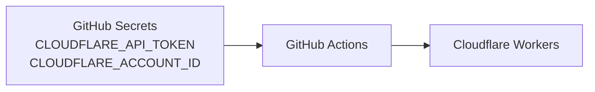

これらの値はソースコードや `riebeckite.config.ts` に直接書かず、リポジトリシークレットとして管理してください。

## ワークフローが実行されるタイミング

生成されるワークフローは、次の3つのトリガーに対応しています。

| トリガー | 用途 |
| --- | --- |
| `main` への `push` | サイトの変更を自動でデプロイする |
| `workflow_dispatch` | GitHub から手動で実行する |
| `repository_dispatch: content-updated` | 別リポジトリでのコンテンツ更新をきっかけに実行する |

通常のサイトリポジトリでは、次の流れになります。

```text id="whvm5u"
main へプッシュ
    ↓
GitHub Actions
    ↓
デプロイ
```

## サイトとコンテンツが同じリポジトリにある場合

これが最も単純な構成です。

```text id="8tqoq6"
my-site/
├─ content/
├─ app/
├─ riebeckite.config.ts
└─ .github/
   └─ workflows/
      └─ publish.yml
```

記事とサイトが同じリポジトリにあるため、流れは次のようになります。

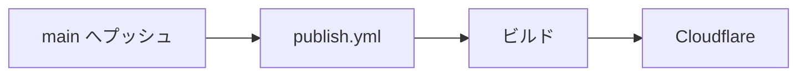

記事を変更して `main` へプッシュすれば、そのプッシュ自体がワークフローを起動します。

## サイトとコンテンツが別リポジトリにある場合

コンテンツリポジトリを分離している場合は、流れが少し変わります。

```text id="w3jwej"
コンテンツリポジトリ
  → Markdown / Obsidian Vault

サイトリポジトリ
  → Riebeckite / 設定 / テーマ / プラグイン
```

コンテンツリポジトリへプッシュしても、**それだけではサイトリポジトリのワークフローは起動しません**。GitHub Actions のワークフローは、それぞれのリポジトリに属しているからです。

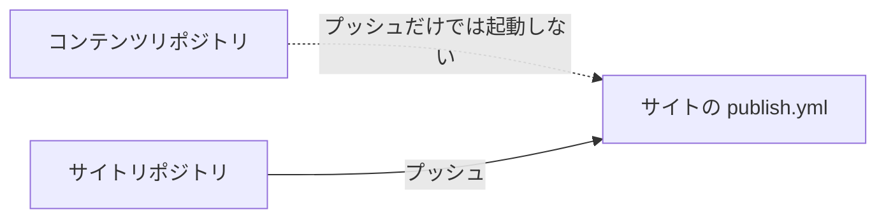

コンテンツの更新をきっかけにサイトを自動デプロイするには、コンテンツリポジトリからサイトリポジトリへ通知します。

## `repository_dispatch`

別リポジトリからサイトのワークフローを起動するには、`repository_dispatch` を利用します。

Riebeckite が生成するワークフローは、次のイベントを受け取れるように設定されています。

```text id="5ss0v6"
content-updated
```

全体の流れは次のとおりです。

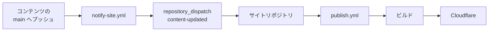

## `notify-site.yml`

コンテンツリポジトリ側には、次のファイルを置きます。

```text id="7p33l5"
.github/workflows/notify-site.yml
```

このワークフローの役割は、サイトをビルドすることではありません。コンテンツが更新されたことをサイトリポジトリへ通知することです。

```text id="kw1g8g"
コンテンツリポジトリ
      ↓
サイトリポジトリへ
「コンテンツが更新された」と通知
```

通知を受け取ったサイトリポジトリの `publish.yml` が、ビルドとデプロイを実行します。

## `SITE_DISPATCH_TOKEN`

コンテンツリポジトリからサイトリポジトリへ `repository_dispatch` を送るには、`SITE_DISPATCH_TOKEN` をコンテンツリポジトリ側のシークレットとして設定します。

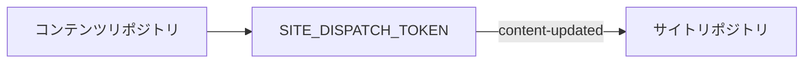

このトークンは、**コンテンツリポジトリからサイトリポジトリのワークフローを起動するためのもの**です。

## ワークフローの処理順

生成されるデプロイワークフローは、おおむね次の順に処理を進めます。

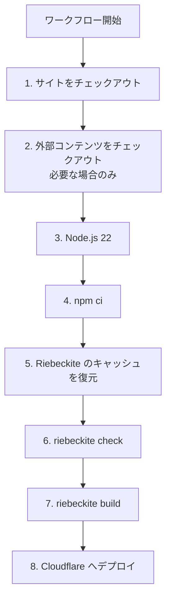

### 1. サイトリポジトリをチェックアウトする

最初にサイトリポジトリを取得します。

```text id="cq3r5o"
GitHub ランナー
    ↓
サイトリポジトリ
```

ここには次のものが含まれます。

- Riebeckite の設定
- アプリケーション
- プラグイン／テーマの設定
- `package.json`
- `package-lock.json`

### 2. 外部コンテンツをチェックアウトする

コンテンツが同じリポジトリにある場合、この追加手順は不要です。

別リポジトリを使っている場合は、コンテンツリポジトリを `content/` へチェックアウトします。

```text id="1rhw6a"
ランナー

サイトリポジトリ
├─ app/
├─ riebeckite.config.ts
├─ package.json
└─ content/          ← 外部のコンテンツリポジトリ
```

その場合、Riebeckite 側では次のように読み込めます。

```ts id="k2zv1m"
content: {
  directory: "content",
},
```

### 3. Node.js をセットアップする

生成されるワークフローでは Node.js 22 をセットアップします。

```text id="db4q7u"
GitHub ランナー
      ↓
Node.js 22
```

以降の `npm ci` と Riebeckite CLI は、この環境で実行されます。

### 4. パッケージをインストールする

次のコマンドを実行します。

```sh id="82x1ig"
npm ci
```

`npm ci` は `package-lock.json` に従って依存パッケージをインストールします。そのため、生成されたワークフローを使う場合は `package-lock.json` をコミットしておく必要があります。

### 5. Riebeckite のビルド状態を復元する

生成されるワークフローは、増分 SSG に必要な状態を1つの `actions/cache` 手順で復元します。

- `.riebeckite/cache`：Markdown とプラグインの処理キャッシュ
- `.riebeckite/build/content-state.json`：増分ビルドの状態
- `.riebeckite/ssg-output-cache.json` と `.riebeckite/ssg-output-cache.entries`：SSG 出力キャッシュ。描画済みのルートとファイル、およびそのエントリの blob を保持します
- `.riebeckite/ssg-output-cache.fast-path.json`：変更なしのファストパスを検証するためのサイドカー

キャッシュキーは、ランナーの OS、Node.js のバージョン、`package-lock.json` のハッシュ、`riebeckite.config.ts` のハッシュで範囲を絞り、実行ごとの世代として保存します。

```text
riebeckite-build-v2-<os>-node<node>-<lockfile hash>-<config hash>-<run id>-<run attempt>
```

`restore-keys` は、互換性のある直近の世代へ2段階でフォールバックします。まず lockfile と config のハッシュが一致する世代、次に lockfile のハッシュだけが一致する世代です。lockfile のハッシュはインストールされる Riebeckite のバージョンを、config のハッシュはプリセットとプラグインの設定を反映します。どちらかが変わると新しいキャッシュ系列が始まりますが、実際に再利用するかどうかは Riebeckite 自身のフィンガープリント検証（スキーマバージョン、アプリ／パイプライン／コンテンツのフィンガープリント、プラグインの `cacheVersion`）が決めます。

エントリがその場で上書きされることはありません。各実行が新しい世代を保存し、古い世代は GitHub が自動的に削除します。キャッシュは OS や Node.js のバージョンをまたいで共有されないため、環境が変われば互換性のないエントリを再利用せず、コールドビルドになります。`dist/` はキャッシュしません。

Riebeckite が復元した出力キャッシュを拒否した場合（キャッシュがない、キャッシュが壊れている、アプリケーションのフィンガープリントが変わった、`unknown` の出力依存関係がある、全体を再生成する必要がある、キャッシュされたエントリのない出力がある）は、すべての出力を描画し直して `dist/` を最初から書き直します。そのため、古いキャッシュや不完全なキャッシュがデプロイに混入することはありません。キャッシュミスは安全で、コールドビルドになるだけです。

ビルド後は、新しいキャッシュ世代が自動的に保存されます。ビルドログの `Persistent content cache` 行にある `hits`、`misses`、`bypasses` はコンテンツ処理を再利用したかどうかを、`SSG outputs` 行の `rendered`、`reused`、`removed` は描画済み出力を再利用したかどうかを示します。

`.riebeckite/` を削除するか、ワークフローのキャッシュ手順を外すと、次回はコールドビルドになりますが、出力の正しさには影響しません。コンテンツキャッシュは残したまま、出力キャッシュの転送だけを省きたい場合は、キャッシュ手順から `.riebeckite/ssg-output-cache*` の3つのパスを外してください。次回はすべての出力が再描画されます。

ワークフローは復元・保存したキャッシュのサイズも出力するので、転送コストを確認できます。キャッシュの保存に失敗した場合や省略された場合でも、デプロイは実行されます。

### 6. サイトを検証する

次に、次のコマンドを実行します。

```sh id="e8v6ki"
npm exec riebeckite check
```

設定やプラグインの解決に問題があれば、デプロイ前にここで失敗します。

```text id="ryypt0"
チェックアウト
   ↓
インストール
   ↓
check
   ↓
問題があれば停止
```

壊れた設定のままデプロイしないための確認です。

### 7. サイトをビルドする

`check` が成功したら、次のコマンドを実行します。

```sh id="4brn9u"
npm exec riebeckite build
```

Riebeckite が公開用の `dist/` を生成します。

```text id="k2bc05"
コンテンツ
設定
プラグイン
テーマ
   ↓
riebeckite build
   ↓
dist/
```

### 8. Cloudflare Workers へデプロイする

最後に、`cloudflare/wrangler-action@v3` を使って Cloudflare Workers へデプロイします。

```text id="b6nmf8"
cloudflare/wrangler-action@v3
```

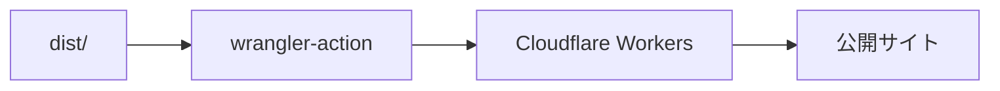

ここでは次のシークレットが使われます。

```text id="7y1w2d"
CLOUDFLARE_API_TOKEN
CLOUDFLARE_ACCOUNT_ID
```

## プライベートなコンテンツリポジトリを使う

コンテンツリポジトリがパブリックかプライベートかで、チェックアウト時の認証方法が異なります。

プライベートなコンテンツリポジトリを読むには、サイトリポジトリに `RIEBECKITE_CONTENT_READ_TOKEN` を設定します。

```text id="c2wnxd"
RIEBECKITE_CONTENT_READ_TOKEN
```

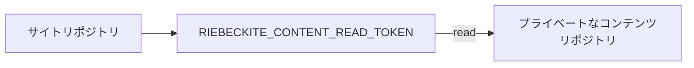

このトークンは、**サイトのワークフローからプライベートなコンテンツリポジトリを読み込むためのもの**です。

## 2つのトークンを使い分ける

リポジトリを分離すると、名前の似た2つのトークンが登場します。用途が異なるので、混同しないよう注意してください。

| シークレット | 保存する場所 | 役割 |
| --- | --- | --- |
| `RIEBECKITE_CONTENT_READ_TOKEN` | サイトリポジトリ | プライベートなコンテンツリポジトリを読む |
| `SITE_DISPATCH_TOKEN` | コンテンツリポジトリ | サイトリポジトリに更新を通知する |

方向で整理すると区別しやすくなります。

```text id="xklxpf"
RIEBECKITE_CONTENT_READ_TOKEN

サイト ─────read─────> コンテンツ
```

```text id="50j8kg"
SITE_DISPATCH_TOKEN

コンテンツ ───notify───> サイト
```

つまり、次の関係です。

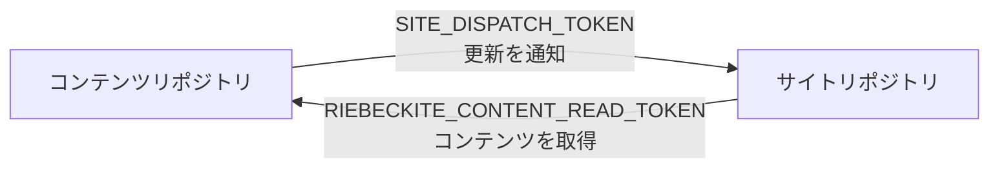

## サイト更新時とコンテンツ更新時のデプロイ経路

リポジトリを分けると、デプロイ経路は2つになります。

### サイトを変更した場合

```text id="z48j9w"
サイトリポジトリ
      ↓
main へプッシュ
      ↓
publish.yml
      ↓
コンテンツをチェックアウト
      ↓
ビルド
      ↓
デプロイ
```

サイトの `push` が直接ワークフローを起動します。

### コンテンツを変更した場合

```text id="rqr5jk"
コンテンツリポジトリ
      ↓
main へプッシュ
      ↓
notify-site.yml
      ↓
repository_dispatch
      ↓
サイトの publish.yml
      ↓
コンテンツをチェックアウト
      ↓
ビルド
      ↓
デプロイ
```

こちらは、コンテンツリポジトリからサイトリポジトリへの通知が1段階増えます。

どちらの場合も、最終的に**サイトリポジトリ側でビルドする**点は同じです。

## デプロイワークフローを手動で実行する

生成されるワークフローは `workflow_dispatch` にも対応しているため、GitHub の画面から手動で実行できます。

```text id="25pv89"
workflow_dispatch
```

実行手順は次のとおりです。

```text id="0coc2a"
GitHub
  ↓
Actions
  ↓
デプロイワークフロー
  ↓
Run workflow
```

コンテンツやサイトに新しいコミットを作らず、現在の状態でもう一度デプロイしたいときに便利です。

## デプロイが動かないとき

まず、ワークフローが起動していないのか、起動したけれど失敗したのかを切り分けます。

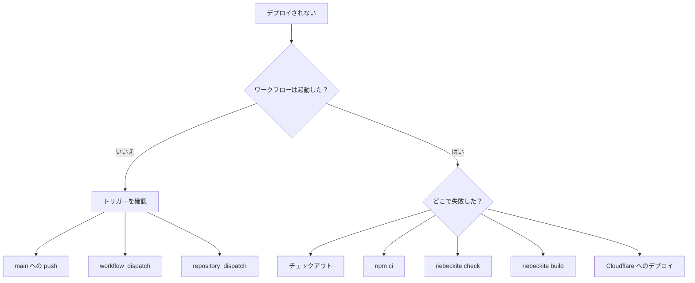

## ワークフローが起動しない

サイトリポジトリへのプッシュなら、`main` へプッシュしているか確認します。

コンテンツリポジトリへのプッシュなら、次の点を確認してください。

```text id="1xb7gc"
notify-site.yml
SITE_DISPATCH_TOKEN
repository_dispatch
content-updated
```

コンテンツリポジトリへのプッシュだけでは、サイトのワークフローは起動しません。

## `npm ci` が失敗する

生成されるワークフローは `npm ci` を使います。`package-lock.json` がリポジトリにコミットされているか確認してください。

```sh id="dtah4e"
npm ci
```

必要なファイルは次のとおりです。

```text id="afg8hg"
package-lock.json
```

## コンテンツのチェックアウトが失敗する

プライベートなコンテンツリポジトリの場合は、`RIEBECKITE_CONTENT_READ_TOKEN` を確認します。

```text id="9d9gdo"
RIEBECKITE_CONTENT_READ_TOKEN
```

サイトリポジトリのワークフローが、そのトークンを使ってコンテンツリポジトリを読める必要があります。

## `check` が失敗する

次のコマンドを手元でも実行します。

```sh id="5jffy5"
npm exec riebeckite check
```

設定やプラグインの問題を修正してからプッシュしてください。

## `build` が失敗する

手元で次のコマンドを実行し、再現するか確認します。

```sh id="o2n6np"
npm exec riebeckite build
```

リポジトリを分けている場合は、CI と同じ場所にコンテンツがあるかも確認してください。

## Cloudflare へのデプロイが失敗する

ビルドまでは成功しているなら、次の点を確認します。

```text id="rxagkm"
CLOUDFLARE_API_TOKEN
CLOUDFLARE_ACCOUNT_ID
wrangler.jsonc
```

Riebeckite のビルドと Cloudflare へのデプロイは別の段階です。どちらで失敗したかを切り分けると、原因を特定しやすくなります。

## まとめ

通常のサイトリポジトリでは、次の流れになります。

```text id="8p29zx"
main へプッシュ
    ↓
GitHub Actions
    ↓
npm ci
    ↓
riebeckite check
    ↓
riebeckite build
    ↓
Cloudflare Workers
```

コンテンツリポジトリを分離している場合は、次のようになります。

```text id="yt0pvq"
コンテンツをプッシュ
    ↓
notify-site.yml
    ↓
repository_dispatch
    ↓
サイトのワークフロー
    ↓
コンテンツをチェックアウト
    ↓
ビルド
    ↓
デプロイ
```

特に覚えておきたいのは、次の役割の違いです。

```text id="30lm4f"
SITE_DISPATCH_TOKEN
  → コンテンツからサイトへ通知する

RIEBECKITE_CONTENT_READ_TOKEN
  → サイトからコンテンツを読む

CLOUDFLARE_API_TOKEN
CLOUDFLARE_ACCOUNT_ID
  → Cloudflare へデプロイする
```

## ローカルで確認する

デプロイせずに、ビルドと設定を確認できます。

```sh
npm install
npm exec riebeckite build
npx wrangler deploy --dry-run
```

`wrangler deploy --dry-run` は Cloudflare に接続せず、`wrangler.jsonc` とアセットディレクトリを検証します。`npx wrangler dev` は同じ出力をローカルで配信します。

## 運用上の注意点

- **静的アセットだけで十分です。** Riebeckite はコンテンツのルートとプラグインのエンドポイントを事前レンダリングするため、`dist/` は実行時の `main` エントリなしで静的アセットとして配信されます。
- **ビルド状態はビルド時に留まります。** `.riebeckite/` とプラグインのキャッシュは `dist/` に含まれず、Worker の実行環境に渡ることはありません。
- **添付ファイルはサイト側で管理します。** 公開するつもりのファイルだけを、ビルド前の `prebuild` 手順でコピーしてください。

## 関連資料

- [デプロイガイド](./README.ja.md)：デプロイ方法の選び方
- [Cloudflare Workers](./cloudflare-workers.ja.md)：Cloudflare Workers の設定と手動デプロイ
- [コンテンツリポジトリの分離](./separate-content-repository.ja.md)：コンテンツとサイトを別リポジトリで運用する方法
- Cloudflare デプロイテンプレート：元のファイル
- [ビルドシステム](../../framework/build-system.ja.md)：ビルドが書き出すもの
