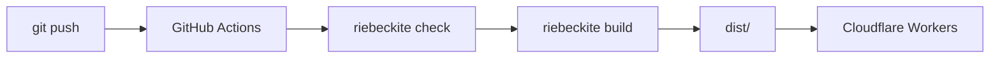

# GitHub Actions

Riebeckite と GitHub Actions を組み合わせると、**GitHub へのプッシュをきっかけに Cloudflare Workers へ自動デプロイ**できます。



サイトとコンテンツを同じリポジトリに置く一般的な構成なら、`main` へプッシュするだけでビルドとデプロイが実行されます。

## このページの構成

- [セットアップ](./github-actions/setup.ja.md)
- [トリガー](./github-actions/triggers.ja.md)
- [ワークフロー](./github-actions/workflow.ja.md)
- [トラブルシューティング](./github-actions/troubleshooting.ja.md)

## まとめ

通常のサイトリポジトリでは、次の流れになります。

```text id="8p29zx"
main へプッシュ
    ↓
GitHub Actions
    ↓
npm ci
    ↓
riebeckite check
    ↓
riebeckite build
    ↓
Cloudflare Workers
```

コンテンツリポジトリを分離している場合は、次のようになります。

```text id="yt0pvq"
コンテンツをプッシュ
    ↓
notify-site.yml
    ↓
repository_dispatch
    ↓
サイトのワークフロー
    ↓
コンテンツをチェックアウト
    ↓
ビルド
    ↓
デプロイ
```

特に覚えておきたいのは、次の役割の違いです。

```text id="30lm4f"
SITE_DISPATCH_TOKEN
  → コンテンツからサイトへ通知する

RIEBECKITE_CONTENT_READ_TOKEN
  → サイトからコンテンツを読む

CLOUDFLARE_API_TOKEN
CLOUDFLARE_ACCOUNT_ID
  → Cloudflare へデプロイする
```

## ローカルで確認する

デプロイせずに、ビルドと設定を確認できます。

```sh
npm install
npm exec riebeckite build
npx wrangler deploy --dry-run
```

`wrangler deploy --dry-run` は Cloudflare に接続せず、`wrangler.jsonc` とアセットディレクトリを検証します。`npx wrangler dev` は同じ出力をローカルで配信します。

## 運用上の注意点

- **静的アセットだけで十分です。** Riebeckite はコンテンツのルートとプラグインのエンドポイントを事前レンダリングするため、`dist/` は実行時の `main` エントリなしで静的アセットとして配信されます。
- **[[glossary/build-state|ビルド状態]]はビルド時に留まります。** `.riebeckite/` とプラグインのキャッシュは `dist/` に含まれず、Worker の実行環境に渡ることはありません。
- **添付ファイルはサイト側で管理します。** 公開するつもりのファイルだけを、ビルド前の `prebuild` 手順でコピーしてください。

## 関連資料

- [デプロイガイド](./README.ja.md)：デプロイ方法の選び方
- [Cloudflare Workers](./cloudflare-workers.ja.md)：Cloudflare Workers の設定と手動デプロイ
- [コンテンツリポジトリの分離](./separate-content-repository.ja.md)：コンテンツとサイトを別リポジトリで運用する方法
- Cloudflare デプロイテンプレート：元のファイル
- [ビルドシステム](../../framework/build-system.ja.md)：ビルドが書き出すもの
