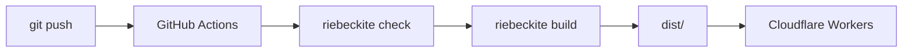

# GitHub Actions

Riebeckite can automate **deployment to Cloudflare Workers from a push to GitHub** with GitHub Actions.



For the common layout where the site and its content live in the same repository, a push to `main` is enough to run the build and deploy.

## In this section

- [Setup](./github-actions/setup.md)
- [Triggers](./github-actions/triggers.md)
- [Workflow](./github-actions/workflow.md)
- [Troubleshooting](./github-actions/troubleshooting.md)

## Summary

For an ordinary site repository the flow is:

```text
push to main
    ↓
GitHub Actions
    ↓
Install dependencies
    ↓
riebeckite check
    ↓
riebeckite build
    ↓
Cloudflare Workers
```

With a separate content repository:

```text
push content
    ↓
notify-site.yml
    ↓
repository_dispatch
    ↓
Site workflow
    ↓
check out content
    ↓
Build
    ↓
Deploy
```

The roles to remember in particular are:

```text
RIEBECKITE_APP_ID + RIEBECKITE_APP_PRIVATE_KEY
  → notify from content to site via a short-lived token

SITE_DISPATCH_TOKEN
  → fallback notification without a GitHub App

RIEBECKITE_CONTENT_READ_TOKEN
  → read content from site

CLOUDFLARE_API_TOKEN (secret)
CLOUDFLARE_ACCOUNT_ID (variable)
  → deploy to Cloudflare
```

## Local verification

Exercise the build and the configuration without deploying:

```sh
npm install
npm exec riebeckite build
npx wrangler deploy --dry-run
```

`wrangler deploy --dry-run` validates `wrangler.jsonc` and the asset directory without contacting Cloudflare. `npx wrangler dev` serves the same output locally.

## Notes

- **Static assets are enough.** Riebeckite pre-renders content routes and plugin endpoints, so `dist/` is served as static assets with no runtime `main` entry.
- **Build state stays at build time.** `.riebeckite/` and plugin caches are not part of `dist/` and never reach the Worker runtime.
- **Attachments are site-owned.** Copy only the files you intend to publish in a `prebuild` step before the build.

## See also

- [Cloudflare Workers](./cloudflare-workers.md) — the manual deployment path
- [Separate content repository](./separate-content-repository.md) — CI reading articles from another repository
- Cloudflare deployment template — the source files
- [Build system](../../framework/build-system.md) — what the build writes
