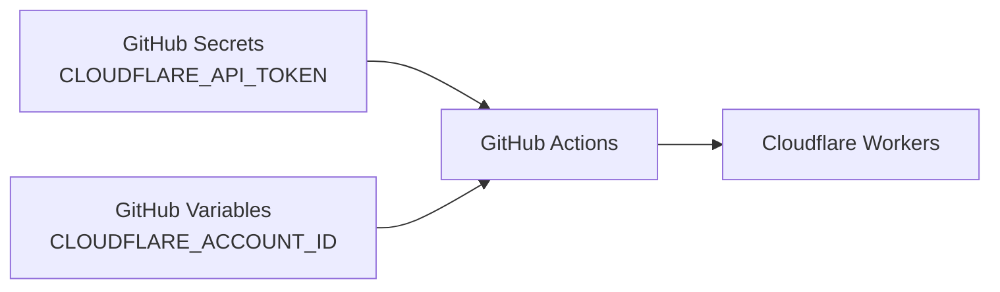

# セットアップ

## GitHub Actions を有効にしてサイトを作る

対話形式の CLI では、セットアップの最後にデプロイ方法を尋ねられます。継続デプロイには `GitHub Actions` を選んでください。手元から最初の公開を行う場合は `Cloudflare Workers` を選んでください。コマンドラインから GitHub Actions を指定する場合は次のとおりです。

```bash id="f10w6x"
npx create-riebeckite my-site --preset starter --github-actions
```

`--github-actions` を付けると、サイトに次の2つが追加されます。

```text id="hw99qe"
my-site/
├─ .github/
│  └─ workflows/
│     └─ publish.yml
│
├─ wrangler.jsonc
└─ ...
```

| ファイル | 役割 |
| --- | --- |
| `wrangler.jsonc` | Cloudflare Workers へのデプロイ設定 |
| `.github/workflows/publish.yml` | GitHub Actions のビルド／デプロイワークフロー |

通常は、生成されたワークフローを出発点として使います。

## 既存のサイトに継続デプロイを追加する

すでに Local-first で公開しているサイトなら、作り直さずに継続デプロイを追加できます。サイトのディレクトリで次を実行してください。

```sh id="d3setupj1"
npm exec riebeckite deploy setup
```

このコマンドは次の順に処理を進めます。

1. Git リポジトリと GitHub のリモートを検出する
2. GitHub CLI（`gh`）がインストール済みで、ログイン済みか確認する
3. `.github/workflows/publish.yml` がなければ、同じテンプレートから作成する。Riebeckite 以外の既存ワークフローは上書きせず、検出した旨を報告して、シークレットの登録に進む前に停止する
4. Wrangler のログイン状態から Cloudflare アカウントを取得する。複数ある場合は選択する
5. `CLOUDFLARE_API_TOKEN` をリポジトリシークレット、`CLOUDFLARE_ACCOUNT_ID` をリポジトリ変数として登録する。トークンは入力内容が表示されないプロンプト、または非対話実行用の環境変数 `CLOUDFLARE_API_TOKEN` から読み取る。変数を管理できない古い GitHub CLI ではシークレットにフォールバックする

GitHub リポジトリの作成やプッシュは行いません。処理が完了したら、次のコマンドでデプロイします。

```sh
git push
```

このコマンドは何度でも再実行できます。一致するワークフローと登録済みのシークレットがあれば、それらはスキップされ、残りの手順だけが実行されます。別のデプロイワークフローがすでにある場合は、置き換えるか削除してから再実行してください。

## 必要なもの

GitHub Actions からデプロイするには、次のものが必要です。

- `package-lock.json`
- `CLOUDFLARE_API_TOKEN` (secret)
- `CLOUDFLARE_ACCOUNT_ID` (variable)
- `deploy setup` を使う場合は、GitHub CLI（`gh`）のインストールとログイン、およびプロジェクト内の Wrangler（Local-first のサイトには含まれています）

### `package-lock.json`

生成されるワークフローは、次のコマンドで依存パッケージをインストールします。

```sh
if [ -f package-lock.json ]; then npm ci; else npm install; fi
```

ローカルと同じ依存バージョンで CI を動かすため、`package-lock.json` をリポジトリにコミットしてください。

```text
package.json
package-lock.json
      ↓
npm ci
      ↓
CI でも同じ依存関係がインストールされる
```

`package-lock.json` がない場合、ワークフローは `npm install` にフォールバックし、新しいバージョンを解決することがあります。

## リポジトリを GitHub に置く

GitHub Actions は GitHub 上のリポジトリを読み取ります。サイトのリポジトリがまだない場合は作成してください。

### Git でリポジトリを初期化する

サイトのディレクトリで次を実行します。

```sh
git init
git add .
git commit -m "First commit"
```

`.gitignore` は生成済みなので、`node_modules/` や `dist/` はコミットされません。一方、`package-lock.json` はコミットされます。このファイルがないと後述の `npm ci` が動かないため、必ず残してください。

Git を初めて使う場合、`git commit` が `Author identity unknown` で失敗することがあります。その場合は次を設定してから、もう一度実行してください。

```sh
git config --global user.name "Your Name"
git config --global user.email "you@example.com"
```

### GitHub にリポジトリを作成してプッシュする

1. [GitHub の New repository](https://github.com/new) を開きます。リポジトリ名を決めて作成してください。**Add a README file** と **Add .gitignore** は追加しません。ローカルにすでに履歴があるため、どちらかを追加するとプッシュが拒否されます。
2. 作成直後に表示される「…or push an existing repository from the command line」のコマンドを、そのまま実行します。`main` を使う構成の例は次のとおりです。

```sh
git remote add origin https://github.com/<you>/my-site.git
git branch -M main
git push -u origin main
```

`git push -u origin main` が成功すると、GitHub のリポジトリページにファイルが表示されます。以降は `main` へプッシュするたびにワークフローが実行されます。

## Cloudflare のシークレット

サイトのリポジトリに、次の GitHub Actions シークレットを設定します。

```text id="79c4ea"
CLOUDFLARE_API_TOKEN
CLOUDFLARE_ACCOUNT_ID
```

どちらも Cloudflare 側で用意します。

### `CLOUDFLARE_API_TOKEN` を作成する

1. [Cloudflare ダッシュボード](https://dash.cloudflare.com/) にログインし、右上のアカウントメニューから **My Profile** を開きます。[API Tokens](https://dash.cloudflare.com/profile/api-tokens) を直接開いてもかまいません。
2. **Create Token** → **Create Custom Token** を選びます。
3. **Permissions** で **Account** / **Workers Scripts** / **Edit**、**Zone** / **Workers Routes** / **Edit**、**Zone** / **Zone** / **Read** を追加します。
4. **Account Resources** に自分のアカウントを含めます。**Zone Resources** にはカスタムドメインのゾーンを含めます。Workers のカスタムドメインは DNS レコードを自動で作るため、**DNS:Edit** は不要です。
5. **Continue to review** → **Create Token** を押します。
6. 表示されたトークンの値をコピーします。この画面を閉じると、値は二度と表示されません。

権限の考え方については、[Cloudflare の公式ガイド](https://developers.cloudflare.com/fundamentals/api/get-started/create-token/) を参照してください。トークンが漏れた場合は、同じ画面からローテーションできます。

### `CLOUDFLARE_ACCOUNT_ID` を確認する

ダッシュボードで **Workers & Pages** を開くと、ブラウザのアドレスバーは次の形式になります。

```text
https://dash.cloudflare.com/<ACCOUNT_ID>/workers-and-pages
```

`<ACCOUNT_ID>` が `CLOUDFLARE_ACCOUNT_ID` の値です。Worker の詳細ページに表示される **Account ID** も同じ値です。

### GitHub に登録する

GitHub のサイトリポジトリで **Settings** → **Secrets and variables** → **Actions** を開きます。トークンは **secret**、アカウント ID は **variable** として登録します。

```text
Secret:   CLOUDFLARE_API_TOKEN   値: 上でコピーしたトークン
Variable: CLOUDFLARE_ACCOUNT_ID  値: 上の ACCOUNT_ID
```

`CLOUDFLARE_ACCOUNT_ID` は認証情報ではありません。変数にしておくとワークフローを確認しやすく、公開情報をシークレットとして扱わずに済みます。

`riebeckite deploy setup` を使うと、すでに Git リポジトリになっているサイトでこの2つの登録を自動化できます。Wrangler のログインからアカウントを取得し、トークンは入力内容が表示されないプロンプトに貼り付けます。シークレットを手動で登録したい場合や、CLI を使えない場合は、上記の手順をそのまま利用してください。

ワークフローは、GitHub リポジトリの Actions に登録した secret と variable を参照します。



これらの値はソースコードや `riebeckite.config.ts` に直接書かないでください。トークンはリポジトリシークレット、アカウント ID はリポジトリ変数で管理します。

## ワークフローが実行されるタイミング

生成されるワークフローは、次の3つのトリガーに対応しています。

| トリガー | 用途 |
| --- | --- |
| `main` への `push` | サイトの変更を自動でデプロイする |
| `workflow_dispatch` | GitHub から手動で実行する |
| `repository_dispatch: content-updated` | 別リポジトリでのコンテンツ更新をきっかけに実行する |

通常のサイトリポジトリでは、次の流れになります。

```text id="whvm5u"
main へプッシュ
    ↓
GitHub Actions
    ↓
デプロイ
```
