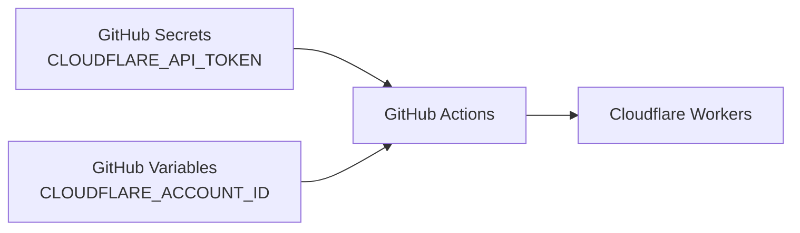

# Setup

## Create a site with GitHub Actions enabled

The interactive CLI asks about deployment at the end of setup; choose `GitHub Actions` for continuous deployment. Choose `Cloudflare Workers` instead for a local first publish. From the command line:

```sh
npx create-riebeckite my-site --preset starter --github-actions
```

With `--github-actions`, the generator adds two things to the site:

```text
my-site/
├─ .github/
│  └─ workflows/
│     └─ publish.yml
│
├─ wrangler.jsonc
└─ ...
```

| File | Role |
| --- | --- |
| `wrangler.jsonc` | Cloudflare Workers deployment settings |
| `.github/workflows/publish.yml` | The GitHub Actions build/deploy workflow |

The command-line form skips the prompts and does not install dependencies. Run `cd my-site` and `npm install` before continuing, so `package-lock.json` exists for the workflow's `npm ci`.

Normally you use the generated workflow as your starting point.

## Add it to an existing site

If you already published with Local-first, you can add continuous deployment without recreating the site. Run this in the project:

```sh
npm exec riebeckite deploy setup
```

The command:

1. Detects the Git repository and the GitHub remote.
2. Checks that the GitHub CLI (`gh`) is installed and logged in.
3. Creates `.github/workflows/publish.yml` from the same template when it does not exist. An existing non-Riebeckite workflow is reported and never overwritten; the command then stops before registering secrets.
4. Reads the Cloudflare account from your Wrangler login, asking you to choose when there is more than one.
5. Registers `CLOUDFLARE_API_TOKEN` as a repository secret and `CLOUDFLARE_ACCOUNT_ID` as a repository variable. The token is read from a hidden prompt, or from `CLOUDFLARE_API_TOKEN` in the environment for non-interactive use. Older GitHub CLI versions that cannot manage variables fall back to a secret.

It does not create a GitHub repository and does not push. When it finishes, push to deploy:

```sh
git push
```

Run it again any time. A matching workflow and existing secrets are detected and skipped, so only the remaining steps run. If a different deployment workflow already exists, replace or remove it first, then run the command again.

## What you need

To deploy from GitHub Actions you need:

- `package-lock.json`
- `CLOUDFLARE_API_TOKEN` (secret)
- `CLOUDFLARE_ACCOUNT_ID` (variable)
- For `deploy setup`: the GitHub CLI (`gh`) installed and logged in, plus Wrangler in the project (Local-first sites already have it)

### `package-lock.json`

The generated workflow installs dependencies with:

```sh
if [ -f package-lock.json ]; then npm ci; else npm install; fi
```

Commit `package-lock.json` so CI uses the same dependency versions as local development.

```text
package.json
package-lock.json
      ↓
npm ci
      ↓
the same dependencies installed in CI
```

Without `package-lock.json`, the workflow falls back to `npm install` and may resolve newer versions.

## Put the repository on GitHub

GitHub Actions reads a repository on GitHub. If the site repository does not exist yet, create it.

### Initialize with Git

In the site directory, run:

```sh
git init
git add .
git commit -m "First commit"
```

`.gitignore` is generated, so `node_modules/` and `dist/` are not committed, while `package-lock.json` is. Keep that file, because `npm ci` cannot run without it.

If you are new to Git, `git commit` may fail with `Author identity unknown`. Set the following and try again:

```sh
git config --global user.name "Your Name"
git config --global user.email "you@example.com"
```

### Create a repository on GitHub and push

1. Open [New repository on GitHub](https://github.com/new). Choose a repository name and create it. Do **not** add a README file or a `.gitignore`; you already have local history, and adding either makes the push fail.
2. Run the "…or push an existing repository from the command line" commands shown right after creation. For a `main` setup:

```sh
git remote add origin https://github.com/<you>/my-site.git
git branch -M main
git push -u origin main
```

When `git push -u origin main` succeeds, the files appear on the GitHub repository page. From the next push to `main`, the workflow can run.

## Cloudflare secrets

Set the following GitHub Actions secrets on the site repository:

```text
CLOUDFLARE_API_TOKEN
CLOUDFLARE_ACCOUNT_ID
```

Both come from Cloudflare.

### Create `CLOUDFLARE_API_TOKEN`

1. Log in to the [Cloudflare dashboard](https://dash.cloudflare.com/) and open **My Profile** from the account menu in the top right. You can also open [API Tokens](https://dash.cloudflare.com/profile/api-tokens) directly.
2. Choose **Create Token** → **Create Custom Token**.
3. Under **Permissions**, add **Account** / **Workers Scripts** / **Edit**, **Zone** / **Workers Routes** / **Edit**, and **Zone** / **Zone** / **Read**.
4. Under **Account Resources**, include your account. Under **Zone Resources**, include the zone that owns the custom domain. A Workers custom domain creates its DNS record, so **DNS:Edit** is not required.
5. Press **Continue to review** → **Create Token**.
6. Copy the token value that is shown. Once you close this screen, the value is never shown again.

For the reasoning behind permissions, see [Cloudflare's official guide](https://developers.cloudflare.com/fundamentals/api/get-started/create-token/). If a token leaks, you can rotate it from the same screen.

### Find `CLOUDFLARE_ACCOUNT_ID`

Open **Workers & Pages** in the dashboard; the browser address bar looks like:

```text
https://dash.cloudflare.com/<ACCOUNT_ID>/workers-and-pages
```

`<ACCOUNT_ID>` is the value for `CLOUDFLARE_ACCOUNT_ID`. The **Account ID** shown on a Worker's detail page is the same value.

### Register them in GitHub

On the GitHub site repository, open **Settings** → **Secrets and variables** → **Actions**. Add the token as a **secret** and the account ID as a **variable**:

```text
Secret:   CLOUDFLARE_API_TOKEN   Value: the token you copied
Variable: CLOUDFLARE_ACCOUNT_ID  Value: the ACCOUNT_ID above
```

`CLOUDFLARE_ACCOUNT_ID` is not a credential. Keeping it as a variable makes the workflow easier to inspect and avoids treating public information as a secret.

`riebeckite deploy setup` automates these two registrations for a site that is already a Git repository, using the account from your Wrangler login and a token you paste into a hidden prompt. Follow the manual steps above when you prefer to add the secrets by hand or when the CLI is unavailable.

The workflow reads them from the GitHub repository's Actions:



Do not put these directly in source code or `riebeckite.config.ts`. Keep the token in repository secrets; the account ID can be a repository variable.

## When the workflow runs

The generated workflow starts on:

| Trigger | Purpose |
| --- | --- |
| `push` to `main` | Deploy site changes automatically |
| `workflow_dispatch` | Run manually from GitHub |
| `repository_dispatch: content-updated` | Run from a content update in another repository |

For an ordinary site repository the flow is:

```text
push to main
    ↓
GitHub Actions
    ↓
Deploy
```
