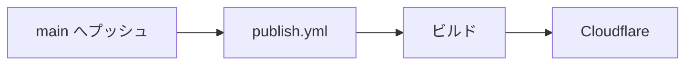
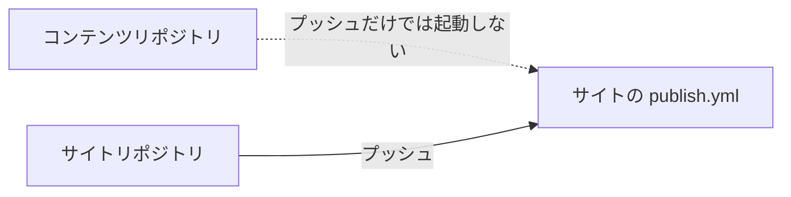
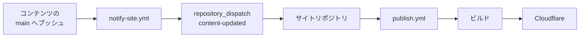
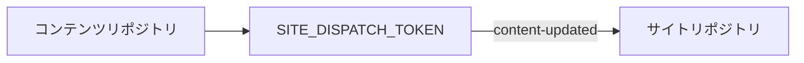

# トリガー

## サイトとコンテンツが同じリポジトリにある場合

これが最も単純な構成です。

```text id="8tqoq6"
my-site/
├─ content/
├─ app/
├─ riebeckite.config.ts
└─ .github/
   └─ workflows/
      └─ publish.yml
```

記事とサイトが同じリポジトリにあるため、流れは次のようになります。



記事を変更して `main` へプッシュすれば、そのプッシュ自体がワークフローを起動します。

## サイトとコンテンツが別リポジトリにある場合

コンテンツリポジトリを分離している場合は、流れが少し変わります。

```text id="w3jwej"
コンテンツリポジトリ
  → Markdown / Obsidian Vault

サイトリポジトリ
  → Riebeckite / 設定 / テーマ / プラグイン
```

コンテンツリポジトリへプッシュしても、**それだけではサイトリポジトリのワークフローは起動しません**。GitHub Actions のワークフローは、それぞれのリポジトリに属しているからです。



コンテンツの更新をきっかけにサイトを自動デプロイするには、コンテンツリポジトリからサイトリポジトリへ通知します。

## `repository_dispatch`

別リポジトリからサイトのワークフローを起動するには、`repository_dispatch` を利用します。

Riebeckite が生成するワークフローは、次のイベントを受け取れるように設定されています。

```text id="5ss0v6"
content-updated
```

全体の流れは次のとおりです。



## `notify-site.yml`

コンテンツリポジトリ側には、次のファイルを置きます。

```text id="7p33l5"
.github/workflows/notify-site.yml
```

このワークフローの役割は、サイトをビルドすることではありません。コンテンツが更新されたことをサイトリポジトリへ通知することです。

```text id="kw1g8g"
コンテンツリポジトリ
      ↓
サイトリポジトリへ
「コンテンツが更新された」と通知
```

通知を受け取ったサイトリポジトリの `publish.yml` が、ビルドとデプロイを実行します。

## `SITE_DISPATCH_TOKEN`

コンテンツリポジトリからサイトリポジトリへ `repository_dispatch` を送るには、`SITE_DISPATCH_TOKEN` をコンテンツリポジトリ側のシークレットとして設定します。



このトークンは、**コンテンツリポジトリからサイトリポジトリのワークフローを起動するためのもの**です。
