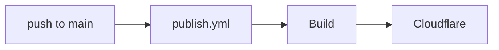
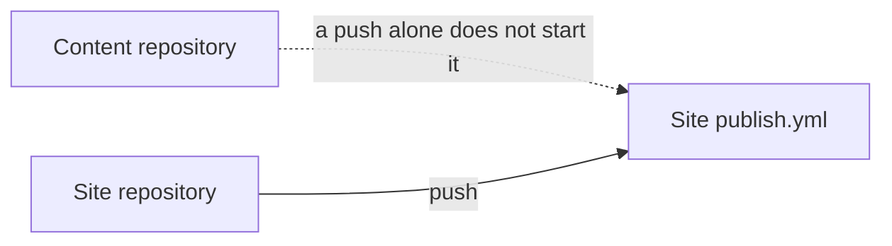
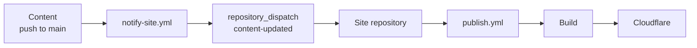
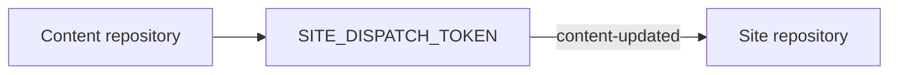

# Triggers

## When the site and content are in the same repository

This is the simplest layout.

```text
my-site/
├─ content/
├─ app/
├─ riebeckite.config.ts
└─ .github/
   └─ workflows/
      └─ publish.yml
```

Because the articles and the site live in the same repository:



Change an article and push to `main`, and the push itself starts the workflow.

## When the site and content are in separate repositories

If you split out a content repository, the flow changes a little.

```text
Content repository
  → Markdown / Obsidian vault

Site repository
  → Riebeckite / config / theme / plugin
```

A push to the content repository **does not start the site repository's workflow by itself**, because a GitHub Actions workflow belongs to its own repository.



To deploy the site automatically from a content update, notify the site repository from the content repository.

## `repository_dispatch`

To start a site workflow from another repository, use:

```text
repository_dispatch
```

Riebeckite's generated workflow is set up to receive the event:

```text
content-updated
```

The overall flow is:



## `notify-site.yml`

Place this on the content repository side:

```text
.github/workflows/notify-site.yml
```

This workflow's job is not to build the site. It is to notify the site repository that the content was updated:

```text
Content repository
      ↓
notify the site repository
"the content was updated"
```

The site repository's `publish.yml`, on receiving that notification, runs the build and deploy.

## `SITE_DISPATCH_TOKEN`

To send a `repository_dispatch` from the content repository to the site repository, set:

```text
SITE_DISPATCH_TOKEN
```

as a secret on the content repository side.



This token is **for starting the site repository's workflow from the content repository**.
