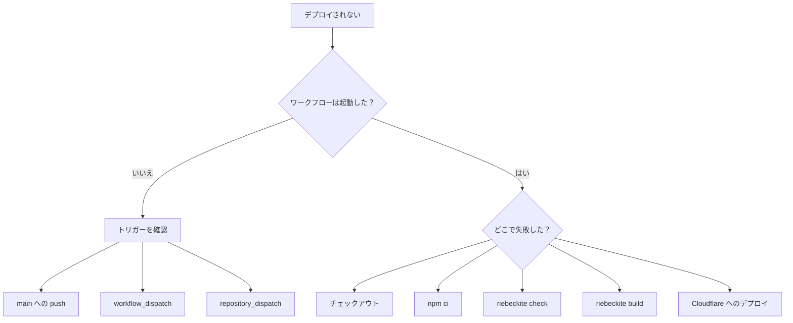

# トラブルシューティング

## デプロイが動かないとき

まず、ワークフローが起動していないのか、起動したけれど失敗したのかを切り分けます。



## ワークフローが起動しない

サイトリポジトリへのプッシュなら、`main` へプッシュしているか確認します。

コンテンツリポジトリへのプッシュなら、次の点を確認してください。

```text id="1xb7gc"
notify-site.yml
RIEBECKITE_APP_ID
RIEBECKITE_APP_PRIVATE_KEY
repository_dispatch
content-updated
```

コンテンツリポジトリへのプッシュだけでは、サイトのワークフローは起動しません。GitHub App ではなく PAT を使う場合は `SITE_DISPATCH_TOKEN` と、サイトリポジトリへ dispatch できる権限を確認してください。

## 依存パッケージのインストールが失敗する

生成されるワークフローは、`package-lock.json` があれば `npm ci`、なければ `npm install` を使います。

```sh id="dtah4e"
if [ -f package-lock.json ]; then npm ci; else npm install; fi
```

`package-lock.json` がなくてもインストールは続行されます。それでも失敗する場合は、ネットワークと `package.json` の依存バージョンを確認してください。

## コンテンツのチェックアウトが失敗する

プライベートなコンテンツリポジトリの場合は、`RIEBECKITE_CONTENT_READ_TOKEN` を確認します。

```text id="9d9gdo"
RIEBECKITE_CONTENT_READ_TOKEN
```

サイトリポジトリのワークフローが、そのトークンを使ってコンテンツリポジトリを読めるようにしておく必要があります。

## `check` が失敗する

次のコマンドを手元でも実行します。

```sh id="5jffy5"
npm exec riebeckite check
```

設定やプラグインの問題を修正してからプッシュしてください。

## `build` が失敗する

手元で次のコマンドを実行し、再現するか確認します。

```sh id="o2n6np"
npm exec riebeckite build
```

リポジトリを分けている場合は、CI と同じ場所にコンテンツがあるかも確認してください。

## Cloudflare へのデプロイが失敗する

ビルドまでは成功しているなら、次の点を確認します。

```text id="rxagkm"
CLOUDFLARE_API_TOKEN   （Secret）
CLOUDFLARE_ACCOUNT_ID  （Variable）
wrangler.jsonc
```

Riebeckite のビルドと Cloudflare へのデプロイは別の段階です。どちらで失敗したかを切り分けると、原因を特定しやすくなります。

`Missing entry-point` と表示された場合は、Wrangler 3 が実行されています。Riebeckite のサイトは assets のみの `wrangler.jsonc` を使うため、Wrangler 4 が必要です。生成されるワークフローは `cloudflare/wrangler-action` に `wranglerVersion: "4"` を設定します。ワークフローを独自に変更した場合も同じ行を追加してください。
