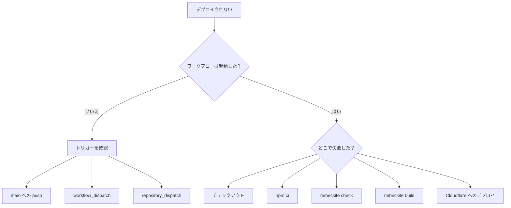

# トラブルシューティング

## デプロイが動かないとき

まず、ワークフローが起動していないのか、起動したけれど失敗したのかを切り分けます。



## ワークフローが起動しない

サイトリポジトリへのプッシュなら、`main` へプッシュしているか確認します。

コンテンツリポジトリへのプッシュなら、次の点を確認してください。

```text id="1xb7gc"
notify-site.yml
SITE_DISPATCH_TOKEN
repository_dispatch
content-updated
```

コンテンツリポジトリへのプッシュだけでは、サイトのワークフローは起動しません。

## `npm ci` が失敗する

生成されるワークフローは `npm ci` を使います。`package-lock.json` がリポジトリにコミットされているか確認してください。

```sh id="dtah4e"
npm ci
```

必要なファイルは次のとおりです。

```text id="afg8hg"
package-lock.json
```

## コンテンツのチェックアウトが失敗する

プライベートなコンテンツリポジトリの場合は、`RIEBECKITE_CONTENT_READ_TOKEN` を確認します。

```text id="9d9gdo"
RIEBECKITE_CONTENT_READ_TOKEN
```

サイトリポジトリのワークフローが、そのトークンを使ってコンテンツリポジトリを読めるようにしておく必要があります。

## `check` が失敗する

次のコマンドを手元でも実行します。

```sh id="5jffy5"
npm exec riebeckite check
```

設定やプラグインの問題を修正してからプッシュしてください。

## `build` が失敗する

手元で次のコマンドを実行し、再現するか確認します。

```sh id="o2n6np"
npm exec riebeckite build
```

リポジトリを分けている場合は、CI と同じ場所にコンテンツがあるかも確認してください。

## Cloudflare へのデプロイが失敗する

ビルドまでは成功しているなら、次の点を確認します。

```text id="rxagkm"
CLOUDFLARE_API_TOKEN
CLOUDFLARE_ACCOUNT_ID
wrangler.jsonc
```

Riebeckite のビルドと Cloudflare へのデプロイは別の段階です。どちらで失敗したかを切り分けると、原因を特定しやすくなります。
